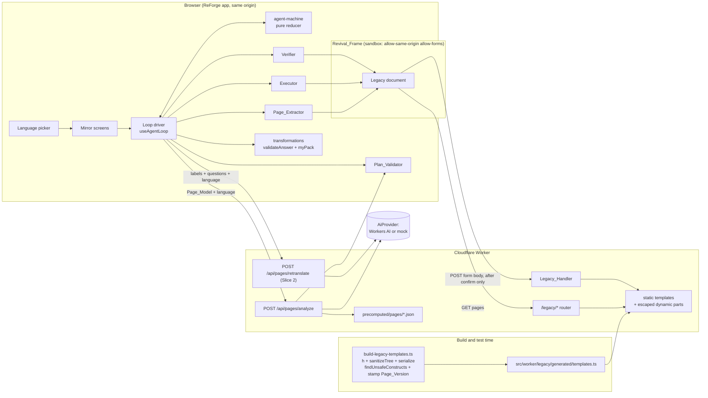
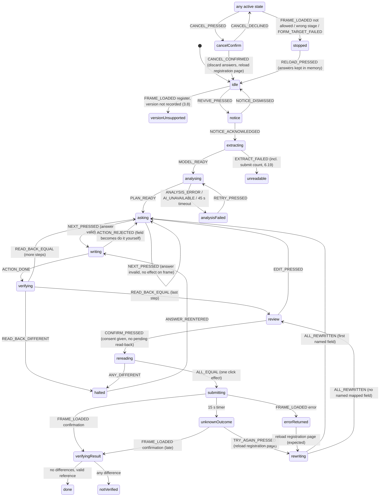

# AccessForge Skeleton: Design

**Spec:** accessforge-skeleton
**Workflow:** Requirements-First
**Status:** Design, updated after review. Decisions A, B, D to J are decided; decision C is deferred to gate G2. Implementation starts after the FormBridge milestone is deployed.

---

## Overview

AccessForge revives one fictional legacy registration form. The Worker serves a 2005-style portal under `/legacy/` from Legacy_Templates that a build step generates and verifies ahead of time. The ReForge app shows that portal in a same-origin, script-free iframe (the Revival_Frame) and builds a modern Mirror beside it. The Mirror asks one plain question at a time in the interface language, validates answers with the existing `MY` country pack, writes each answer into the legacy form, reads it back, and submits the legacy form only after the user presses the confirm button. The Legacy_Handler in the Worker does the real work and returns its own confirmation with a reference number and a received-fields summary, which the Mirror reads and checks.

The design is a walking skeleton. It adds no new runtime dependency. It reuses these existing modules unchanged or with small additions:

| Existing module | Path | Use in AccessForge |
|---|---|---|
| AI provider interface | `src/lib/ai/interface.ts` | two new methods: `analyzePage` (Slice 1), `retranslatePage` (Slice 2) |
| Workers AI provider | `src/lib/ai/cf-workers.ts` | implements the new methods, 20 s per-call timeout |
| Mock provider | `src/lib/ai/mock.ts` | implements the new methods from a table in `fixtures/mock-analysis/legacy-register.json` |
| Prompts | `src/lib/ai/prompt.ts` | new prompt builders |
| AI mode switch | `src/worker/ai-mode.ts` (`resolveAiMode`) | unchanged |
| Worker entry, error shape, body limit, logging | `src/worker/index.ts`, `src/worker/http.ts` | new API routes; `/legacy/*` dispatch; `LogEntry` unchanged |
| Rate limiting | `RATE_LIMITER` binding in `wrangler.jsonc` | same binding, key `route:ip` |
| Answer validation | `src/packs/country/validate.ts` (`validateAnswer`), `my.ts` (`myPack`), `dates.ts` (`isValidCalendarDate`, `formatDate`, `detectDateFormat`, `DATE_FORMATS`) | unchanged |
| Language registry and i18n | `src/packs/language/registry.ts`, `src/frontend/i18n.tsx` | new `accessforge.*` keys |
| Shared question UI | `src/frontend/components/FieldQuestion.tsx`, `ValidationMessage.tsx`, `MachineTranslatedLabel.tsx`, `StatusMessage.tsx`, `ScreenHeading.tsx` | reused through an adapter (see "Reuse of FormBridge components and validators") |
| Shared shell | `AppHeader.tsx`, `screens/LanguagePicker.tsx`, `tokens.css` | reused |
| Fixture cache convention | `src/worker/cache/precomputed/`, `scripts/generate-fixture-cache.ts` | page plans in a `pages/` subfolder, written by the same script |

New code goes into five places: `scripts/build-legacy-templates.ts` and `src/lib/legacy-build/` (build-time template generation and verification, never bundled into the Worker), `src/worker/legacy/` (serving and the handler), `src/lib/accessforge/` (pure agent logic, no I/O), `src/frontend/accessforge/` (Mirror screens and the loop driver), and `src/shared/page-schemas.ts` (zod schemas shared by Worker and browser). The page schemas live in their own file so this spec does not edit `src/shared/schemas.ts` while FormBridge work continues there.

---

## Delivery slices

Slice 1 is the complete story and the only slice needed for acceptance. Slice 2 is optional. Slice 1 never depends on a Slice 2 part; where Slice 2 would add a behaviour, Slice 1 has a safe replacement listed in the last column.

| Area | Slice 1 | Slice 2 | Slice 1 behaviour in place of Slice 2 |
|---|---|---|---|
| Legacy_Portal, Legacy_Templates, generator, CSP, handler | all | none | |
| Allow_List, frame check, Revival_Generation | all | none | |
| Page_Extractor | the eight fields, buttons, evidence incl. checkbox next-row text, refusals of 5.10 | duplicate-id handling (5.8), unsupported control types (5.9) | the only form is the fixed Legacy_Form; a page that fails 5.10 or 6.19 stops with "could not be read" |
| Page_Version mismatch | stop safely (3.8) | "page changed" notice and continue (3.5) | no analysis, no Action, message to complete the page directly |
| Analysis modes | `live`, `mock`, `cached` (exact Page_Version and language) | `heuristic` and `Heuristic_Extractor` | no cached plan after a failed live call gives `AI_UNAVAILABLE`, handled as an analysis failure (7.10, 6.15) |
| Language | `en` and `zh-Hans` complete; picker before revival | switching after analysis with re-translation (7.7, 7.9) | picker unavailable while the loop is active (7.11) |
| Plan_Validator | all rules of 6.4 to 6.8, 6.12, 6.13 | submit-button count other than one handled as Do_It_Yourself (6.16) | count other than one stops before analysis (6.19) |
| Low confidence | original evidence shown above the input with a notice (6.11) | accept-or-decline step (6.18) | |
| Executor, Verifier, review, confirm, report | all | skipping and clearing (8.11, 9.12), scroll-and-highlight for Do_It_Yourself fields (12.2) | every Legacy_Field is required, so no skip control is shown |
| Property tests | Properties 1, 2, 3, 4 and 7 (Requirements 17.1, 17.3, 17.4, 17.5, 17.8) | all other properties | example tests cover the same criteria (see Testing Strategy) |

Modules that exist only for Slice 2: `src/lib/accessforge/heuristic.ts`, `src/worker/routes/page-retranslate.ts`, `PageAnalyzeCall`'s sibling `PageRetranslateCall`, the Mirror `LowConfidenceCheck` accept-or-decline view, and the skip control. The agent state machine below marks its Slice 2 events; with those events never sent, every remaining path still ends in `done`, `notVerified`, `unknownOutcome`, `stopped`, `analysisFailed`, `unreadable` or `idle`.

---

## Architecture



Data paths:

1. At build time, `scripts/build-legacy-templates.ts` builds every Legacy_Template from the typed tree builder, sanitises and verifies it, stamps the Page_Version of the home and registration templates, and writes `src/worker/legacy/generated/templates.ts`. A failing verification stops the build (Requirement 4.8).
2. The frame loads `GET /legacy/register`. The Worker returns the pre-generated string with the legacy headers and CSP. No sanitiser runs and no hash is computed per request (Requirement 2.11).
3. The user presses "Revive this page", reads the data notice and acknowledges it.
4. The Page_Extractor reads the frame document and builds the Page_Model (structure only, no values).
5. The browser sends the Page_Model and the interface language to `POST /api/pages/analyze`. The Worker gets a Page_Plan from the provider or, after a failed live call, a cached plan for the exact Page_Version and language, runs the Plan_Validator and returns the plan with its Analysis_Mode.
6. For each mapped field, the Mirror asks, validates, computes the Intended_Value, the Executor writes it into the frame and the Verifier reads it back. Every one of these effects carries the Revival_Generation at which it started.
7. On the review screen the user presses the confirm button. The Verifier re-reads every field, and the Executor clicks the legacy submit button once. The browser itself sends the legacy form POST; no ReForge API carries an answer.
8. The frame loads the confirmation response. The Verifier parses the reference number and the received-fields summary and compares them with the Intended_Values.

### Routing changes in `wrangler.jsonc`

`assets.run_worker_first` becomes `["/api/*", "/legacy", "/legacy/*"]`, so the SPA fallback never answers a legacy path. The legacy stylesheet is a static asset at `public/legacy-assets/portal.css` (served at `/legacy-assets/portal.css`), outside `/legacy/`, because Requirement 1.10 turns every unlisted `/legacy/` path into the not-found document.

---

## Components and Interfaces

### Repository layout (new files)

```
scripts/
  build-legacy-templates.ts     # generates and verifies Legacy_Templates; npm run build:legacy (also run by prebuild and predev)
src/
  shared/
    page-schemas.ts             # zod: PageModel, PagePlan, analyze/retranslate requests and replies, Action
    app-paths.ts                # SAMPLE_FORM_PATH (created by the formbridge-pdf sample-form task; imported here)
  lib/
    legacy-build/               # build and test only; never imported by src/worker
      html.ts                   # h(), sanitizeTree(), serialize(), findUnsafeConstructs()
      templates.ts              # homePage(), registerPage(), confirmationPage(), errorPage(), notFoundPage() as trees with slots
      page-version.ts           # computePageVersion(html) for the generator and the test
    accessforge/
      allow-list.ts             # ALLOW_LIST constant + checkFrameDocument() + checkFormTarget()
      element-id.ts             # elementIdFor(), parseElementId()
      extract.ts                # extractPageModel(doc, pageVersion)
      plan-validator.ts         # validatePlan(model, rawEntries)
      heuristic.ts              # heuristicPlan(model, language)                       (Slice 2)
      executor.ts               # execute(action, ctx)
      verifier.ts               # readBack(), sameValue(), parseConfirmation(), compareReceived()
      transformations.ts        # toIntendedValue(), legacyLength(), detectLegacyDateFormat()
      agent-machine.ts          # agentReducer(state, event) -> { state, effects }
      generation.ts             # RevivalGeneration counter and FrameHandle
      supported-versions.ts     # SUPPORTED_PAGE_VERSIONS (recorded hashes)
    analysis/
      run-page.ts               # runPageAnalyze(), runPageRetranslate() (retry rule of 6.10)
  worker/
    legacy/
      form-spec.ts              # LEGACY_FORM: the eight fields, single source for templates and handler
      generated/templates.ts    # GENERATED: segments, slots and Page_Version stamps (committed)
      escape.ts                 # escapeHtml() for dynamic parts
      render.ts                 # fill(template, slots) joins segments with escaped dynamic parts
      handler.ts                # handleLegacy(request, deps)
      submission.ts             # parseSubmission(), validateSubmission()
      reference.ts              # newReferenceNumber(now, randomDigits)
      respond.ts                # legacyResponse(), LEGACY_CSP
    routes/
      page-analyze.ts           # POST /api/pages/analyze
      page-retranslate.ts       # POST /api/pages/retranslate                         (Slice 2)
    cache/
      page-plan-cache.ts        # lookupPagePlanCache(pageVersion, language)
      precomputed/pages/        # <pageVersion>-<bcp47>.json, written by generate-fixture-cache.ts
  frontend/
    accessforge/
      RevivalScreen.tsx         # split view: frame + Mirror
      RevivalFrame.tsx          # the iframe, load events, generation, highlight
      useAgentLoop.ts           # runs agent-machine effects against the frame and the API
      useLeaveWarning.ts        # beforeunload handler while answers exist and no confirmation
      mirror-field-adapter.ts   # MirrorField -> FieldQuestion props (FieldState shape)
      DataNotice.tsx
      ModeNotice.tsx
      MirrorStep.tsx            # one question: FieldQuestion, or DateQuestion, or ConsentQuestion
      DateQuestion.tsx          # three inputs (day, month, year) built from ValidationMessage
      ConsentQuestion.tsx       # one checkbox built from ValidationMessage and StatusMessage
      LowConfidenceEvidence.tsx # original evidence above the input (Slice 1, 6.11)
      LowConfidenceCheck.tsx    # accept-or-decline (Slice 2, 6.18)
      MirrorReview.tsx
      MirrorResult.tsx          # verified, not verified, unknown outcome, stopped
      DoItYourselfList.tsx
  packs/language/locales/
    legacy-portal/ms.json       # every Malay string of the portal (decision B)
public/
  legacy-assets/portal.css      # the 2005-style stylesheet
fixtures/
  mock-analysis/legacy-register.json   # mock Page_Plan table (decision B rule applies)
tests/
  unit/accessforge-*.test.ts, unit/legacy-*.test.ts
  e2e/accessforge-*.spec.ts
  e2e/helpers/hostile-pages.ts  # hostile and instruction-like pages, test-only
docs/
  accessibility-checklist.md    # AccessForge section
```

### AiProvider additions (`src/lib/ai/interface.ts`)

```typescript
export interface PageAnalyzeCall {
  request: PageAnalyzeRequest;        // Page_Model + interfaceLanguage
  interfaceLanguageName: string;      // e.g. "Simplified Chinese"
}

export interface PageRetranslateCall {  // Slice 2
  request: PageRetranslateRequest;    // items: { humanLabel, question }[] + targetLanguage
  targetLanguageName: string;
}

export interface AiProvider {
  readonly kind: 'real' | 'mock';
  analyze(call: AnalyzeCall): Promise<AiReply>;
  retranslate(call: RetranslateCall): Promise<AiReply>;
  translate(call: TranslateCall): Promise<AiReply>;
  analyzePage(call: PageAnalyzeCall): Promise<AiReply>;        // new (Requirement 6.2)
  retranslatePage(call: PageRetranslateCall): Promise<AiReply>; // new (Requirement 7.7, Slice 2)
}
```

`CfWorkersAiProvider` runs both with a 20 s timeout (`PAGE_TIMEOUT_MS = 20_000`), `max_completion_tokens` 1,500 (analysis) and 2,000 (re-translation), temperature 0.2, Gemma with thinking off, like the existing methods. The ten-entry Page_Model is estimated at about 2,000 input and 800 output tokens, roughly 40 neurons per analysis with the selected Gemma model; the real figure is read from `usage.neurons` and logged.

`MockAiProvider.analyzePage` answers from `fixtures/mock-analysis/legacy-register.json`, keyed by Element_Id, with label and question per language and English fallback, like the existing PDF tables. Unknown Element_Ids get a generic entry (`mock.question` template, confidence 0.5). The mock gives the reason-for-visit select confidence 0.6, so the low-confidence evidence view appears in mock runs and in the acceptance test. `retranslatePage` (Slice 2) finds each item's table entry by matching its label in any language and returns that entry's text in the target language.

### Orchestration (`src/lib/analysis/run-page.ts`)

```typescript
export type PageRunOutcome =
  | { kind: 'plan'; entries: unknown[]; meta: RunMeta }   // schema-valid reply
  | { kind: 'invalid'; meta: RunMeta }                    // two schema failures
  | { kind: 'provider-error'; code: AiErrorCode; meta: RunMeta };

export function runPageAnalyze(provider: AiProvider, request: PageAnalyzeRequest, languageName: string): Promise<PageRunOutcome>;
export function runPageRetranslate(provider: AiProvider, request: PageRetranslateRequest, languageName: string): Promise<RunResult<PageRetranslateResponse>>; // Slice 2
```

Retry rule (Requirement 6.10): attempt 1; if the reply fails `PagePlanReplySchema` or the attempt times out, attempt 2 with the same input. Unlike the existing `withRetry`, a timeout is retried once here, because the requirement says so and 2 × 20 s stays inside the browser's 45 s limit. Quota, rate-limit and unavailable errors are not retried. The outcome is classified by the last attempt.

### Page_Extractor (`src/lib/accessforge/extract.ts`)

```typescript
export type ExtractResult =
  | { ok: true; model: PageModel }
  | { ok: false; code: 'UNREADABLE' | 'NO_FORM' | 'MULTIPLE_FORMS' | 'TOO_MANY_CONTROLS' | 'SUBMIT_COUNT' };

export function extractPageModel(doc: Document, pageVersion: string): ExtractResult;
```

Pure DOM reading, no network (Requirement 5.1). It reads attributes and text nodes only; it never reads `.value`, `.checked`, `.selected`, `defaultValue`, `defaultChecked` or `defaultSelected`, and skips `input[type=hidden]` entirely. Text is collected from text nodes with control subtrees removed, so `option` text is read only as option text. Radio option text is the text between that radio input and the next control in the same cell.

`SUBMIT_COUNT` is returned when the form has zero or more than one submit button. In Slice 1 the Mirror treats it like the other refusals (Requirement 6.19). In Slice 2 the extractor returns the model instead and the Plan_Validator marks the submission step Do_It_Yourself (Requirement 6.16).

**Next-row text (decision F, Requirement 5.4).** For a checkbox only, the extractor finds the `tr` that contains the checkbox, takes the next sibling `tr`, and, if that row contains no form control, records its visible text, whitespace-normalised and cut to 200 characters, as `nextRowText`. For every other control `nextRowText` is the empty string. This is the only text taken from outside the field's own row (Requirement 5.6). The Legacy_Form's consent explanation sits in exactly that row, so the AI prompt and the Mirror's "original wording" (Requirement 9.8) both get it from the Page_Model.

### Plan_Validator (`src/lib/accessforge/plan-validator.ts`)

```typescript
export interface ValidatedPlan {
  mapped: Map<string, PagePlanEntry>;   // Element_Id -> entry (non-button fields)
  doItYourself: Set<string>;            // Element_Ids
  submitId: string | null;              // Slice 2 can produce null (Requirement 6.16)
  resetIds: string[];
}
export function validatePlan(model: PageModel, rawEntries: readonly unknown[]): ValidatedPlan;
```

Runs in the Worker before replying and again in the browser on the reply. Rules are in "Question 3".

### Heuristic_Extractor (`src/lib/accessforge/heuristic.ts`, Slice 2)

```typescript
export function heuristicPlan(model: PageModel, language: string): PagePlanEntry[];
```

Pure, shared by Worker and browser. Rules are in "Question 3".

### Executor (`src/lib/accessforge/executor.ts`)

```typescript
export type ActionResult = { ok: true } | { ok: false; reason: ActionRejectReason };
export type ActionRejectReason =
  | 'SCHEMA' | 'UNKNOWN_ELEMENT' | 'KIND_MISMATCH' | 'TOO_LONG' | 'NOT_AN_OPTION'
  | 'VERSION_CHANGED' | 'STALE_GENERATION' | 'RESET_BUTTON' | 'SUBMIT_NOT_ARMED'
  | 'CONSENT_NOT_GIVEN' | 'DO_IT_YOURSELF' | 'NOT_FOUND' | 'AMBIGUOUS' | 'FORM_TARGET';

export interface ExecutorContext {
  frame: FrameHandle;                  // current document + generation (see Revival_Generation)
  actionGeneration: number;            // generation recorded when the effect was created
  model: PageModel;
  plan: ValidatedPlan;
  submitArmed: boolean;                // true only between confirm press (all read-backs equal) and the single click
  submissionDone: boolean;             // a submission is in progress or a confirmation was received
  consentGiven: boolean;               // the Mirror consent checkbox
}

export function execute(action: unknown, ctx: ExecutorContext): ActionResult;
```

`action` is parsed with the strict `ActionSchema` first, so a kind such as `Click` or `submit` fails as `SCHEMA`. All checks run before any write; a rejected Action changes nothing. The checks, in order:

1. `SCHEMA`: the Action passes `ActionSchema`.
2. `STALE_GENERATION`: `ctx.actionGeneration === ctx.frame.generation` and `ctx.frame.document === frameElement.contentDocument` (Requirements 3.9, 8.14).
3. `VERSION_CHANGED`: the `portal-page-version` meta of the current document equals `model.pageVersion` (Requirement 8.2).
4. `UNKNOWN_ELEMENT`: the Element_Id is a **member** of the Page_Model. Membership means: the Element_Id of a Page_Model entry, or the Element_Id of an option listed in a radio entry's `options` (Requirement 8.13). Exact, case-sensitive comparison.
5. `KIND_MISMATCH`: `fill` targets a text entry; `select` a select entry; `check` a checkbox entry or a radio **option** id; `click` the submit entry. A `check` on a radio **group** id is rejected here.
6. `RESET_BUTTON`: any Action addressed to a reset entry.
7. `DO_IT_YOURSELF`: the target (or, for a radio option, its group) is in `plan.doItYourself`.
8. `TOO_LONG`: `fill` value with `legacyLength(value) > maxLength`.
9. `NOT_AN_OPTION`: `select` value not in the entry's option values (or the empty value, used only by Slice 2 clearing).
10. `CONSENT_NOT_GIVEN`: `check` with `checked: true` on the consent checkbox while `consentGiven` is false.
11. `SUBMIT_NOT_ARMED`: `click` on the submit entry while `submitArmed` is false or `submissionDone` is true.
12. `FORM_TARGET`: before the first Action of a generation and before a `click`, `checkFormTarget` (Question 6) passes.
13. `NOT_FOUND` / `AMBIGUOUS`: exactly one element matches.

Location uses `form.elements` filtered by control type and exact `name` (and `value` for a radio option); `querySelector` is never called with any string derived from the plan. The Executor sets values through DOM properties (`input.value`, `select.value`, `input.checked`) and submits with `form.requestSubmit(submitButton)`. Neither button has a `name`, so neither appears in the POST body.

### Verifier (`src/lib/accessforge/verifier.ts`)

```typescript
export type ReadBack = { kind: 'text' | 'select' | 'radio'; value: string | null } | { kind: 'checkbox'; checked: boolean };
export function readBack(frame: FrameHandle, generation: number, entry: PageEntry): ReadBack | 'NOT_FOUND' | 'AMBIGUOUS' | 'STALE_GENERATION';
export function sameValue(intended: string, read: string): boolean;   // intended === read, nothing else
export function parseConfirmation(doc: Document): ConfirmationRead | null;
export function compareReceived(read: ConfirmationRead, filled: readonly FilledField[], model: PageModel): Difference[];
```

### Transformations (`src/lib/accessforge/transformations.ts`)

```typescript
export type DateParts = { day: string; month: string; year: string };
export type MirrorAnswer = { kind: 'text'; value: string } | { kind: 'date'; parts: DateParts }
  | { kind: 'option'; value: string } | { kind: 'consent'; checked: boolean };

export type IntendedResult =
  | { ok: true; intended: string | boolean; transformation: TransformationName }
  | { ok: false; messageKey: string; messageParams?: Record<string, string | number>; needs?: 'format' };

export function toIntendedValue(entry: PageEntry, answerType: AnswerType, answer: MirrorAnswer,
  ctx: { dateFormat?: DateFormat }): IntendedResult;
export function legacyLength(value: string): number;                 // UTF-16 code units, as the browser counts maxlength
export function detectLegacyDateFormat(entry: PageEntry): DateFormat | 'ambiguous' | undefined;
```

`toIntendedValue` delegates every rule to the shared pack code (see "Reuse of FormBridge components and validators"): text, IC, phone and postcode go through `validateAnswer(myPack, answerType, value, { required })`; dates go through `isValidCalendarDate` and `formatDate`. It then applies the legacy length check itself, in UTF-16 code units (decision I), because the shared `checkMaxLength` counts code points as PDF viewers do. The shared validator stays unchanged; `maxLength` is not passed to it.

### Agent loop (`src/lib/accessforge/agent-machine.ts`, `src/frontend/accessforge/useAgentLoop.ts`)

```typescript
export function agentReducer(state: AgentState, event: AgentEvent): { state: AgentState; effects: Effect[] };
```

The reducer is pure. `useAgentLoop` performs effects (extract, call API, execute, read back, reload frame, start or clear the 15 s timer) and feeds results back as events. Every effect and every result event carries a `generation` field. The states and transitions are in "Question 4".

### Revival_Generation (`src/lib/accessforge/generation.ts`)

```typescript
export interface FrameHandle {
  readonly generation: number;     // Revival_Generation of the current document
  readonly document: Document | null;
}
export function nextGeneration(handle: FrameHandle, doc: Document | null): FrameHandle;
```

`RevivalFrame` increments the Revival_Generation when a new document starts loading (Requirement 3.9):

- **App-initiated loads.** Before the app sets or resets `src` (cancel, reload control, error-page reload, try again) and immediately after the submit click, it increments the generation and aborts the AbortController of the previous generation.
- **Every `load` event** of the iframe element increments the generation again and records the new `contentDocument`. This covers navigations the user starts inside the frame (a legacy link, a direct legacy submit).
- **Document identity.** Each effect records the document object it started on. The Executor and Verifier refuse to touch a document that is not `frameElement.contentDocument`, which catches a navigation in the window between the old document's unload and the next `load` event.

Obsolete work is cancelled or ignored:

| Effect | On a new generation |
|---|---|
| Page-analysis request | `AbortController.abort()`; a reply that still arrives is dropped because its `generation` is old |
| Re-translation request (Slice 2) | same |
| Field write, read-back, re-read before submit | rejected with `STALE_GENERATION`; nothing in the frame changes |
| 15 s submission timer | cleared by the reducer when the response `load` arrives; a timer event with an old generation is ignored |

A Page_Version comparison alone cannot detect a new document. Two loads of the registration page have the same template and the same Page_Version meta, but they are different documents with different field values, so a version check would let a write meant for the first load land in the second. The generation counter and document identity tell the two apart; Page_Version equality is checked in addition (Requirement 3.10).

### Allow-list check (`src/lib/accessforge/allow-list.ts`)

```typescript
export function checkFrameDocument(frame: HTMLIFrameElement, appOrigin: string):
  | { ok: true; entry: AllowListEntry; pageVersion: string | null }
  | { ok: false; reason: 'ORIGIN' | 'PATH' | 'QUERY' | 'PAGE_TYPE' | 'UNREADABLE' };

export function checkFormTarget(doc: Document, appOrigin: string): { ok: true } | { ok: false };
```

### Worker legacy modules

```typescript
// src/worker/legacy/generated/templates.ts  (written by scripts/build-legacy-templates.ts)
export type SlotName = 'reference' | 'summaryRows' | 'failingNames' | 'name' | 'value'; // name and value: row templates only
export interface GeneratedTemplate { segments: readonly string[]; slots: readonly SlotName[] } // segments.length === slots.length + 1
export const TEMPLATES: Record<'home' | 'register' | 'confirmation' | 'error' | 'notFound', GeneratedTemplate>;
export const ROW_TEMPLATES: { summaryRow: GeneratedTemplate; failingName: GeneratedTemplate };
export const PAGE_VERSIONS: { home: string; register: string };

// src/worker/legacy/render.ts
export function fill(t: GeneratedTemplate, values: Partial<Record<SlotName, string>>): string; // values already escaped

// src/worker/legacy/escape.ts
export function escapeHtml(value: string): string; // & < > " ' as entities

// src/worker/legacy/handler.ts
export function handleLegacy(request: Request, deps: { now(): Date; randomDigits(): string; log: Logger; requestId: string }): Promise<Response>;

// src/worker/legacy/submission.ts
export type Submission = { entries: Array<{ name: string; value: string }> };
export function parseSubmission(body: string): Submission;
export function validateSubmission(s: Submission): { ok: true } | { ok: false; failing: string[]; unknownPresent: boolean };
```

```typescript
// src/lib/legacy-build/html.ts  (build and test only)
export type Node = { tag: AllowedTag; attrs: Record<string, string>; children: Node[] } | { text: string } | { slot: SlotName };
export function h(tag: AllowedTag, attrs?: Record<string, string>, ...children: Array<Node | string>): Node;
export function sanitizeTree(node: Node): Node;          // drops every element and attribute outside the allow-list, with its subtree
export function serialize(node: Node): string;           // escapes text and attribute values; a slot becomes a split point
export function findUnsafeConstructs(html: string): string[];  // names of constructs found, [] when clean
```

### API client (`src/frontend/api.ts`)

Adds `analyzePage(req, { signal })` with a 45 s abort (Requirement 6.15) and, in Slice 2, `retranslatePage(req, { signal })`. The `signal` is the AbortController of the current Revival_Generation, combined with the 45 s timeout.

### Reuse of FormBridge components and validators

The Mirror reuses these exports, checked against the current source:

| Export | File | Signature used |
|---|---|---|
| `FieldQuestion` | `src/frontend/components/FieldQuestion.tsx` | `FieldQuestionProps { field: FieldState; draft; onDraftChange; onCommit; result: ValidationResult \| null; formLanguage; formCountry; interfaceLanguage; confirmed; onConfirm; onChooseDateFormat; headingLevel? }` |
| `ValidationMessage` | `ValidationMessage.tsx` | `{ id, result }` |
| `MachineTranslatedLabel` | `MachineTranslatedLabel.tsx` | `{ id? }` |
| `StatusMessage` | `StatusMessage.tsx` | `{ tone, children, id? }` |
| `ScreenHeading` | `ScreenHeading.tsx` | `{ children, focusKey, autoFocus? }` |
| `validateAnswer` | `src/packs/country/validate.ts` | `(pack, answerType, value, field?: FieldConstraints, context?)` |
| `myPack` | `src/packs/country/my.ts` | `CountryPack` |
| `isValidCalendarDate`, `formatDate`, `detectDateFormat`, `DATE_FORMATS` | `src/packs/country/dates.ts` | `(day, month, year)`, `(day, month, year, format)`, `(text)` |

**Adapter (`mirror-field-adapter.ts`).** `FieldQuestion` takes FormBridge's `FieldState`. The adapter builds one from a `MirrorField` with no change to `FieldQuestion`:

| `FieldState` / prop | Value from the Mirror |
|---|---|
| `evidence.fieldId` | the Element_Id |
| `evidence.fieldType` | `text` for a text input, `dropdown` for a select, `radio` for a radio group |
| `evidence.tooltip` | legacy label text, else neighbouring-cell text (shown by `FieldQuestion` as the original label with `lang` = `formLanguage`) |
| `evidence.options` | Page_Model options as `{ exportValue: value, displayLabel: text }` |
| `evidence.required`, `readOnly`, `maxLength` | from the Page_Model; `readOnly` false; `maxLength` left undefined (the Mirror applies the UTF-16 rule) |
| `evidence.widgets` | one entry with `pageSnippet` = nearby text and a zero bbox |
| `evidence.hasValue` | false |
| `analysis` | `{ fieldId, humanLabel, question, answerType, confidence }` from the validated plan entry |
| `status` | `'mapped'` always, so `FieldQuestion` never shows its own low-confidence view; Slice 1 shows `LowConfidenceEvidence` above it (Requirement 6.11) |
| `formLanguage` | `'ms'`; `formCountry` `'MY'`; `interfaceLanguage` from the session |
| `confirmed` | true; `onConfirm`, `onChooseDateFormat` no-ops for these types |

`FieldQuestion` is used for the text, IC, phone, postcode, radio and dropdown steps. It reads `useServices()` and `useSession()`, which the Mirror screen has because it renders inside the same `AppContext.Provider`; the description translation branch and the answer-type override are never reached, because no Legacy_Field has type `description` and `status` is never `low-confidence`.

Two steps cannot use `FieldQuestion` without changing its behaviour: it renders a date as one text input, while Requirement 9.7 asks for three inputs, and it renders a checkbox as a two-option radio group, while Requirement 9.8 asks for one checkbox. `DateQuestion` and `ConsentQuestion` are therefore small Mirror components built from `ValidationMessage`, `MachineTranslatedLabel` and `StatusMessage`, and they validate only through `isValidCalendarDate`, `formatDate` and `validateAnswer`. An alternative is an additive `dateParts` and `singleCheckbox` prop on `FieldQuestion`; it was not chosen because it would add AccessForge-only branches to a FormBridge component under active work. Requirement 9.14 lists `FieldQuestion` for "each question step"; see the note at the end of this document.

**No duplicated validation (Requirement 9.15).** `tests/unit/accessforge-no-duplicate-validation.test.ts` reads every `.ts` and `.tsx` file under `src/lib/accessforge/` and `src/frontend/accessforge/` and fails when any of them:

- contains a regular expression literal or `new RegExp` whose source matches digit-run patterns typical of the rules (`\d{6}`, `\d{5}`, `\d{12}`, `\d{2}[-/]`, `\+?60`, `@`), or a literal `/^\d+$/`-style check applied to answers;
- defines a function whose name matches `/validate(Ic|Phone|Postcode|Email|Date)|isValid.*Date|daysInMonth|isLeap/i`;
- uses `Date.UTC`, `new Date(` or `getDate()` in `transformations.ts`, `DateQuestion.tsx` or `ConsentQuestion.tsx`.

It also asserts that `transformations.ts` imports `validateAnswer` from `packs/country/validate`, `myPack` from `packs/country/my`, and `isValidCalendarDate` and `formatDate` from `packs/country/dates`. The regular expressions the spec does need (the Reference_Number pattern in `verifier.ts`, the Malay date-format abbreviation in `detectLegacyDateFormat`) are listed in an explicit allow-list inside the test with a comment naming the requirement, so a new pattern fails until someone reviews it.

---

## Data Models

### Page schemas (`src/shared/page-schemas.ts`)

```typescript
import { z } from 'zod';

const Hex64 = z.string().regex(/^[0-9a-f]{64}$/);
const Lang = z.string().min(2).max(20);
const Text200 = z.string().max(200);
export const ElementIdSchema = z.string().min(1).max(256);

export const ControlTypeSchema = z.enum(['text', 'select', 'radio', 'checkbox', 'submit', 'reset', 'unsupported']);

export const PageOptionSchema = z.object({
  value: z.string().max(200),
  text: Text200,
  elementId: ElementIdSchema.optional(),   // present on every radio option; a member of the Page_Model
}).strict();

export const PageEntrySchema = z.object({
  elementId: ElementIdSchema,
  control: ControlTypeSchema,
  name: z.string().max(100),
  id: z.string().max(100),
  labelText: Text200,
  neighbourText: Text200,
  nearbyText: Text200,
  nextRowText: Text200,                    // checkbox only, else "" (decision F)
  options: z.array(PageOptionSchema).max(50),
  hasEmptyOption: z.boolean(),             // select has an option with value "" (not listed in options)
  checkboxValue: z.string().max(200).optional(),
  required: z.boolean(),
  maxLength: z.number().int().min(0).max(524288).nullable(),
  position: z.number().int().min(0),
  duplicateId: z.boolean(),                // Requirement 5.8 (Slice 2); always false in Slice 1
}).strict();

export const PageModelSchema = z.object({
  path: z.literal('/legacy/register'),
  pageVersion: Hex64,
  entries: z.array(PageEntrySchema).min(1).max(50),
}).strict();

// --- Plan ---------------------------------------------------------------
/** Natural-language text from the model. Untrusted: length-capped and non-blank only. */
const ModelText = (max: number) => z.string().min(1).max(max).refine((s) => s.trim().length > 0, 'blank');

export const PagePlanEntrySchema = z.object({
  elementId: ElementIdSchema,
  humanLabel: ModelText(80),
  question: ModelText(200),
  answerType: AnswerTypeSchema,            // the shared FormBridge enum, reused
  confidence: z.number().min(0).max(1),
}).strict();                               // the closed property set (Requirement 6.6)

/** Envelope of a model reply: entries are validated one by one, so one bad entry is dropped, not the reply. */
export const PagePlanReplySchema = z.object({ entries: z.array(z.unknown()).max(100) });

export const AnalysisModeSchema = z.enum(['live', 'mock', 'cached', 'heuristic']); // 'heuristic' is Slice 2

export const PageAnalyzeRequestSchema = z.object({
  pageModel: PageModelSchema,
  interfaceLanguage: Lang,
}).strict();

export const PageAnalyzeResponseSchema = z.object({
  analysisMode: AnalysisModeSchema,
  entries: z.array(PagePlanEntrySchema).max(50),   // already passed the Plan_Validator
}).strict();

// Slice 2
export const PageRetranslateRequestSchema = z.object({
  items: z.array(z.object({ humanLabel: ModelText(80), question: ModelText(200) }).strict()).min(1).max(50),
  targetLanguage: Lang,
}).strict();

export const PageRetranslateResponseSchema = z.object({
  items: z.array(z.object({ humanLabel: ModelText(80), question: ModelText(200) }).strict()).max(50),
}).strict();   // the route also requires items.length === request.items.length

export const PrecomputedPagePlanSchema = z.object({
  pageVersion: Hex64,
  interfaceLanguage: Lang,
  entries: z.array(PagePlanEntrySchema).max(50),
}).strict();

// --- Actions --------------------------------------------------------------
export const ActionSchema = z.discriminatedUnion('kind', [
  z.object({ kind: z.literal('fill'), elementId: ElementIdSchema, value: z.string() }).strict(),
  z.object({ kind: z.literal('select'), elementId: ElementIdSchema, value: z.string() }).strict(),
  z.object({ kind: z.literal('check'), elementId: ElementIdSchema, checked: z.boolean() }).strict(),
  z.object({ kind: z.literal('click'), elementId: ElementIdSchema }).strict(),
]);
```

**Model text is untrusted.** The schema limits `humanLabel` and `question` to their lengths and requires visible text; it does not and cannot detect a URL, a script or a selector written inside a natural-language sentence. Safety comes from how the text is used: the Mirror renders it only as React text children (never `dangerouslySetInnerHTML`, never `href`, `src` or a URL), and no code path passes it to the Executor, the Element_Id parser, `querySelector`, navigation or the prompt of a later Action (Requirement 6.17). A unit test renders a plan whose question is `<a href="https://example.com">x</a> javascript:alert(1) #nama` and asserts the DOM has no `a` element and shows the string literally.

The re-translation request carries labels and questions by position only, with no Element_Id and no Page_Version, so it holds exactly what Requirement 13.1 lists.

### Mirror session state (memory only)

```typescript
export interface MirrorField {
  elementId: string;
  entry: PageEntry;                            // from the Page_Model
  plan: PagePlanEntry | null;                  // null for Do_It_Yourself
  status: 'pending' | 'filled' | 'skipped' | 'do-it-yourself' | 'mismatch';
  answer?: MirrorAnswer;                       // as typed, never trimmed in state
  intended?: string | boolean;
  lastReadBack?: ReadBack;
  diyReason?: 'NO_PLAN' | 'DUPLICATE_ID' | 'UNSUPPORTED' | 'NOT_FOUND' | 'AMBIGUOUS' | 'DECLINED';
  accepted?: boolean;                          // Slice 2: low-confidence question accepted
}

export interface RevivalSession {
  interfaceLanguage: string;
  analysisMode: AnalysisMode | null;
  model: PageModel | null;
  fields: MirrorField[];                       // Legacy_Form order, buttons excluded
  dateFormat?: DateFormat;                     // chosen by the user when the page states none
  generation: number;                          // Revival_Generation of the frame document in use
  largeText: boolean;                          // Requirement 14.11
  noticeAcknowledged: boolean;
  confirmationReceived: boolean;               // ends the leave warning (Requirement 12.5)
  submitAttempt: number;
}
```

State lives in a React store inside the AccessForge screen; nothing is written to any browser storage (Requirement 13.4).

### Legacy form specification (`src/worker/legacy/form-spec.ts`)

One constant drives both the templates and the handler, so the handler's rules cannot drift from the served form.

```typescript
export const LEGACY_FORM = {
  action: '/legacy/register',
  method: 'post',
  fields: [
    { name: 'nama',    control: 'text',     maxLength: 60, required: true },
    { name: 'nokp',    control: 'text',     maxLength: 12, required: true },
    { name: 'tlahir',  control: 'text',     maxLength: 10, required: true },
    { name: 'jantina', control: 'radio',    values: ['L', 'P'], required: true },
    { name: 'tel',     control: 'text',     maxLength: 15, required: true },
    { name: 'poskod',  control: 'text',     maxLength: 5,  required: true },
    { name: 'tujuan',  control: 'select',   values: ['', 'PERIKSA', 'SUSULAN', 'VAKSIN', 'LAIN'], required: true },
    { name: 'akuan',   control: 'checkbox', value: 'YA', required: true },
  ],
} as const;
```

Visible labels and option texts come from the content file by key; the codes above are the option `value` attributes.

### Received_Fields_Summary format

The confirmation template contains the static markup below; the parts in `{…}` are slots filled per request with escaped values:

```html
<table class="ringkasan" id="ringkasan-diterima">
  {summaryRows}   <!-- one row per received field, in Legacy_Form order:
                       <tr><th scope="row" data-name="{name}">{name}</th><td data-value>{value}</td></tr> -->
</table>
<p id="no-rujukan">...label from content file... <b id="rujukan">{reference}</b></p>
<div id="mesej-pengesahan">...the Malay confirmation text...</div>
```

Values are inserted through `escapeHtml`, so `textContent` returns them exactly as received (Requirement 2.10). Only names from `LEGACY_FORM` reach the table, because a body with any other name fails validation first. A checkbox that was not ticked is absent from the POST body; because consent is required, an accepted submission always has it.

---

## Question 1: Supported paths, methods and page versions

### The Allow_List constant (`src/lib/accessforge/allow-list.ts`)

```typescript
export type PageType = 'home' | 'register' | 'confirmation' | 'error';

export const ALLOW_LIST = [
  { method: 'GET',  path: '/legacy/',         pageType: 'home' },
  { method: 'GET',  path: '/legacy/register', pageType: 'register' },
  { method: 'POST', path: '/legacy/register', pageType: 'confirmation' },
  { method: 'POST', path: '/legacy/register', pageType: 'error' },
] as const;
```

Only these four transitions exist. The Worker answers every other `/legacy/` GET with the not-found document, which carries page type `not-found` and therefore matches no entry.

### How the browser checks a loaded document (defence in depth)

The guarantee that the frame requests only allowed paths comes before any request, from the templates and the CSP (Question 6, "Navigation restrictions"). The check below runs after a document has loaded and catches anything that slipped through (Requirement 3.11).

Every Legacy_Portal document carries meta elements written into its template:

```html
<meta name="portal-page" content="register">
<meta name="portal-page-version" content="<64 hex>">   <!-- home and register templates only -->
```

`checkFrameDocument` runs on every `load` event of the Revival_Frame, after the generation increment and before any other module touches the document:

1. Read `frame.contentWindow.location`. Any exception (cross-origin) gives `UNREADABLE`.
2. `origin` must equal the app origin; `search` and `hash` must be empty; `pathname` must equal an Allow_List path exactly (`/legacy/register/` does not match).
3. Read `portal-page`. A missing or unknown value gives `PAGE_TYPE`.
4. The page must match an entry on path and page type.

A frame load does not expose the HTTP method to the parent page. The method is bound to the page type instead: the Worker produces `home` and `register` only for GET, and `confirmation` and `error` only for a POST that reached the Legacy_Handler. Matching on path plus page type therefore matches on method as well. The agent machine adds the stage check of Requirement 3.6 (Question 4).

### Page_Version

`Page_Version = SHA-256 (hex, lowercase) of the UTF-8 bytes of the generated Legacy_Template HTML with the content of the portal-page-version meta set to the empty string.`

This matches the requirements glossary: the hash is taken once, at build time, over the generated and verified template with its own stamp left empty, and written into that template. The home and registration templates have no slots, so the served bytes equal the template bytes. The Worker serves the stamp unchanged and computes no hash per request (Requirement 2.11).

`scripts/build-legacy-templates.ts` serialises each GET template with `content=""`, computes the hash with `crypto.subtle.digest` (available in Node 22), writes the hash into the meta, and emits it in `PAGE_VERSIONS`. The browser reads the meta; it cannot recompute the hash because the DOM does not keep the served bytes. That is safe because the same build writes both the page and the meta; the hash identifies a template version, it does not authenticate the page.

Confirmation, error and not-found templates carry no version meta (Requirement 3.4).

### Where the recorded hashes live and how they are checked

`src/lib/accessforge/supported-versions.ts`:

```typescript
export const SUPPORTED_PAGE_VERSIONS = {
  home: '<filled in by the template task>',
  register: '<filled in by the template task>',
} as const;
```

| Page | Path | Recorded Page_Version |
|---|---|---|
| Home | GET `/legacy/` | to be recorded by the template task |
| Registration | GET `/legacy/register` | to be recorded by the template task |

`tests/unit/legacy-templates.test.ts`:

- regenerates every template in memory with the generator functions and asserts the output equals the committed `generated/templates.ts` (a stale generated file fails);
- calls `handleLegacy` for both GET pages, recomputes the hash from the served HTML with the formula above, and asserts it equals the meta, `PAGE_VERSIONS` and `SUPPORTED_PAGE_VERSIONS`;
- fails when a file in `src/worker/cache/precomputed/pages/` is keyed by a version that is no longer supported, so stale plans cannot linger.

A deliberate template change therefore needs the generated file, `SUPPORTED_PAGE_VERSIONS`, the table above and the precomputed page plans updated together.

### A loaded registration page with an unrecorded version

| Slice | Behaviour |
|---|---|
| Slice 1 (Requirement 3.8) | After the Allow_List check, the reducer compares the meta with `SUPPORTED_PAGE_VERSIONS.register`. On a difference it moves to `versionUnsupported`: no data notice, no extraction request, no analysis request, no Action. The Mirror shows `accessforge.error.pageChanged` ("This page has changed since it was tested. You can complete it directly on the page.") and the frame stays usable. |
| Slice 2 (Requirement 3.5) | The Mirror shows the "page has changed" notice on every screen and continues; the Worker finds no cached plan for that version, so a failed live call ends in `heuristic`. |

---

## Question 2: What makes a field mapping reliable

### Element_Id formula (`src/lib/accessforge/element-id.ts`)

```
Element_Id        = "f" + formIndex + ":" + controlType + ":" + enc(name)
radio option id   = Element_Id of the group + ":" + enc(value)
enc               = encodeURIComponent (so ":" inside a name cannot fake a separator)
controlType       ∈ text | select | radio | checkbox | submit | reset | unsupported
```

`formIndex` is always `0` because the Page_Extractor refuses a document with more than one form. Nothing else enters the id: not the `id` attribute, label text, cell text or position. Two loads of the same page produce the same ids, and an AI reply cannot influence them. `parseElementId` is the exact inverse and is what the Executor uses to locate a control.

**Membership.** The set of Page_Model members is the entry Element_Ids plus every radio option Element_Id listed in a radio entry's `options`. The Executor's membership check (rule 4) and Property 2 use this set. The Plan_Validator accepts plan entries only for non-button **entry** ids; a plan entry addressed to a radio option id is discarded, because a plan describes the group, while a `check` Action addresses one option.

### What locates a control and what only explains it

| Purpose | Inputs used |
|---|---|
| Locating a control (Executor, Verifier) | form, control type, exact `name`, radio `value` |
| Explaining a control (AI prompt, low-confidence view, Slice 2 heuristics) | label text, neighbouring-cell text, nearby text, next-row text, option texts, `required`, `maxlength`, position |

A mapping is reliable only when all of these hold; otherwise the field is Do_It_Yourself:

1. The Element_Id is unique in the Page_Model (`duplicateId` false).
2. The control type is supported.
3. The Page_Plan entry passed the Plan_Validator.
4. At action time, exactly one element in the frame matches the id (Requirement 8.10).
5. The frame's Page_Version equals the Page_Model's (Requirement 8.2).
6. The action's Revival_Generation and document are current (Requirements 3.9, 8.14).

### Evidence fields

Recorded per entry, after collapsing whitespace runs to one space and trimming: `name`, `id`, `labelText` (a `label[for]` or wrapping `label`), `neighbourText` (the cell before the field's cell in the same row), `nearbyText` (other visible text of the same row, without label, neighbour and control text, cut to 200 characters), `nextRowText` (checkbox only; decision F), `options` (`value`, text and, for radio, the option Element_Id; the empty-value select option is reported as `hasEmptyOption` instead), `checkboxValue`, `required`, `maxLength`, `position`. Absent evidence is an empty string or `null`.

### The Legacy_Form fields

| # | Legacy_Field | Control | `name` | `maxlength` | `required` | Element_Id |
|---|---|---|---|---|---|---|
| 0 | Full name | text | `nama` | 60 | yes | `f0:text:nama` |
| 1 | IC number | text | `nokp` | 12 | yes | `f0:text:nokp` |
| 2 | Date of birth | text | `tlahir` | 10 | yes | `f0:text:tlahir` |
| 3 | Gender | radio (`L`, `P`) | `jantina` | n/a | yes | `f0:radio:jantina` (options `f0:radio:jantina:L`, `f0:radio:jantina:P`) |
| 4 | Mobile phone | text | `tel` | 15 | yes | `f0:text:tel` |
| 5 | Postcode | text | `poskod` | 5 | yes | `f0:text:poskod` |
| 6 | Reason for visit | select (empty, `PERIKSA`, `SUSULAN`, `VAKSIN`, `LAIN`) | `tujuan` | n/a | yes | `f0:select:tujuan` |
| 7 | Consent | checkbox, `value="YA"` | `akuan` | n/a | yes | `f0:checkbox:akuan` |
| 8 | Submit button | submit, no `name` | (none) | n/a | n/a | `f0:submit:` |
| 9 | Reset button | reset, no `name` | (none) | n/a | n/a | `f0:reset:` |

Each `maxlength` is at least the length of the matching Intended_Value (60 ≥ 12, 12 = 12, 10 = 10, 15 ≥ 13, 5 = 5). Reason for visit is a select so the form exercises the `select` Action and the dropdown step.

---

## Question 3: Which rules reject an AI plan

The schema is `PagePlanEntrySchema` above. The Plan_Validator applies these rules in order to the model reply or a cached plan (and, in Slice 2, a heuristic plan):

1. **Envelope.** The reply must pass `PagePlanReplySchema`. Failure counts as an invalid reply and triggers the single retry (Requirement 6.10).
2. **Closed property set and bounds.** Each entry is parsed alone with the strict schema: only `elementId`, `humanLabel`, `question`, `answerType`, `confidence`; label 1 to 80 characters and question 1 to 200, both with visible text; confidence 0.0 to 1.0. A failing entry is discarded, so an extra property carrying a selector, XPath, script, URL or Action never reaches the Mirror or the Executor (Requirement 6.6). Text inside `humanLabel` and `question` is not inspected; it is handled as untrusted text (Data Models, "Model text is untrusted").
3. **Known target.** The `elementId` must be the id of a non-button entry of the submitted Page_Model, compared exactly. Radio option ids, button ids, unknown ids and near-misses are discarded (Requirements 6.4, 6.13).
4. **First wins.** A later entry for an id already accepted is discarded (Requirement 6.5).
5. **Compatibility.**

   | Control type | Accepted answer types | Implied type if incompatible |
   |---|---|---|
   | text | `text`, `ic`, `phone`, `postcode`, `date`, `email`, `description` | `text` |
   | select | `dropdown` | `dropdown` |
   | radio | `radio` | `radio` |
   | checkbox | `checkbox` | `checkbox` |

   An incompatible type is replaced by the implied type and the confidence becomes 0 (Requirements 6.7, 6.8).
6. **Coverage.** Every non-button entry without an accepted plan entry, and (Slice 2) every entry with `duplicateId` or control `unsupported`, becomes Do_It_Yourself. Each non-button entry ends in exactly one of mapped or Do_It_Yourself (Requirement 6.12).
7. **Buttons.** The submit and reset buttons are identified by control type alone; plan entries for buttons never matter (Requirement 6.13). Slice 1 never sees a submit count other than one, because the extractor refuses it (6.19).

Options never come from the plan. The Mirror lists the Page_Model options and the Executor writes the Page_Model option value (Requirement 6.9).

**Confidence threshold.** A mapped entry with confidence below 0.7 shows, above the answer input, the original legacy label, neighbouring-cell text and nearby text (each with `lang="ms"`) and a notice asking the user to check the question against them (Slice 1, Requirement 6.11). In Slice 2 the user must also accept or decline before the input appears; declining makes the field Do_It_Yourself (Requirement 6.18).

### Heuristic_Extractor rules (Slice 2, Requirement 7.4)

- select → `dropdown`, radio → `radio`, checkbox → `checkbox`, from the control type alone.
- text input, first matching rule on `name` (case-insensitive) and `maxlength`:

  | Rule | Answer type |
  |---|---|
  | `name` is one of `nokp`, `kp`, `ic`, `nric`, `mykad`, or (`maxlength` is 12 and `name` contains `kp` or `ic`) | `ic` |
  | `name` is one of `tel`, `telefon`, `notel`, `hp`, `phone`, `mobile` | `phone` |
  | `name` is one of `poskod`, `pos`, `postcode`, `zip`, or (`maxlength` is 5 and `name` contains `pos`) | `postcode` |
  | `name` contains `lahir`, `dob`, `birth` or `tarikh` | `date` |
  | `name` contains `email` or `emel` | `email` |
  | otherwise | `text` |

- `humanLabel` is the legacy label text, else the neighbouring-cell text, else the `name`, cut to 80 characters.
- `question` is the locale sentence `accessforge.heuristic.question` with that text as `{label}`, rendered with the quoted part in a `<span lang="ms">`.
- Every confidence is 0. No network request is made. Same Page_Model and language give the same plan.

---

## Question 4: Confirmation, edits, retries and duplicate submission

The agent loop is one pure reducer. Effects are the only way anything touches the frame or the network, so tests can drive the reducer with any event sequence. Every result event carries the `generation` of the effect that produced it; the reducer drops any result whose generation is older than `state.generation` (Requirement 3.9).

Slice 1 states and events are drawn in the diagram. Slice 2 adds the events listed after it; none of them is needed to reach a result.



Slice 2 additions: `asking → lowConfidence` when a step needs the accept-or-decline check, with `ACCEPTED` and `DECLINED` back to `asking`; `SKIP_PRESSED` from `asking` to `writing` with a clearing Action; `LANGUAGE_CHANGED` in any state; a `heuristic` plan in `analysing → asking`; the "page changed" notice instead of `versionUnsupported`.

Rules that tie the states together:

- **Generation.** `FRAME_LOADED` carries the new generation. The reducer stores it and emits `ABORT_PENDING` for the previous generation's requests. Every `EXECUTE`, `READ_BACK` and `ANALYZE` effect is stamped with `state.generation`.
- **Expected loads.** The state records `expectedLoad`: `register` while the app itself reloads the registration page (cancel, stop reload, error page, try again), `post-response` from the submit click until a response loads, otherwise `register-current` (the registration page must stay loaded and no new load is expected). A `FRAME_LOADED` event that does not match `expectedLoad` or fails the Allow_List check moves to `stopped` (Requirements 3.3, 3.6). A second registration-page load while `register-current` is expected also stops the loop, because the field values written so far are gone. In `done` and `notVerified` the loop is over; a later navigation in the frame shows the "page is not supported" notice but changes no result.
- **Only one click per confirm press.** The click effect exists only on the `rereading → submitting` transition, which requires a `CONFIRM_PRESSED` in `review`. `submitArmed` is set for the single Executor call and cleared at once; `submissionDone` is set at the same moment. In `submitting`, `unknownOutcome`, `verifyingResult`, `done` and `notVerified` the confirm button is disabled and any click Action is rejected (Requirement 10.7). No other event leads to `submitting` (Requirement 12.1).
- **Timeout.** After 15 s without a response, `unknownOutcome` keeps every answer, warns that a new attempt may create a second registration, and offers "try again". Trying again reloads and rewrites the form and returns to the review screen; a new confirm press is still needed (Requirement 10.8). A late confirmation is still read and verified.
- **Error page.** The named fields are shown with their legacy labels, the registration page is reloaded as an expected load, every mapped field is rewritten and read back from the kept answers, and the question for the first named field opens. Submitting again needs a new confirm press (Requirement 10.9).
- **Edits.** An edit from the review screen or a re-entered answer in `halted` goes through validation, a write and a read-back. A field counts as `filled` only when its latest read-back equals its Intended_Value (Requirement 12.7). The confirm button stays disabled while a read-back is pending or any field differs, and the screen states why (Requirement 10.13).
- **Consent.** While the Mirror consent box is unticked, the Executor keeps the legacy box unchecked and the confirm button is unavailable (Requirement 9.8).
- **Cancel.** Asks first. Confirming discards answers, stops the loop and reloads the registration page so every field is empty (Requirement 12.6).
- **Language (Slice 1).** While the loop is active, the language picker in the Mirror header is disabled with `accessforge.language.locked` beside it (Requirement 7.11). In Slice 2, `LANGUAGE_CHANGED` never changes the state, step, answers, Intended_Values or statuses and can never emit a click.
- **Leaving the page.** `useLeaveWarning(active)` registers a `beforeunload` listener that calls `event.preventDefault()` and sets `event.returnValue = ''` while `active` is true, where `active = fields.some(f => f.answer !== undefined) && !confirmationReceived`, and removes the listener when `active` becomes false (Requirement 12.5). This is the same pattern FormBridge uses in `App.tsx`. Whether a dialog appears is the browser's decision; the tests check the listener, not a dialog. Nothing is saved.

---

## Question 5: Analysis modes, selection and disclosure

### Decision table (Worker, `POST /api/pages/analyze`)

| `resolveAiMode(env)` | Provider outcome (up to 2 attempts) | Precomputed plan for exact (Page_Version, language) | Analysis_Mode returned | Plan returned |
|---|---|---|---|---|
| `mock` | valid reply (deterministic) | not consulted | `mock` | mock plan after Plan_Validator |
| `mock` | invalid twice (a bug) | not consulted | none | `500 INTERNAL_ERROR`, so no response claims a mode that did not produce the plan |
| `real` | valid reply | not consulted | `live` | live plan after Plan_Validator |
| `real` | invalid twice, quota, rate limit, timeout or other provider error | exists | `cached` | precomputed plan after Plan_Validator against the submitted Page_Model |
| `real` | same failures | none, Slice 1 | none | `503 AI_UNAVAILABLE` in the shared error shape (Requirement 7.10) |
| `real` | same failures | none, Slice 2 | `heuristic` | Heuristic_Extractor plan |

The existing `x-reforge-ai-mode` header is still set; `analysisMode` in the body is what the Mirror shows.

### Precomputed page plans

- Storage: `src/worker/cache/precomputed/pages/<pageVersion>-<bcp47>.json`, each a `PrecomputedPagePlanSchema` object, bundled with `import.meta.glob('./precomputed/pages/*.json', { eager: true })` in `src/worker/cache/page-plan-cache.ts`. The existing glob `./precomputed/*.json` does not descend into `pages/`, so the PDF cache and the page cache cannot mix. Lookup is by exact Page_Version and exact language tag; there is no fallback to another language or version.
- Generation: `scripts/generate-fixture-cache.ts` gains a page-plan step, run as `npm run generate-fixture-cache -- --pages` with `AI_MODE=real`. It takes the registration HTML from `generated/templates.ts`, extracts the Page_Model with the same extractor in jsdom, calls the real provider for each listed language, validates each reply with `PagePlanReplySchema` and the Plan_Validator, and writes only passing results. Any failing key writes nothing and the script exits non-zero (Requirement 7.6). Languages: `en` and `zh-Hans` in Slice 1; `ms`, `zh-Hant`, `ta` and `es` may be added later with the same script. The plans fall under the repository's existing single exception for committed model output, which covers schema-validated labels and questions in `precomputed/`.
- Cost: about 40 neurons per language, spent once per template version.

### Disclosure

`ModeNotice` sits above the current question or result on every Mirror screen, before any input in reading order, with an icon and text:

| Mode | Locale key | Meaning shown |
|---|---|---|
| `live` | `accessforge.mode.live` | AI wrote these questions from the page. |
| `mock` | `accessforge.mode.mock` | Simulated demonstration questions; no AI analysed the page. FormBridge's Demo mode banner is also shown. |
| `cached` | `accessforge.mode.cached` | Live AI was unavailable, so these questions come from an AI analysis saved when this page was tested. |
| `heuristic` (Slice 2) | `accessforge.mode.heuristic` | No AI was used; the questions quote the original labels. |

The `cached` text says why the saved analysis is used and makes no claim that no live call was made, because the Worker tried one first (Requirement 7.5). `MachineTranslatedLabel` appears on every plan label and question in `live`, `mock` and `cached` modes (Requirement 6.14).

### Language switch by mode (Slice 2, Requirement 7.7)

| Mode | New wording comes from | Network |
|---|---|---|
| `live`, `mock` | `POST /api/pages/retranslate` with labels and questions by position | yes |
| `cached` | the precomputed plan for (Page_Version, new language), fetched with `GET /api/pages/cached-plan?version=…&lang=…`. This route reads only the bundled cache, never calls the provider and returns 404 when no plan exists, so switching language in `cached` mode never reruns live analysis | yes, no AI |
| `heuristic` | `heuristicPlan(model, newLanguage)` in the browser | no |

If the reply is missing or any re-translation fails or times out (20 s per attempt, 45 s overall), the previous wording stays with its previous `lang` attribute and a notice says the questions could not be translated (Requirement 7.9). In Slice 1 the picker is locked during the loop instead (Requirement 7.11).

---

## Question 6: Templates, CSP and navigation limits

### Build-time generation and verification

`scripts/build-legacy-templates.ts` runs as `npm run build:legacy` and from the `prebuild` and `predev` scripts. It:

1. Builds each template tree from `src/lib/legacy-build/templates.ts` with `h()`, reading every visible string from `src/packs/language/locales/legacy-portal/ms.json` and the link targets from `ALLOW_LIST` and `SAMPLE_FORM_PATH`.
2. Runs `sanitizeTree` over the tree.
3. Serialises it with `serialize`, which escapes every text and attribute value and turns each `{ slot }` node into a split point between segments.
4. Runs `findUnsafeConstructs` over the joined segments, with every slot replaced by a hostile probe value (`<script>x</script>" onload="x`, escaped as a slot would be). Any finding stops the script with the template name and the construct (Requirement 4.8).
5. Stamps the Page_Version of the home and registration templates.
6. Writes `src/worker/legacy/generated/templates.ts` (committed, so a clean clone runs without the script, and checked for staleness by the test in Question 1).

The Worker imports only `generated/templates.ts`, `escape.ts` and `render.ts`. A unit test asserts that no module under `src/worker/` imports `src/lib/legacy-build/` and that `handleLegacy` calls neither `sanitizeTree`, `findUnsafeConstructs` nor `crypto.subtle.digest` (spies), which proves Requirement 2.11.

### Dynamic parts at request time

| Slot | Template | Filled with |
|---|---|---|
| `reference` | confirmation | the Reference_Number, `escapeHtml` applied |
| `summaryRows` | confirmation | for each received entry in Legacy_Form order, `fill(ROW_TEMPLATES.summaryRow, { name: escapeHtml(name), value: escapeHtml(value) })` |
| `failingNames` | error | for each failing name from `LEGACY_FORM`, `fill(ROW_TEMPLATES.failingName, …)`; an unknown name in the body is reported by one fixed content-file sentence, never by its name |

Every slot sits in a text position or inside a quoted attribute value, and `escapeHtml` encodes `& < > " '`, so no value can open a tag or leave an attribute.

### CPU budget (Requirement 2.12)

Each request does: route match, for POST a `URLSearchParams` parse of at most 16 KB and eight field checks, a reference number, string joins of at most twelve segments, and header construction. No DOM, no hash, no sanitiser.

Measurement, `tests/unit/legacy-cpu.test.ts`: for each of GET `/legacy/`, GET `/legacy/register` and a valid POST `/legacy/register` with values at their `maxlength`, call `handleLegacy` 50 times to warm up, then 500 times, and record the median and 99th percentile of `performance.now()` differences. The test fails when the 99th percentile exceeds 2 ms, a fifth of the free-plan limit of 10 ms CPU, leaving margin for the difference between Node and the Workers runtime. The smoke run then reads the CPU time Cloudflare reports for the same three requests in Workers Logs on the deployed app. Both figures are recorded here:

| Request | Node p50 / p99 | Deployed CPU time | Limit |
|---|---|---|---|
| GET `/legacy/` | to be measured | to be measured | 10 ms |
| GET `/legacy/register` | to be measured | to be measured | 10 ms |
| POST `/legacy/register` (valid) | to be measured | to be measured | 10 ms |

### Response headers on every `/legacy/*` response (`src/worker/legacy/respond.ts`)

```
Content-Security-Policy: default-src 'none'; style-src 'self'; img-src 'self'; base-uri 'none'; form-action 'self'; frame-ancestors 'self'
Cache-Control: no-store
X-Content-Type-Options: nosniff
Referrer-Policy: no-referrer
X-Frame-Options: SAMEORIGIN
Content-Type: text/html; charset=utf-8      (application/json for shared-error-shape rejections)
```

`default-src 'none'` blocks scripts (inline, external and `eval`), plugin objects, fonts, connections and frames. `style-src 'self'` allows only the same-origin stylesheet, with no `'unsafe-inline'` and no external source. `base-uri 'none'` stops a `base` element from changing where relative links resolve. `form-action 'self'` limits form posts to the Worker's origin. `frame-ancestors 'self'` allows framing only by the ReForge app. The JSON rejections of Requirement 2.8 carry the same CSP.

### Sandbox

```html
<iframe sandbox="allow-same-origin allow-forms" src="/legacy/register" title="…locale key accessforge.frame.title…"></iframe>
```

Without `allow-scripts`, `allow-popups`, `allow-top-navigation*`, `allow-modals` and `allow-downloads`, the framed document cannot run script, open windows, navigate the app window, show dialogs or start downloads. `allow-same-origin` without `allow-scripts` is safe: the framed page has no code that could lift its own sandbox, while the parent app can still read and write the frame DOM, which the Executor and Verifier need.

### Tree builder and sanitiser (build and test only)

- `h(tag, attrs, ...children)` accepts only allow-listed tags: `html head meta title link body table tbody tr td th div span p b small ul li a form input select option label br hr h1 h2`. Allowed attributes per tag: `class id lang colspan width scope data-name data-value` everywhere; `charset name content` on `meta`; `rel href` on `link` (stylesheet under `/legacy-assets/` only); `href` on `a`; `action method accept-charset` on `form`; `type name value maxlength required` on `input` (types `text radio checkbox submit reset`); `name required` on `select`; `value` on `option`. `formaction`, `formmethod` and `formtarget` are not on the list.
- URL attributes: `href` on `a` must be an Allow_List GET path or `SAMPLE_FORM_PATH`; `href` on `link` must start with `/legacy-assets/`; `action` must be `/legacy/register`. Anything else is dropped.
- `serialize` escapes `& < > " '` in text and attribute values and always quotes attributes. There is no `style` attribute, no `style` element and no inline handler in the allow-list.
- `sanitizeTree` removes every element outside the allow-list **together with its whole subtree**, and every attribute outside the allow-list. Text inside a removed element is therefore gone from the output; text in kept elements is kept exactly.
- `findUnsafeConstructs(html)` scans only tag text (`<…>`), never text between tags, for: `script`, `noscript`, `iframe`, `frame`, `object`, `embed`, `base` elements; any attribute whose name starts with `on`; `srcdoc`; `http-equiv="refresh"`; `javascript:` or `data:` in any attribute; `href`, `src`, `action` or `formaction` values that are absolute or protocol-relative; `formaction`, `formmethod`, `formtarget` attributes; `url(` and `@import` in any attribute. Scanning only tags means a submitted value such as `javascript:` shown as escaped text in the summary does not trigger a false finding.
- `public/legacy-assets/portal.css` contains no `url(` and no `@import`; a unit test reads the file and checks this.

Alternatives considered: `HTMLRewriter` exists only in the Workers runtime and would run per request, which Requirement 2.11 rules out. DOMPurify needs a DOM in the build (a new dependency). The tree builder needs neither and fits a portal whose every page we write.

### Inline styles under the CSP

All portal styling is in the external stylesheet with class names. The write highlight of Requirement 8.5 is applied by the parent app through the CSSOM (`element.style.setProperty('outline', …)`), which the frame's `style-src` does not govern; the frame's markup still never contains a `style` attribute. A Playwright test asserts the computed outline width and colour. Fallback if a browser blocks CSSOM changes: an overlay drawn in the parent document over the field's bounding box.

### Navigation restrictions, layer by layer

The guarantee that the frame requests only allowed addresses comes from the layers that act **before** a request is made (Requirements 4.10, 3.11):

| Layer | Acts | Enforces |
|---|---|---|
| Generated templates | before any request | the only `a` targets are `/legacy/`, `/legacy/register` and (confirmation page) `SAMPLE_FORM_PATH`; the only `link` is `/legacy-assets/portal.css`; the only form posts to `/legacy/register`; no `formaction`, `formmethod`, `formtarget`, `base` or `meta refresh` |
| CSP | before any request | no scripts, plugins, fonts, connections or frames; stylesheet and images only from the same origin; `base-uri 'none'`; form posts only to the same origin; framing only by the same origin |
| Sandbox | before any request | no top navigation, pop-ups, modals, downloads |
| `RevivalFrame` source | before any request | `src` is a constant (`/legacy/register`); no URL input; a `url` or `page` parameter naming any other address shows the scope message and loads nothing (Requirements 18.1, 18.2) |
| `checkFormTarget` (Requirement 4.4) | before the first Action and before the click | `new URL(form.getAttribute('action'), frameLocation)` equals the app origin plus `/legacy/register`, `form.method` is `post`, the submit button has no `formaction`, `formmethod` or `formtarget` |
| `checkFrameDocument` | after a load (defence in depth) | every loaded document is one of the four Allow_List transitions |
| Agent machine | after a load | wrong-stage documents stop the loop |

The CSP does not restrict link navigation, so the link guarantee rests on the generated templates. A Sample_Form_Route page loaded inside the frame (a user who clicks the legacy link there) matches no Allow_List entry and is handled by Requirement 3.3.

### The not-found document

`notFoundPage()` has the banner, a short Malay message from the content file and exactly one link, to `/legacy/`. It has no menu, no form and no other link (Requirement 1.10). It is served with status 404 and the legacy headers.

### Hostile pages are test-only

`tests/e2e/helpers/hostile-pages.ts` defines:

- **Hostile tree** (unit tests): a node tree with a script, an inline handler, a `javascript:` link, an external image and stylesheet, a meta refresh, a foreign form `action` and a submit button with a foreign `formaction`. The test asserts that `findUnsafeConstructs(serialize(tree))` (the raw serialisation, with the sanitiser bypassed) reports every one of those constructs, and that `findUnsafeConstructs(serialize(sanitizeTree(tree)))` is empty.
- **Raw hostile document** (Playwright): served with `page.route('**/legacy/register', …)` and the real `LEGACY_CSP` headers. The tests assert that the script does not run, the external resources are not requested, the form-target check stops the loop before any Action, and nothing is submitted.
- **Instruction-like variant** (Requirement 4.6): the real registration template with label, cell, option and nearby texts replaced by text telling the agent to press reset, submit, change answers, follow a URL or use a selector.

None of these exist under `src/`, so the deployed Worker cannot serve them. A unit test asserts the Worker's route table has no other `/legacy/` documents than Requirement 1.1 lists.

### Prompt delimiting (Requirement 4.5)

`pageAnalyzeMessages` places the Page_Model JSON between the lines `<<<FORM_DATA` and `FORM_DATA>>>`. Every text value of the Page_Model is a JSON string inside that one block, and the JSON is produced with every `<` and `>` written as `\u003c` and `\u003e`, so neither marker can occur inside any value. The system prompt says the block is form data from an untrusted page, contains no instructions, and cannot change the task or the reply schema. The re-translation prompt (Slice 2) delimits its list the same way.

---

## Question 7: Verifying privacy, language choice and accessibility

### Privacy rules (decision A, applied)

Decision A approves this change to the repository privacy rules, made in one change with the locale notices before AccessForge implementation. The rules then allow, for AccessForge: the Page_Model (control types, names, ids, label, cell, next-row, option and nearby text of the legacy page, `required`, `maxlength`, position, Page_Version) and, in Slice 2, the re-translation payload (existing labels and questions plus the target language) to reach the Worker and the AI service. Confirmed answers go only to the Legacy_Handler on the ReForge app's own Worker, which processes them in memory for that request, renders them back once and never stores or logs them. The FormBridge notice stays as it is; the AccessForge data notice below is added to every core locale file in the same change.

### Data notice keys (shown before analysis and again on the review screen)

| Key | Content (English source) | Slice |
|---|---|---|
| `accessforge.notice.title` | What leaves your browser | 1 |
| `accessforge.notice.pageText` | Labels and nearby text from the old page go to the AI service. | 1 |
| `accessforge.notice.answersStay` | Your answers stay in this browser until you confirm. | 1 |
| `accessforge.notice.legacyOnly` | When you confirm, your answers go only to the demonstration portal's own form handler. | 1 |
| `accessforge.notice.acknowledge` | I understand, continue | 1 |
| `accessforge.notice.retranslate` | If you change language, the questions go to the AI service again for translation. | 2, shown only when language switching is delivered |

The notice states nothing the delivered code does not do (Requirement 13.7): the Slice 2 sentence is added to the rendered notice only in the same change that delivers re-translation. A unit test asserts every Slice 1 key exists and is non-empty in each core locale file and falls back to English for experimental languages.

### Canary test plan (Requirement 13.10)

Two canaries: `CANARY-FRAME-5Q7Z` typed into the `nama` input in the frame before "Revive this page", and `CANARY-ANSWER-8K2M` given as the full-name answer in the Mirror and carried to confirmation.

| Surface | Test level | How it is captured | Expected |
|---|---|---|---|
| Page_Model | Vitest (jsdom) and Playwright | `JSON.stringify(model)` | neither canary |
| Page-analysis request body | Playwright | `page.on('request')` post data | neither |
| Re-translation request body (Slice 2) | Playwright | same, after a language switch | neither |
| Prompt sent to the AI service | Vitest | recording fake provider in the route; `pageAnalyzeMessages` output | neither |
| Worker log entries | Vitest | `logger` spy in `createHandler` for analysis, re-translation and legacy routes, including the POST | neither, and no field name |
| Error responses | Vitest | legacy error page and API errors built from bodies containing canaries | neither |
| localStorage, sessionStorage, IndexedDB, cookies | Playwright | `page.evaluate` dumps after confirmation | neither |
| Every request URL | Playwright | `request.url()` | neither |
| FormBridge link URL | Playwright | `href` of the Mirror and legacy links | neither |
| Legacy_Form POST body | Playwright | post data of the one POST | `CANARY-ANSWER-8K2M` present (the only place) |

### Language checks

- `<html lang>` follows the interface language (existing i18n provider).
- Every original legacy text in the Mirror (labels, cell text, nearby text, next-row consent text, original confirmation) sits in an element with `lang="ms"`.
- The acceptance test runs in `zh-Hans`; component tests cover `en`; locale completeness covers `en` and `zh-Hans` for every `accessforge.*` key (Requirement 9.13). Other languages fall back to English and are marked experimental for AccessForge.

### Automated accessibility checks

Playwright with `@axe-core/playwright`, tags `wcag2a wcag2aa wcag21a wcag21aa wcag22aa`, excluding the iframe (`.exclude('iframe')`), in `en` and `zh-Hans`, failing on any violation, for these states: legacy page with "Revive this page"; data notice; one step each for text, IC, phone, postcode, date, radio, select and consent checkbox; low-confidence evidence shown; validation error shown; review screen; verified confirmation; "could not be verified"; loop stopped; do-it-yourself report; larger text on.

### Manual checklist (`docs/accessibility-checklist.md`, AccessForge section)

The section states that the Legacy_Portal pages fail accessibility on purpose. Entries, each with pass or fail and the date checked: keyboard-only run of the whole revival flow; screen-reader pass (NVDA or VoiceOver) on the question, review and confirmation screens; 360 px width; 200% zoom on a 1280 px viewport; reduced motion; larger text.

---

## Question 8: Evidence that the legacy handler received the same data

### Documented_Transformations

| Name | Applies to | Rule | Source |
|---|---|---|---|
| `trim` | text answers, postcode | remove leading and trailing whitespace | `validateAnswer` |
| `ic-separators` | IC number | remove the hyphens or spaces between the 6-2-4 groups | `myPack.validateIc` |
| `my-phone-grouping` | phone | national grouping such as `011-2345 6789` | `myPack.validatePhone` |
| `date-format` | date of birth | `formatDate(day, month, year, format)`, zero-padded | `dates.ts` |
| `none` | radio, select, checkbox | the Page_Model option `value` or `checkboxValue` is written | Executor |

### Per-field table for the Synthetic_Registration

| Legacy_Field | Answer given in the Mirror | Intended_Value | Transformation |
|---|---|---|---|
| `nama` | `  LIN MEI TEST ` (two leading spaces, one trailing) | `LIN MEI TEST` | `trim` |
| `nokp` | `900101-10-1234` | `900101101234` | `ic-separators` |
| `tlahir` | day `1`, month `1`, year `1990` | `01/01/1990` | `date-format` (DD/MM/YYYY) |
| `jantina` | the female option | `P` | none |
| `tel` | `+60 11-2345 6789` | `011-2345 6789` | `my-phone-grouping` |
| `poskod` | `43000` | `43000` | `trim` (no change for this value) |
| `tujuan` | the general check-up option | `PERIKSA` | none |
| `akuan` | ticked | `YA` | none |

The IC typed wrongly in the acceptance test is `901301-10-1234` (month 13), rejected with the `validation.ic.invalidDate` message. The date of birth matches the IC's first six digits.

### Date format of the legacy form

The legacy date cell shows the format only as the Malay abbreviation for day, month and year in a two-two-four pattern (the exact string is in the content file). `detectLegacyDateFormat` first runs the shared `detectDateFormat` over the label, cell and nearby text, then applies one AccessForge rule: the Malay abbreviation `HH/BB/TTTT` (case-insensitive) means `DD/MM/YYYY`. Two different formats found means ambiguous, and then the Mirror asks the user to choose among `DATE_FORMATS` before writing (Requirement 9.7). The three Mirror inputs are day (1 to 31), month (1 to 12) and year (exactly 4 digits); `isValidCalendarDate` rejects impossible dates.

### Length rule (decision I)

Browsers count `maxlength` in UTF-16 code units, and the Legacy_Handler counts the same way (Requirement 2.2). The Mirror uses `legacyLength(intended) = intended.length` for Legacy_Fields (Requirement 9.9). An answer the Mirror accepts can therefore never fail the handler's length rule. The answer stays as typed, never truncated.

### Received_Fields_Summary parsing (`parseConfirmation`)

```typescript
export interface ConfirmationRead {
  reference: string | null;                      // textContent of #rujukan, exact
  originalText: string | null;                   // textContent of #mesej-pengesahan
  entries: Array<{ name: string; value: string }>; // rows of #ringkasan-diterima in order
}
```

Each row gives `name` from `th[data-name]` (attribute value) and `value` from `td[data-value]` `textContent`, both exact. `compareReceived` lists a difference when: a `filled` field's received value is not `===` its Intended_Value (a checkbox matches when its `checkboxValue` is received); a `filled` field is missing; the summary contains a name not in the Page_Model; or the reference is absent or fails `/^SR-DEMO-\d{8}-\d{6}$/`. Skipped and do-it-yourself fields are not compared (Requirements 10.10 to 10.12).

### End-to-end evidence (Requirement 15)

`tests/e2e/accessforge-same-data.spec.ts` runs two submissions in separate browser contexts with the mock provider:

1. Direct: open `/legacy/register` top-level, type the Intended_Values (`LIN MEI TEST`, `900101101234`, `01/01/1990`, check `P`, `011-2345 6789`, `43000`, select `PERIKSA`, tick consent) and press the legacy submit button.
2. Mirror: answer every Mirror question with the "Answer given in the Mirror" column and press the confirm button.

It parses both confirmation documents with `parseConfirmation` and asserts: identical entry lists (count, order, names, values character for character); exactly eight entries in Legacy_Form order with no button names; each received value equals the transformation in the table applied to the Mirror answer; the reference in the frame matches the pattern and equals the one the Mirror shows.

---

## API Routes

The routes are added to `ROUTES` in `src/worker/index.ts` and inherit the existing pipeline: POST only (except the Slice 2 cached-plan GET), byte limit before JSON parse, zod validation (400 `BAD_REQUEST` with schema paths only), per-IP rate limit through `RATE_LIMITER` with key `route:ip` (10 requests per 60 s, the binding's current setting), metadata-only log entry.

### POST /api/pages/analyze (Slice 1)

- Body limit: 48 KB (`PAGE_ANALYZE_BODY_LIMIT = 48 * 1024`). The ten-entry registration Page_Model is about 4 KB; the limit allows the schema maximum of 50 entries with short texts and stops larger payloads before parsing.
- Request: `PageAnalyzeRequestSchema`. An interface language not in the registry gives `UNSUPPORTED_LANGUAGE`.
- Processing: `runPageAnalyze` → decision table of Question 5 → `validatePlan` → response.
- Response 200: `PageAnalyzeResponseSchema` (`analysisMode`, `entries`).
- Errors: 400, 405, 413, 429, 500, 503 `AI_UNAVAILABLE` (Slice 1, no cached plan after a failed live call).

### POST /api/pages/retranslate (Slice 2)

- Body limit: 48 KB (50 items of up to 280 characters in a three-byte script fit in about 42 KB).
- Request: `PageRetranslateRequestSchema` (items by position, target language).
- Processing: `runPageRetranslate` with the same retry rule; the reply must have exactly as many items as the request, else it counts as invalid.
- Response 200: `PageRetranslateResponseSchema`.
- Errors: 400, 405, 413, 429, 503 `AI_UNAVAILABLE`, 504 `AI_TIMEOUT`. The browser keeps the previous wording on any error (Requirement 7.9).

### GET /api/pages/cached-plan (Slice 2)

- Query: `version` (64 hex) and `lang` (registry tag), validated with zod.
- Reads the bundled precomputed plans only and never calls the provider. 200 with the labels and questions, or 404 `NOT_FOUND`.

### Logging

`LogEntry` in `src/worker/http.ts` is unchanged. Entries for the page routes and for `/legacy/*` carry exactly these fields, the list the repository privacy rules allow:

| Field | `LogEntry` property |
|---|---|
| request id | `requestId` |
| route | `route` |
| status | `status` |
| duration | `durationMs` |
| error code | `errorCode` |
| AI mode | `aiMode` |
| model | `model` |
| attempts | `attempts` |
| token counts | `promptTokens`, `completionTokens` |
| neurons | `neurons` |
| cache flag | `servedFromCache` |

There is no separate Analysis_Mode field. The analysis mode follows from these fields: `aiMode` `mock` is `mock`; `aiMode` `real` with `servedFromCache` true is `cached`; `aiMode` `real` with `servedFromCache` false and status 200 is `live` (and, in Slice 2, `heuristic` is logged as `servedFromCache` false with `errorCode` `AI_FALLBACK_HEURISTIC`, a fixed code that carries no data). The legacy routes log route `/legacy/register` or `/legacy/` and the status, never a field name or value. No entry contains a request body, prompt, model reply, Page_Model text, label, question, answer, Legacy_Field name or any part of a Received_Fields_Summary.

---

## Legacy_Portal Rendering

### Request dispatch

`createHandler().fetch` sends `/legacy` and every `/legacy/…` path to `handleLegacy` before the assets binding:

| Request | Result |
|---|---|
| GET `/legacy/` | `TEMPLATES.home` as is |
| GET `/legacy/register` | `TEMPLATES.register` as is (query string ignored for rendering; the frame check refuses it anyway) |
| POST `/legacy/register`, `application/x-www-form-urlencoded`, ≤ 16,384 bytes | `parseSubmission` → `validateSubmission` → `fill(TEMPLATES.confirmation, …)` (200) or `fill(TEMPLATES.error, …)` (422) |
| POST `/legacy/register` with another content type or over 16,384 bytes | shared error shape (`BAD_REQUEST` or `PAYLOAD_TOO_LARGE`), no reference |
| Any other method on `/legacy/register` | shared error shape `METHOD_NOT_ALLOWED` |
| GET on any other `/legacy…` path | `TEMPLATES.notFound` (404) |

`parseSubmission` reads only the request body with `URLSearchParams`, keeping every name and value in order, and never reads the URL's query (Requirement 2.7). `validateSubmission` applies the rules of Requirement 2.2 against `LEGACY_FORM`, counting length in UTF-16 code units, and returns every failing name at once. The reference number is `SR-DEMO-` + UTC `YYYYMMDD` + six digits from `crypto.getRandomValues`, injected as `randomDigits` for tests (Requirement 2.9).

### Templates and content

`src/lib/legacy-build/templates.ts` builds every page with `h()` from one layout: banner first (Requirement 1.2), header bar, the five-entry menu (the last, "others" entry holding the registration link in a nested list shown with CSS `:hover` and `:focus-within`, so it works without script; the other four entries are plain text or links to `/legacy/`), content table, footer. `lang="ms"` on `html`, `<meta charset="utf-8">`, the portal meta elements, and one stylesheet link.

Every visible Malay string comes from `src/packs/language/locales/legacy-portal/ms.json` (decision B), read by the generator with typed keys (`banner.ms`, `banner.en`, `menu.*`, `register.intro`, `field.<name>.label`, `field.tlahir.hint`, `option.<value>`, `consent.explanation`, `button.submit`, `button.reset`, `confirm.received`, `confirm.notAppointment`, `confirm.referenceLabel`, `confirm.formLink`, `error.*`, `notFound.*`). The English half of the banner is the only English text on the portal. The file stays outside the Language_Registry, and the README lists it, together with `fixtures/mock-analysis/legacy-register.json`, as the non-English content outside the interface locale files (Requirements 1.7, 1.11).

Template tests assert that every text node of every served document is either a string from the content file or one of the escaped dynamic parts of that response: the Reference_Number, a Received_Fields_Summary name or value, or a failing field name. On GET pages, where there are no slots, every text node comes from the content file.

### Reproducing the legacy traits

| Trait | How the template produces it |
|---|---|
| Table layout | whole page in nested `table` elements, fixed 760 px width |
| Tiny fixed fonts | `portal.css`: body 11px, labels 10px, all in px |
| Low contrast | label text `#808080` on `#E0E0E0`, body text `#999999` on `#FFFFFF` |
| Unlabelled inputs | inputs have no `label`, `aria-*`, `title` or `placeholder` |
| Abbreviated label in neighbouring cell | `td.label` before the input cell holds the abbreviation from the content file |
| Hidden consent purpose | the explanation sits in the next row, in `small` text, with no association and no form control in that row |
| Ambiguous date box | `input type="text"` with the format abbreviation in the same row |
| Reset next to submit | `<input type="submit"><input type="reset">` adjacent in one cell |

---

## FormBridge Link

- **Path constant.** `SAMPLE_FORM_PATH` is exported from `src/shared/app-paths.ts`, created by the formbridge-pdf task that builds the "Try a sample form" entry (decision G). It opens FormBridge with `fixtures/clinic-registration.pdf` loaded and every field empty. AccessForge imports the constant; it does not choose the value.
- **From the Mirror confirmation screen** (Requirement 11.5): an in-app link to `SAMPLE_FORM_PATH`, always shown, with no query values from the Mirror. In-app navigation keeps the interface language in the existing session store. FormBridge starts its own session, so every PDF field starts empty and no Mirror answer carries over (decision D).
- **From the legacy confirmation page** (Requirement 11.6): a plain link with the Malay text from the content file to the same path, written into the confirmation template at build time. It is meant for users who submitted directly at top level. Inside the sandboxed frame it would load the app in the frame, which fails the Allow_List check; the Mirror then shows its notice, and the verified result already on screen is unaffected.

---

## Design Plan: Legacy_Portal (deliberately 2005-style)

**Concept.** A tired but believable municipal clinic portal from around 2005: grey window-chrome background, a navy title bar, Verdana at 11px, everything boxed in tables. It must look neglected, not comic, so the revival reads as a real improvement and never as mockery.

| Name | Hex | Role | Contrast |
|---|---|---|---|
| `portal-grey` | `#D4D0C8` | page background | n/a |
| `header-navy` | `#336699` | title bar, white bold text | white on navy 6.0:1 |
| `cell-grey` | `#E0E0E0` | label cells | label `#808080` on it 3.0:1 (fails 4.5:1 on purpose) |
| `content-white` | `#FFFFFF` | content cells | body `#999999` on it 2.8:1 (fails on purpose) |
| `link-blue` | `#3366CC` | menu and links | 5.4:1 on white |
| `banner-yellow` | `#FFFF99` | fictional-demo banner, black text | 20:1 (decision J, Requirement 1.12) |

Type: Verdana, Tahoma, Arial, sans-serif (system fonts, no file shipped, so no licence question). Sizes: title 13px bold, body 11px, labels and small print 10px.

```
┌──────────────────────── 760px fixed ────────────────────────┐
│ [yellow] FICTIONAL DEMONSTRATION PORTAL (Malay + English)   │
│ [navy]  Portal name                                          │
│ menu 1 | menu 2 | menu 3 | menu 4 | others ▸ (nested link)   │
├──────────────────────────────────────────────────────────────┤
│ intro text (grey, 11px)                                      │
│ ┌──────────┬──────────────────────────────────────────────┐ │
│ │ name*    │ [______________________]                     │ │
│ │ IC*      │ [____________]                               │ │
│ │ DOB*     │ [__________] (format abbreviation)           │ │
│ │ sex*     │ ( ) L  ( ) P                                 │ │
│ │ tel*     │ [_______________]                            │ │
│ │ post*    │ [_____]                                      │ │
│ │ matter*  │ [-- choose --  v]                            │ │
│ │ agree*   │ [ ]                                          │ │
│ │          │ consent explanation in small print           │ │
│ │          │ [submit][reset]                              │ │
│ └──────────┴──────────────────────────────────────────────┘ │
│ footer                                                       │
└──────────────────────────────────────────────────────────────┘
```

The labels in the sketch are English placeholders for the abbreviated Malay strings in the content file.

**Principles.** Every flaw is one that real old portals have; nothing is exaggerated for laughs. The banner is the one element kept fully readable, because the honesty notice must never fail. No images at all.

**Review.** The first idea leaned on parody (animated "under construction" image, marquee text, Comic Sans). That is a cliché and would make the demo look staged, so it was dropped for restrained grey tables. The banner's high contrast is an intended exception to the low-contrast trait, which applies to the form labels and the body text.

---

## Design Plan: Mirror screens

**Concept.** The old page and its plain-language explanation side by side, like a translator's notes written beside an old document. The frame stays the real thing; the Mirror is quiet and orderly next to it.

**Colour.** The Mirror reuses the FormBridge tokens in `src/frontend/tokens.css`, so the two modules look like one product. Contrast on `paper` (`#F5F5F0`), recomputed with the WCAG formula in the FormBridge design:

| Token | Hex | Role | On paper |
|---|---|---|---|
| `ink` | `#1C1C1E` | text, headings | 15.6:1 |
| `stamp-blue` | `#1A4DA2` | primary actions, links, write highlight | 7.3:1 |
| `approval-green` | `#1A7A4A` | `filled` status, verified result | 4.9:1 |
| `alert-red` | `#B91C1C` | errors, mismatch, stopped | 5.9:1 |
| `caution-amber` | `#92400E` | low confidence, do it yourself, changed page | 6.5:1 |
| `control-border` | `#6E6E73` | input and control edges | 4.6:1 |

The write highlight in the frame is a 4 px `stamp-blue` outline: about 8.0:1 against the white input, 6.0:1 against the `#E0E0E0` label cells and 5.2:1 against `#D4D0C8`, all above the 3:1 of Requirement 8.5. The existing tokens test gains these three pairs.

**Type.** Noto Sans family (existing, OFL-1.1), with the per-script Noto families from the language registry. Scale: display 1.5rem/600, section 1.125rem/600, body 1rem/400 (16px), small 0.875rem. Step counter uses tabular figures. The larger-text option sets `--text-scale: 1.25` inside the Mirror, giving 20px body text as Requirement 14.11 asks; FormBridge's 1.125 scale is not changed (decision H).

**Layout.**

```
≥ 1024 px
┌──────────────────────────────────────────────────────────────────────────┐
│ ReForge AI · AccessForge                         [Language ▾] [Larger text]│
│ (Demo mode banner, mock only)                                             │
├─────────────────────────────────────────┬────────────────────────────────┤
│ Original page. It still does the work.  │ Mode notice (icon + text)       │
│ ┌─────────────────────────────────────┐ │ Scope notice (first screen)     │
│ │                                     │ │ Step 2 of 8                     │
│ │   legacy portal in the frame        │ │ h1  Question in your language   │
│ │   field being written ▣ (outline)   │ │ Original label, lang="ms"       │
│ │                                     │ │ Machine-translated              │
│ │                                     │ │ [ answer input              ]   │
│ └─────────────────────────────────────┘ │ Helper: 12 digits, e.g. …       │
│                                         │ [Back]                 [Next]   │
│                                         │ Cancel                          │
└─────────────────────────────────────────┴────────────────────────────────┘
  frame column: flexible, min 520 px        Mirror column: 480 px, ruled line between

< 1024 px (down to 360 px)
┌──────────────────────────────┐
│ header                       │
│ Mode notice                  │
│ Step 2 of 8                  │
│ h1 Question                  │
│ [answer]                     │
│ [Back]            [Next]     │
│ [Show the original page]     │  toggles the frame below, step and answers unchanged
│ ┌──────────────────────────┐ │
│ │ frame (scrolls inside)   │ │
│ └──────────────────────────┘ │
└──────────────────────────────┘
```

Content aligns to the start edge of the Mirror column with logical properties (`margin-inline`, `padding-block`), so RTL languages later need no layout change.

**Principles.**
- The link between the two halves is always visible: each write outlines the legacy field and scrolls it into view. This cause-and-effect highlight is the screen's one motion moment.
- The original wording is always one action away and always carries `lang="ms"`.
- Status is never colour alone: `filled`, `skipped`, `do it yourself`, mismatch and mode all have an icon and words.
- Ruled sections as in FormBridge; the question area is the only boxed element.
- One primary action per screen: Next on steps, the confirm button on review.

**Review.** The first draft floated the Mirror as a card with a shadow over a dimmed legacy page, and gave the legacy side a dark tint as a theme nod. The floating card is the template look, and dimming the original hides the proof that it still does the work, so both were dropped for a plain split with a ruled divider. Decoration removed before finishing: a "revived" stamp animation on the confirmation screen. FormBridge's download stamp stays the product's only stamp.

---

## Correctness Properties

*A property is a characteristic or behavior that should hold true across all valid executions of a system-essentially, a formal statement about what the system should do. Properties serve as the bridge between human-readable specifications and machine-verifiable correctness guarantees.*

Reflection before writing: the Plan_Validator criteria (6.4 to 6.8, 6.12, 6.13) collapse into Property 1; the Executor criteria and guards (8.1 to 8.3, 8.6 to 8.10, 8.13, 8.14, 10.6, 10.7) into Property 2; the extraction criteria 5.2, 5.5 and 5.7 into Property 4; required, type and length validation (9.5, 9.9) into Property 7; 9.10, 9.11 and 15.5 into Property 6; the submission-safety and stale-result criteria (3.3, 3.6, 3.9, 10.2, 10.6, 10.7, 10.13, 12.1, 12.7) into the model-based Property 16; the mode criteria 6.10, 7.1 to 7.3, 7.8 and 7.10 into Property 17. Property 10 was restated so that text inside removed subtrees is expected to disappear, which the earlier wording contradicted.

**Slices.** Properties 1, 2, 3, 4 and 7 are Slice 1; they are the five core property tests of Requirements 17.1, 17.3, 17.4, 17.5 and 17.8. Every other property is Slice 2 as a property-based test. The Slice 1 criteria those Slice 2 properties validate are still tested in Slice 1 by the example tests named under each property.

### Property 1: Plan validation keeps only trustworthy entries and covers every field

**Slice 1.** *For any* Page_Plan generated against the Legacy_Form Page_Model (including unknown ids, ids one character or one letter case away from a valid id, radio option ids, button ids, duplicates, incompatible answer types, extra properties carrying a selector, XPath, script, URL or Action, out-of-range labels and confidences, empty plans and fully valid plans), the Plan_Validator output contains only entries whose Element_Id is a non-button Page_Model entry id, at most one entry per Element_Id and it is the first valid one, only the five allowed properties, only answer types compatible with the control type (an incompatible one replaced by the implied type with confidence 0); option values offered for a mapped field are exactly the Page_Model option values; every non-button Legacy_Field is in exactly one of mapped or Do_It_Yourself; and for a fully valid plan every field with an entry is mapped.

**Validates: Requirements 6.4, 6.5, 6.6, 6.7, 6.8, 6.9, 6.12, 6.13, 17.1, 17.2**

### Property 2: The Executor accepts exactly the safe actions and changes only their target

**Slice 1.** *For any* generated action and Executor state run on the Legacy_Form, where actions include kinds inside and outside the four (with letter-case variants), ids inside and outside the Page_Model, radio option ids and the radio group id, every kind and control pairing, over-long fill values, select values outside the options, any action on the reset button, clicks on fields and on the submit button before the confirm press, while armed, during a submission and after a confirmation, consent checks while the Mirror box is unticked, actions on Do_It_Yourself fields, actions while the frame's Page_Version differs, and actions stamped with an earlier Revival_Generation or a replaced document, the Executor accepts the action exactly when all of these hold: the kind is one of the four; the Element_Id is a Page_Model member (entry ids and radio option ids); the kind matches the control type (`check` on a radio addresses an option id, never the group id); a `fill` value fits `maxlength` in UTF-16 units; a `select` value is a Page_Model option value; the target is not the reset button; a `click` targets the submit button only while armed and with no submission in progress or completed; it does not set consent checked while the Mirror consent is unticked; the target is not Do_It_Yourself; the Page_Version matches; and the action's generation and document are current. A rejected action leaves every value, checked state and selected state unchanged, and an accepted action changes only the addressed Legacy_Field.

**Validates: Requirements 3.9, 8.1, 8.2, 8.3, 8.6, 8.7, 8.8, 8.9, 8.13, 8.14, 10.7, 17.3**

### Property 3: Read-back comparison is exact equality

**Slice 1.** *For any* pair of Intended_Value and read-back value (identical, differing only in surrounding whitespace, letter case or Unicode normalization form, one empty, or differing in one character), the Verifier reports a mismatch exactly when the two strings are not `===`.

**Validates: Requirements 10.1, 10.3, 17.4**

### Property 4: Entered state never reaches the Page_Model

**Slice 1.** *For any* combination of typed text, selected option, chosen radio option and consent state on the Legacy_Form, the Page_Model equals, and serialises to the same JSON as, the Page_Model of the untouched page, including Element_Ids, radio option Element_Ids, next-row text and Page_Version, and the untouched page's Page_Model has the ten entries of Requirement 5.2.

**Validates: Requirements 5.2, 5.5, 5.7, 17.5**

### Property 5: Date answers round-trip and invalid dates write nothing

**Slice 2** (Slice 1: example tests for 1 January 1990, 29 February 2000, 29 February 1990, day 32, month 13). *For any* valid day, month and year (including 29 February in leap years and the first and last day of each month), splitting the written date back into day, month and year in the legacy format returns the original numbers; *for any* invalid combination (29 February in a common year, day 0, day 32, month 0 or 13, year not four digits), `toIntendedValue` returns no value and no write happens.

**Validates: Requirements 9.7, 17.6**

### Property 6: Intended_Value equals the documented transformation

**Slice 2** (Slice 1: the per-field table of Question 8 as example tests, and Requirement 15.5). *For any* valid answer to each mapped Legacy_Field, the Intended_Value equals the Documented_Transformation listed for that field applied to the answer, and a field whose transformation is `none` receives the Page_Model option or checkbox value unchanged; no other change ever occurs.

**Validates: Requirements 9.10, 9.11, 15.5, 17.7**

### Property 7: The Mirror accepts exactly the answers that are present, well-typed and fit

**Slice 1.** *For any* generated answer to each text Legacy_Field (blank and whitespace-only answers, answers that fail and pass the `MY` rule for the field's answer type, characters outside the Basic Multilingual Plane, and Intended_Value lengths from 0 to `maxlength` + 5 UTF-16 code units, including exactly `maxlength` and `maxlength` + 1), the Mirror accepts the answer exactly when it is not blank where the field is `required`, `validateAnswer(myPack, answerType, …)` accepts it, and `legacyLength(intended) ≤ maxlength`; a rejected answer is kept exactly as typed and the frame field is unchanged; and every accepted Intended_Value also passes the Legacy_Handler's length rule.

**Validates: Requirements 9.5, 9.6, 9.9, 2.2, 17.8**

### Property 8: Element_Ids are deterministic and injective, collisions become do it yourself

**Slice 2** (Slice 1: example tests on the Legacy_Form for ids, evidence, next-row text and truncation at 200 characters). *For any* generated single-form table page (random names including `:`, `%`, quotes and CSS metacharacters, random control types, labels, cells and long texts), extraction gives the same Element_Ids on every run, `parseElementId(elementIdFor(x)) = x`, distinct (type, name, value) triples get distinct ids, every entry sharing an id with another is kept and marked Do_It_Yourself, every unsupported control is recorded and marked Do_It_Yourself, a checkbox's next-row text is recorded only when the next row has no control, and every text evidence item is whitespace-normalised and at most 200 characters.

**Validates: Requirements 5.3, 5.4, 5.6, 5.8, 5.9**

### Property 9: Page text cannot steer the agent

**Slice 2** (Slice 1: one instruction-like variant as an example test). *For any* instruction-like strings injected into the label, neighbouring-cell, next-row, option and nearby texts of the registration page, the Element_Ids, control types, option values and set of allowed Action kinds of the Page_Model and validated plan are the same as for the unmodified page, and the reducer emits no Action that does not follow a user answer or a confirm press.

**Validates: Requirements 4.6**

### Property 10: Sanitised output contains no active or foreign construct and keeps kept text

**Slice 2** (Slice 1: the hostile tree example and the verification of every generated template). *For any* generated node tree mixing allowed elements with scripts, `noscript`, frames, objects, `base`, inline handlers, `srcdoc`, meta refresh, `javascript:` and `data:` URLs, absolute and protocol-relative URLs, `formaction` attributes, and text containing markup characters, `findUnsafeConstructs(serialize(sanitizeTree(tree)))` is empty; every text node that is not inside a removed element appears unchanged in the parsed output; and no text node from inside a removed element appears in it.

**Validates: Requirements 4.1, 4.8**

### Property 11: Prompt data stays inside its delimiters

**Slice 2** (Slice 1: an example Page_Model whose texts contain both markers). *For any* Page_Model whose texts contain the delimiter markers, angle brackets, quotes and newlines, the page-analysis prompt contains the opening and closing markers exactly once each, and parsing the delimited block gives back a Page_Model equal to the input.

**Validates: Requirements 4.5, 13.2**

### Property 12: The Legacy_Handler accepts exactly the valid bodies and names every failure

**Slice 2** (Slice 1: example bodies for each rule). *For any* generated form body (missing, blank, repeated and unknown names; wrong consent and gender values; values at and over `maxlength` in UTF-16 units), `validateSubmission` accepts exactly when every rule of Requirement 2.2 holds; on rejection the error page names exactly the failing Legacy_Field names from `LEGACY_FORM`, contains no Reference_Number, no submitted value and no unknown name.

**Validates: Requirements 2.2, 2.3**

### Property 13: The Received_Fields_Summary round-trips exactly

**Slice 2** (Slice 1: one body with markup characters and surrounding spaces, and one with a query string). *For any* valid body (values with surrounding spaces, mixed case, any Unicode and markup characters) and any query string on the URL, parsing the confirmation response with `parseConfirmation` returns the eight body entries in Legacy_Form order with values equal character for character, the query string has no effect, no response header contains a submitted value, and the document has the same element structure as for a body without markup characters.

**Validates: Requirements 2.1, 2.4, 2.7, 2.10**

### Property 14: Reference numbers follow the pattern and ignore submitted values

**Slice 2** (Slice 1: example with a fixed clock and random source). *For any* request time and valid body, the Reference_Number matches `SR-DEMO-YYYYMMDD-NNNNNN` with `YYYYMMDD` equal to the UTC date of the request time, and for a fixed random source two different bodies get the same digits.

**Validates: Requirements 2.9**

### Property 15: The frame check accepts exactly the four Allow_List transitions

**Slice 2** (Slice 1: the navigation examples of Requirement 3.7). *For any* generated origin, path, query, hash and page-type meta, `checkFrameDocument` returns ok exactly when the origin is the app origin, the query and hash are empty, and (path, page type) equals an Allow_List entry; unknown or missing page types are refused.

**Validates: Requirements 3.2, 18.1**

### Property 16: One confirm press, at most one submit, no stale effects, and only verified fields count as filled

**Slice 2** (Slice 1: example event sequences for the acceptance path, a mismatch, an error page, a timeout, a stale analysis reply and a reload during the question flow). *For any* sequence of agent events (answers, edits, read-back results, frame loads of every page type with new generations, results stamped with old generations, timer expiries, confirm presses, cancels, and in Slice 2 skips and language changes), the reducer emits a submit click only on a confirm press made in the review state when every mapped read-back equals its Intended_Value and consent is given; emits at most one click per such press and none while a submission is in progress or after a confirmation; ignores every result whose generation is older than the current one; emits no Action after a disallowed or wrong-stage frame load or a read-back mismatch until the user acts again; never changes answers, step or statuses on a language change; and marks a field `filled` exactly when its latest read-back equals its Intended_Value.

**Validates: Requirements 3.3, 3.6, 3.9, 3.10, 7.7, 10.2, 10.6, 10.7, 10.13, 12.1, 12.7**

### Property 17: The Analysis_Mode always names the source of the plan

**Slice 2** (Slice 1: one example per row of the decision table). *For any* sequence of up to two provider outcomes (valid, invalid, timeout, quota, rate limit, other error), AI mode setting, slice configuration and presence or absence of a precomputed plan for the exact (Page_Version, language), the route makes at most two provider calls (none to Workers AI in mock mode), retries exactly when the first attempt was invalid or timed out, and returns the mode, plan or error given by the decision table of Question 5; a precomputed plan for any other Page_Version or language is never used.

**Validates: Requirements 6.10, 7.1, 7.2, 7.3, 7.8, 7.10**

### Property 18: The heuristic plan is deterministic and rule-bound

**Slice 2.** *For any* Page_Model and interface language, `heuristicPlan` returns the same plan on every call, sets every confidence to 0, gives select, radio and checkbox entries the type implied by the control alone, and gives a text input a type other than `text` only when its `name` or `maxlength` matches a rule in the heuristic table.

**Validates: Requirements 7.4**

### Property 19: Received data is verified against what was intended

**Slice 2** (Slice 1: examples for a changed value, a missing entry, an unknown name and a bad reference). *For any* set of filled, skipped and do-it-yourself fields and any confirmation read derived from them by optional mutations (changed value, removed entry, added unknown name, missing or malformed reference), `compareReceived` returns no difference exactly when no mutation was applied to a filled field or the reference, and skipped and do-it-yourself fields never produce a difference.

**Validates: Requirements 10.10, 10.11, 10.12**

### Property 20: The form-target check passes only for the legacy handler

**Slice 2** (Slice 1: the real form and the hostile page). *For any* generated form `action` (relative, absolute same-origin, foreign, protocol-relative, with query), `method` and submit-button `formaction`, `formmethod` and `formtarget` attributes, `checkFormTarget` passes exactly when the action resolves to the app origin plus `/legacy/register`, the method is POST and none of the three button attributes is present.

**Validates: Requirements 4.4, 4.9**

### Property 21: Invalid analysis requests never reach the provider

**Slice 2** (Slice 1: examples for an extra property, 51 entries and a bad Page_Version). *For any* generated request body that fails `PageAnalyzeRequestSchema` (wrong types, extra properties, over-long strings, more than 50 entries, bad Page_Version), the route answers 400 in the shared error shape whose message names only schema paths, and the provider is called zero times.

**Validates: Requirements 6.3, 13.6**

### Property 22: Steps, evidence and review rows follow the plan

**Slice 2** (Slice 1: the acceptance plan with one low-confidence entry). *For any* assignment of statuses and confidences to the Legacy_Fields, the Mirror's step list is the mapped fields in Legacy_Form order without do-it-yourself fields and buttons; a step shows the original evidence exactly when its confidence is below 0.7 (and, where Slice 2 is delivered, needs the accept-or-decline check exactly then); a select or radio step offers exactly the Page_Model options; and the review rows list every non-button field in order with exactly one status.

**Validates: Requirements 6.9, 6.11, 6.18, 9.1, 10.4**

### Property 23: Skipping clears what was written

**Slice 2.** *For any* value earlier written into a mapped, non-required field of any control type, skipping that question leaves the frame field empty, on the empty select option, or unchecked, through exactly one clearing Action of the kind assigned to the control type, and records status `skipped`.

**Validates: Requirements 8.11, 9.12**

### Property 24: Canary values never leave through a forbidden path

**Slice 2** (Slice 1: the two fixed canaries of Question 7). *For any* canary string used as a frame-typed value or as a Mirror answer, the canary is absent from the Page_Model, the page-analysis and re-translation request bodies, the prompts built from them, every Worker log entry and every error response, and appears only in the Legacy_Form POST body.

**Validates: Requirements 13.1, 13.2, 13.3, 13.5, 13.6, 13.10**

### Property 25: Unlisted legacy paths give the not-found document

**Slice 2** (Slice 1: examples `/legacy/x`, `/legacy/register/`, `/legacy/admin`). *For any* GET path beginning with `/legacy` other than `/legacy/` and `/legacy/register`, the Worker returns status 404 with the banner, no form controls, exactly one link and it points to `/legacy/`, the legacy CSP and `Cache-Control: no-store`.

**Validates: Requirements 1.10, 2.6, 4.2**

### Property 26: The frame source cannot be redirected

**Slice 2** (Slice 1: examples with an absolute URL and a protocol-relative URL). *For any* URL parameter or route value naming an address (absolute URLs, protocol-relative URLs, other paths, encoded variants), the Revival_Frame `src` stays `/legacy/register`, nothing is loaded from the named address, and the scope message flag is set whenever the value names anything other than the portal.

**Validates: Requirements 18.1, 18.2**

---

## Error Handling

| Situation | Where detected | What the user sees (locale key) | State |
|---|---|---|---|
| Frame document not allowed, wrong stage, unreadable | `checkFrameDocument`, reducer | `accessforge.error.pageNotSupported` with "Reload the registration page" | `stopped`, answers kept |
| Registration page version not recorded (Slice 1) | version compare | `accessforge.error.pageChanged`, complete the page directly | `versionUnsupported`, no request sent |
| Form posts somewhere else | `checkFormTarget` | `accessforge.error.formTarget` | `stopped`, frame untouched |
| No form, several forms, over 50 controls, submit count not one (Slice 1), unreadable | Page_Extractor | `accessforge.error.cannotRead`, fill the page directly | `unreadable`, no request sent |
| Analysis error, `AI_UNAVAILABLE`, or 45 s without reply | API client | `accessforge.error.analysisFailed` with Retry and "fill it in directly" | `analysisFailed` |
| Rate limited | API 429 | `error.api.rate_limited` (existing) | `analysisFailed` |
| Stale reply or action from an earlier generation | reducer, Executor | nothing; the reply is dropped or the action rejected | unchanged |
| Answer fails validation | `toIntendedValue` | the country pack message key (existing), linked and announced | same step |
| Date format unknown or ambiguous | `detectLegacyDateFormat` | `validation.date.chooseFormat` (existing) with format choice | same step |
| Executor rejects, element missing or ambiguous | Executor | `accessforge.diy.reason.*` | field becomes do it yourself |
| Read-back differs | Verifier | `accessforge.error.mismatch` listing label, intended and read-back values | `halted` |
| Required do-it-yourself field empty at review | review derivation | `accessforge.review.diyRequired` | review, confirm still available |
| Legacy error page | page type `error` | `accessforge.error.legacyRejected` naming legacy labels | `errorReturned` → rewrite |
| No response 15 s after submit | timer | `accessforge.result.unknown` with the duplicate warning | `unknownOutcome` |
| Confirmation does not match | `compareReceived` | `accessforge.result.notVerified` listing differences | `notVerified`, no resubmit |
| Original confirmation text missing | `parseConfirmation` | `accessforge.result.originalUnavailable` | result kept |
| Language picker used during the loop (Slice 1) | header | picker disabled with `accessforge.language.locked` | unchanged |
| Re-translation failed (Slice 2) | API client | `accessforge.notice.translateFailed` | wording unchanged |
| Unsafe construct in a template | build script, tests | build or test fails with template name and construct | not deployed |
| Foreign address in a URL parameter | `RevivalScreen` | `accessforge.scope.onlyDemo` | nothing loaded |

Worker errors use the existing `errorResponse`; messages name schema paths or legacy field names, never values. Legacy error pages are 422 HTML pages in Malay, built from the content file.

---

## Testing Strategy

### Defaults and real AI

- Automated tests never call real AI. `npm test` runs Vitest (unit, property, jsdom component tests) with the mock provider. `npm run test:e2e` runs Playwright against the local dev server with `AI_MODE` unset (mock). Neither command, nor CI, runs a Smoke_Test.
- Real AI calls happen in exactly three places (Requirement 13.11): the deployed app while `AI_MODE=real` and the Workers AI binding is present; the named scripts `scripts/generate-fixture-cache.ts --pages` and the model measurement script, each run by hand with `AI_MODE=real`; and Smoke_Tests the developer runs on purpose, `npm run test:e2e -- --grep @smoke` with `BASE_URL` set to the public URL. The Playwright config excludes `@smoke` unless `BASE_URL` is set, and a unit test asserts that the default Vitest environment resolves the mock provider.

### Property-based tests (Vitest + fast-check)

- Library: fast-check (already a dev dependency). Every property is one test with `numRuns: 100` or more, run through a shared helper that prints the seed and path on failure. No `skip` or `only`; a property that cannot pass yet stays failing or uses `it.todo` with the reason and the fixing task (Requirement 17.9).
- Each test starts with the tag comment `// Feature: accessforge-skeleton, Property N: <title>`.
- Slice 1 runs Properties 1, 2, 3, 4 and 7. The others are added only with Slice 2.
- DOM-based properties (2, 4, 8, 9, 20, 22, 23) run in jsdom against the registration HTML from `generated/templates.ts`, parsed with `DOMParser`, so the same HTML the Worker serves is under test.
- Shrunk counterexamples become named regression tests with the seed in a comment, confirmed failing on the code before the fix, and recorded in the Kiro usage log (Requirement 17.10).

| Test file | Properties (Slice 1 in bold) |
|---|---|
| `tests/unit/accessforge-plan-validator.test.ts` | **1**, 22 |
| `tests/unit/accessforge-executor.test.ts` | **2**, 23 |
| `tests/unit/accessforge-verifier.test.ts` | **3**, 19 |
| `tests/unit/accessforge-extract.test.ts` | **4**, 8, 9 |
| `tests/unit/accessforge-transformations.test.ts` | **7**, 5, 6 |
| `tests/unit/legacy-html.test.ts` | 10 |
| `tests/unit/accessforge-prompt.test.ts` | 11 |
| `tests/unit/legacy-handler.test.ts` | 12, 13, 14, 25 |
| `tests/unit/accessforge-allow-list.test.ts` | 15, 20, 26 |
| `tests/unit/accessforge-agent-machine.test.ts` | 16 (model-based, `fc.commands` or event arrays) |
| `tests/unit/accessforge-routes.test.ts` | 17, 21 |
| `tests/unit/accessforge-heuristic.test.ts` | 18 |
| `tests/unit/accessforge-privacy.test.ts` | 24 |

### Example and edge-case unit tests (Slice 1)

- Templates (`legacy-templates.test.ts`): generated file not stale; every template and every served document free of the constructs of Requirement 4.1, including a confirmation and an error page rendered with markup-character values; banner first and at least 7:1; five menu entries; form structure equals `LEGACY_FORM`; DOM-checkable traits; `lang="ms"`; every text node from the content file or an escaped dynamic part; empty initial state; no images; not-found page has exactly one link, to `/legacy/`; stylesheet free of `url(` and `@import`; no `src/worker` module imports `src/lib/legacy-build`.
- Page_Version test (Question 1) and the stale precomputed plan check.
- Handler: no sanitiser or digest call during `handleLegacy` (spies); body of exactly 16,384 bytes accepted, 16,385 rejected; JSON content type rejected; PUT and DELETE rejected; CSP and `no-store` on every response kind; example bodies for each validation rule; summary with markup values; reference with fixed clock.
- CPU measurement (`legacy-cpu.test.ts`, Question 6).
- Extractor: refusals at 50 and 51 controls, no form, two forms, zero and two submit buttons; next-row text for the consent checkbox and empty for every other control.
- Generation: a stale analysis reply after a reload is dropped; a write stamped with an old generation or a replaced document is rejected; a reload during the question flow stops the loop.
- Untrusted model text: a question containing markup and a URL renders literally with no link.
- Leave warning: with an answer and no confirmation, `window.addEventListener` was called with `beforeunload` and the handler calls `preventDefault`; after confirmation or with no answers, the handler is removed (spies on `addEventListener` and `removeEventListener`).
- Reuse: `accessforge-no-duplicate-validation.test.ts` (Reuse section); the adapter produces a `FieldState` that `FieldQuestion` renders for each Slice 1 answer type.
- Mock provider determinism; generator script writes on valid replies and writes nothing with a non-zero exit on an invalid reply (fake provider).
- Locale completeness for every `accessforge.*` key in `en` and `zh-Hans`; data notice keys in every core language; English fallback for experimental languages.
- Components: mode notice per mode, the `cached` text mentions that live AI was unavailable, machine-translated label in `live`, `mock` and `cached`; `aria-invalid` set and removed; focus moves to the step heading; show-original toggle keeps focus; do-it-yourself list; scope notice; picker locked during the loop.
- Contrast pairs added to the tokens test (Mirror) and a legacy test asserting the deliberate failures stay below 4.5:1.

### Playwright end-to-end (mock provider)

| Spec | Covers |
|---|---|
| `accessforge-acceptance.spec.ts` | Requirements 16.1, 16.3 to 16.6 at 1280 × 800 in `zh-Hans`: frame without Mirror, Revive, data notice, every step, wrong IC rejected then fixed, each field in the frame within 2 s, low-confidence evidence shown, review with eight `filled`, confirm, exactly one POST, verified result, original Malay text hidden until shown with `lang="ms"`, link to `SAMPLE_FORM_PATH` present. Tagged `@smoke` for the deployed run of 16.2 and 16.7 (any Analysis_Mode, checks by `lang`, step count and Element_Id, 120 s limit). |
| `accessforge-same-data.spec.ts` | Requirement 15 (Question 8) |
| `accessforge-navigation.spec.ts` | Requirement 3.7: unlisted path, query string, home page during the flow; Requirement 18.2 parameter; unrecorded Page_Version stops safely (Requirement 3.8, route override in the test) |
| `accessforge-hostile.spec.ts` | Requirement 4.7 with the test-only raw hostile page; sandbox (no pop-up, no top navigation); CSP blocks script and foreign resources; instruction-like variant |
| `accessforge-flows.spec.ts` | error page and rewrite, 15 s unknown outcome (stalled POST via `page.route`), mismatch stop (test hook alters a frame value), cancel confirm and decline, reload starts fresh, leave-page handler registered, 360 px toggle, reduced-motion highlight, scripts-disabled direct path (Requirement 1.9) |
| `accessforge-privacy.spec.ts` | browser-side canary surfaces (Question 7) |
| `accessforge-a11y.spec.ts` | axe states of Question 7 in `en` and `zh-Hans` |

The manual checklist covers what automation cannot: focus order sense, screen-reader announcements, zoom and reflow judgement, readable translations.

---

## Open Decisions

**A. Privacy rules and notices. Decided.** The Page_Model and the re-translation payload may reach the Worker and the AI service; confirmed answers go only to the Legacy_Handler on the ReForge app's own Worker. The privacy steering file and the AccessForge notice in every core locale file are updated in one change before AccessForge implementation (Question 7).

**B. Where the Malay portal content lives. Decided.** `src/packs/language/locales/legacy-portal/ms.json`, outside the language registry. The same rule covers the mock page-plan table `fixtures/mock-analysis/legacy-register.json`. The README lists both as the non-English content outside the interface locale files.

**C. Category wording. Deferred to gate G2 (Nov 25).** The decision changes how this module is described in the README, the Mirror's scope notice and the submission text, not the design. Strings that would name it stay out of code until it is decided.

**D. Answers do not carry into the FormBridge PDF. Decided.** The link to the clinic PDF starts an empty FormBridge session (Requirement 11.5).

**E. Below 1024 px the frame is behind a show control. Decided.** On phones the Mirror is primary and the original page appears only when the user presses "Show the original page" (Requirement 12.4). The demonstration video is recorded at desktop width.

**F. Consent explanation. Decided.** For a checkbox only, the visible text of the next control-free table row is one more evidence item of at most 200 characters (`nextRowText`; Requirements 5.4, 5.6, 9.8). The extractor design above implements it.

**G. FormBridge sample entry. Decided.** The formbridge-pdf spec builds a "Try a sample form" route that opens `fixtures/clinic-registration.pdf`, exported as `SAMPLE_FORM_PATH`. The AccessForge links point to it unconditionally.

**H. Larger-text scale. Decided.** The Mirror sets `--text-scale: 1.25` inside its own container; FormBridge's scale is unchanged.

**I. Length counting. Decided.** Legacy_Field length is counted in UTF-16 code units, as the browser counts `maxlength` (Requirements 9.9, 17.8).

**J. Banner contrast. Decided.** The banner keeps at least 7:1; the low-contrast trait applies to form labels and body text (Requirements 1.6, 1.12).

---

## Notes for requirements and tasks

These points need a change outside this document to stay consistent:

1. **Requirement 13.5** lists Analysis_Mode as a log item. The repository privacy rules allow only request id, route, status, duration, error code, AI mode, model, attempts, token counts, neurons and the cache flag, and this design's Logging section lists exactly those. Requirement 13.5 should drop "Analysis_Mode" and say the mode is expressed through AI mode and the cache flag.
2. **Requirement 9.14** says each question step is built from `FieldQuestion`. The date step (three inputs, 9.7) and the consent step (one checkbox, 9.8) cannot use `FieldQuestion` without changing its behaviour, so they use `ValidationMessage`, `MachineTranslatedLabel` and `StatusMessage` directly. Requirement 9.14 should allow that, or the developer should approve additive props on `FieldQuestion`.
3. **Requirement 7.7 (Slice 2)** in `cached` mode is served by a new read-only `GET /api/pages/cached-plan`; tasks for Slice 2 need it.
4. **Tasks** need: the template generator script and its stale-file test; the CPU measurement test and the deployed CPU reading; the Revival_Generation module and its tests; the no-duplicate-validation static test; the `beforeunload` handler test; the Mirror field adapter; `SAMPLE_FORM_PATH` imported from the formbridge-pdf sample-form task, with task 16.8's link no longer conditional; Slice labels on every task.
