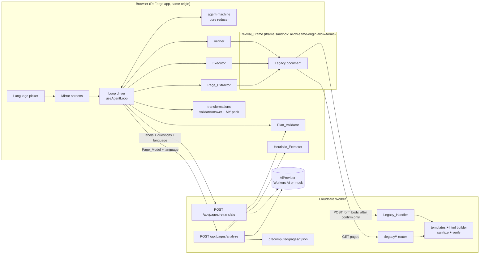
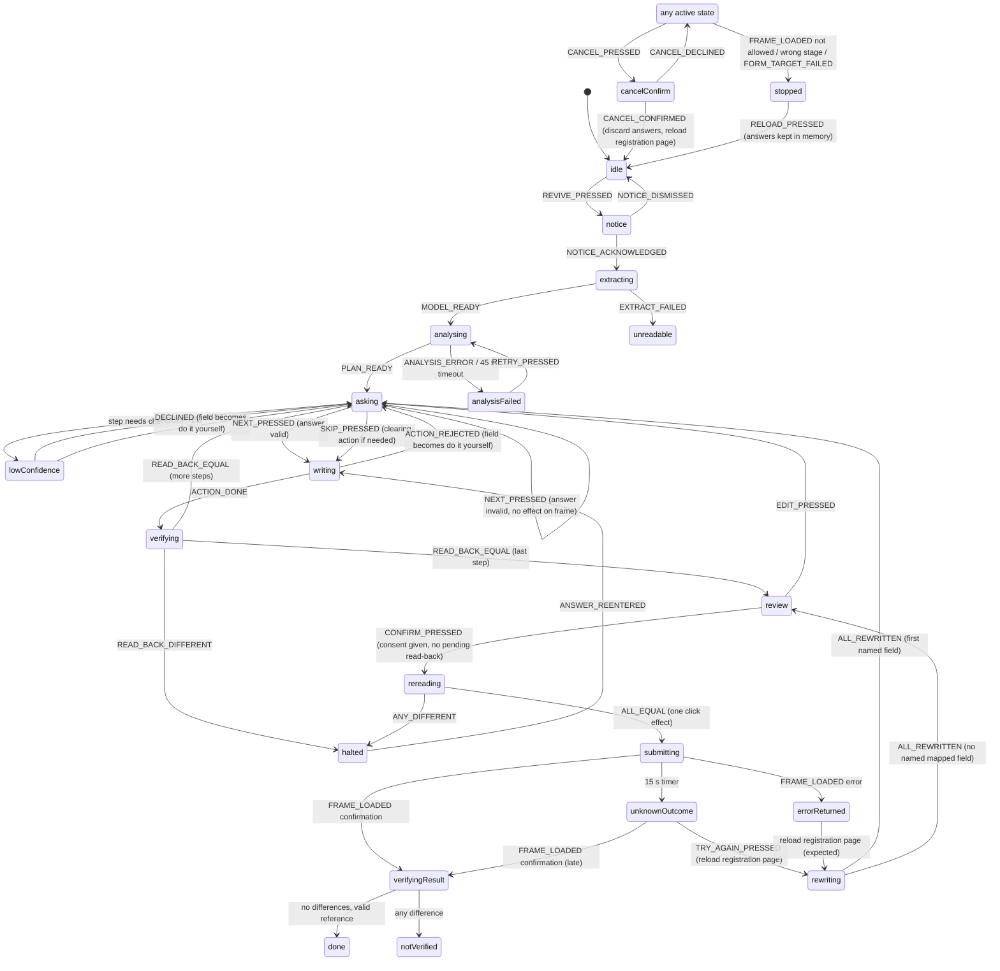

# AccessForge Skeleton: Design

**Spec:** accessforge-skeleton
**Workflow:** Requirements-First
**Status:** Design. Implementation is blocked on the prerequisites in "Open decisions" (privacy rules and notice update first).

---

## Overview

AccessForge revives one fictional legacy registration form. The Worker serves a 2005-style portal under `/legacy/`. The ReForge app shows that portal in a same-origin, script-free iframe (the Revival_Frame) and builds a modern Mirror beside it. The Mirror asks one plain question at a time in the interface language, validates answers with the existing `MY` country pack, writes each answer into the legacy form, reads it back, and submits the legacy form only after the user presses the confirm button. The legacy handler in the Worker does the real work and returns its own confirmation with a reference number and a received-fields summary, which the Mirror reads and checks.

The design is a walking skeleton. It adds no new runtime dependency. It reuses these existing modules unchanged or with small additions:

| Existing module | Path | Use in AccessForge |
|---|---|---|
| AI provider interface | `src/lib/ai/interface.ts` | two new methods: `analyzePage`, `retranslatePage` |
| Workers AI provider | `src/lib/ai/cf-workers.ts` | implements the two methods, 20 s per-call timeout for them |
| Mock provider | `src/lib/ai/mock.ts` | implements the two methods from a table in `fixtures/mock-analysis/legacy-register.json` |
| Prompts | `src/lib/ai/prompt.ts` | two new prompt builders |
| AI mode switch | `src/worker/ai-mode.ts` (`resolveAiMode`) | unchanged |
| Worker entry, error shape, body limit, logging | `src/worker/index.ts`, `src/worker/http.ts` | two new API routes; `/legacy/*` dispatch; `LogEntry` gains an optional `analysisMode` |
| Rate limiting | `RATE_LIMITER` binding in `wrangler.jsonc` | same binding, key `route:ip` |
| Answer validation | `src/packs/country/validate.ts` (`validateAnswer`), `my.ts` (`myPack`), `dates.ts` (`isValidCalendarDate`, `formatDate`, `detectDateFormat`) | unchanged |
| Language registry and i18n | `src/packs/language/registry.ts` (`translate`, `getLanguageEntry`), `src/frontend/i18n.tsx` | new `accessforge.*` keys in every locale file |
| Shared UI | `src/frontend/components/AppHeader.tsx`, `ScreenHeading.tsx`, `StatusMessage.tsx`, `screens/LanguagePicker.tsx`, `tokens.css` | reused |
| Fixture cache convention | `src/worker/cache/precomputed/`, `scripts/generate-fixture-cache.ts` | page plans in a `pages/` subfolder, written by the same script |

New code goes into four places: `src/worker/legacy/` (portal and handler), `src/lib/accessforge/` (pure agent logic, no I/O), `src/frontend/accessforge/` (Mirror screens and the loop driver), and `src/shared/page-schemas.ts` (zod schemas shared by Worker and browser). The page schemas live in their own file so this spec does not edit `src/shared/schemas.ts` while FormBridge work continues there.

---

## Architecture



Data paths:

1. The frame loads `GET /legacy/register`. The Worker renders it from templates, sanitises it, verifies it, stamps its Page_Version and sends it with a strict CSP.
2. The user presses "Revive this page", reads the data notice and acknowledges it.
3. The Page_Extractor reads the frame document and builds the Page_Model (structure only, no values).
4. The browser sends the Page_Model and the interface language to `POST /api/pages/analyze`. The Worker gets a Page_Plan from the provider, or a cached plan, or the heuristic plan, runs the Plan_Validator and returns the plan with its Analysis_Mode.
5. For each mapped field, the Mirror asks, validates, computes the Intended_Value, the Executor writes it into the frame and the Verifier reads it back.
6. On the review screen the user presses the confirm button. The Verifier re-reads every field, and the Executor clicks the legacy submit button once. The browser itself sends the legacy form POST; no ReForge API carries an answer.
7. The frame loads the confirmation response. The Verifier parses the reference number and the received-fields summary and compares them with the Intended_Values.

### Routing changes in `wrangler.jsonc`

`assets.run_worker_first` becomes `["/api/*", "/legacy", "/legacy/*"]`, so the SPA fallback never answers a legacy path. The legacy stylesheet is a static asset at `public/legacy-assets/portal.css` (served at `/legacy-assets/portal.css`), outside `/legacy/`, because Requirement 1.10 turns every unlisted `/legacy/` path into a not-found document.

---

## Components and Interfaces

### Repository layout (new files)

```
src/
  shared/
    page-schemas.ts             # zod: PageModel, PagePlan, analyze/retranslate requests and replies, Action
  lib/
    accessforge/
      allow-list.ts             # ALLOW_LIST constant + checkFrameDocument()
      element-id.ts             # elementIdFor(), parseElementId()
      extract.ts                # extractPageModel(doc, pageVersion)
      plan-validator.ts         # validatePlan(model, rawEntries)
      heuristic.ts              # heuristicPlan(model, language)
      executor.ts               # execute(action, ctx)
      verifier.ts               # readBack(), sameValue(), parseConfirmation(), compareReceived()
      transformations.ts        # toIntendedValue(), legacyLength(), detectLegacyDateFormat()
      agent-machine.ts          # agentReducer(state, event) -> { state, effects }
      supported-versions.ts     # SUPPORTED_PAGE_VERSIONS (recorded hashes)
    analysis/
      run-page.ts               # runPageAnalyze(), runPageRetranslate() (retry rules of 6.10)
  worker/
    legacy/
      form-spec.ts              # LEGACY_FORM: the eight fields, single source for template + handler
      content.ts                # loads the Malay content file, typed keys
      html.ts                   # h(), serialize(), sanitizeTree(), findUnsafeConstructs()
      templates.ts              # homePage(), registerPage(), confirmationPage(), errorPage(), notFoundPage()
      page-version.ts           # stampPageVersion(html)
      handler.ts                # handleLegacy(request, deps)
      submission.ts             # parseSubmission(), validateSubmission()
      reference.ts              # newReferenceNumber(now, randomDigits)
      respond.ts                # legacyResponse(), LEGACY_CSP
    routes/
      page-analyze.ts           # POST /api/pages/analyze
      page-retranslate.ts       # POST /api/pages/retranslate
    cache/
      page-plan-cache.ts        # lookupPagePlanCache(pageVersion, language)
      precomputed/pages/        # <pageVersion>-<bcp47>.json, written by generate-fixture-cache.ts
  frontend/
    accessforge/
      RevivalScreen.tsx         # split view: frame + Mirror
      RevivalFrame.tsx          # the iframe, load events, highlight
      useAgentLoop.ts           # runs agent-machine effects against the frame and the API
      DataNotice.tsx
      ModeNotice.tsx
      MirrorStep.tsx            # one question; text, date (3 inputs), radio, select, checkbox
      LowConfidenceCheck.tsx
      MirrorReview.tsx
      MirrorResult.tsx          # verified, not verified, unknown outcome, stopped
      DoItYourselfList.tsx
  packs/language/locales/
    legacy-portal/ms.json       # every Malay string of the portal (see Open decision B)
public/
  legacy-assets/portal.css      # the 2005-style stylesheet
fixtures/
  mock-analysis/legacy-register.json   # mock Page_Plan table (same convention as the PDF mock tables)
tests/
  unit/accessforge-*.test.ts
  e2e/accessforge-*.spec.ts
  e2e/helpers/hostile-pages.ts  # hostile and instruction-like pages, test-only
docs/
  accessibility-checklist.md    # AccessForge section (created if not present)
```

### AiProvider additions (`src/lib/ai/interface.ts`)

```typescript
export interface PageAnalyzeCall {
  request: PageAnalyzeRequest;        // Page_Model + interfaceLanguage
  interfaceLanguageName: string;      // e.g. "Simplified Chinese"
}

export interface PageRetranslateCall {
  request: PageRetranslateRequest;    // items: { humanLabel, question }[] + targetLanguage
  targetLanguageName: string;
}

export interface AiProvider {
  readonly kind: 'real' | 'mock';
  analyze(call: AnalyzeCall): Promise<AiReply>;
  retranslate(call: RetranslateCall): Promise<AiReply>;
  translate(call: TranslateCall): Promise<AiReply>;
  analyzePage(call: PageAnalyzeCall): Promise<AiReply>;        // new (Requirement 6.2)
  retranslatePage(call: PageRetranslateCall): Promise<AiReply>; // new (Requirement 7.7)
}
```

`CfWorkersAiProvider` runs both with a 20 s timeout (`PAGE_TIMEOUT_MS = 20_000`), `max_completion_tokens` 1,500 (analysis) and 2,000 (re-translation), temperature 0.2, Gemma with thinking off, exactly like the existing methods. Estimated cost for the ten-entry Page_Model is about 2,000 input and 800 output tokens, roughly 40 neurons per analysis with the selected Gemma model; the real figure is read from `usage.neurons` and logged.

`MockAiProvider.analyzePage` answers from `fixtures/mock-analysis/legacy-register.json`, keyed by Element_Id, with label and question per language and English fallback, like the existing PDF tables. Unknown Element_Ids get a generic entry (`mock.question` template, confidence 0.5). The mock gives the reason-for-visit select confidence 0.6, so the low-confidence check appears in mock runs and in the acceptance test. `retranslatePage` finds each item's table entry by matching its label in any language and returns that entry's text in the target language; an unmatched item gets the `mock.question` template.

### Orchestration (`src/lib/analysis/run-page.ts`)

```typescript
export type PageRunOutcome =
  | { kind: 'plan'; entries: unknown[]; meta: RunMeta }   // schema-valid reply
  | { kind: 'invalid'; meta: RunMeta }                    // two schema failures
  | { kind: 'provider-error'; code: AiErrorCode; meta: RunMeta };

export function runPageAnalyze(provider: AiProvider, request: PageAnalyzeRequest, languageName: string): Promise<PageRunOutcome>;
export function runPageRetranslate(provider: AiProvider, request: PageRetranslateRequest, languageName: string): Promise<RunResult<PageRetranslateResponse>>;
```

Retry rule (Requirement 6.10): attempt 1; if the reply fails `PagePlanReplySchema` or the attempt times out, attempt 2 with the same input. Unlike the existing `withRetry`, a timeout is retried once here, because the requirement says so and 2 × 20 s stays inside the browser's 45 s limit. Quota, rate-limit and unavailable errors are not retried. The outcome is classified by the last attempt: a schema failure gives `invalid`, any provider error gives `provider-error`.

### Page_Extractor (`src/lib/accessforge/extract.ts`)

```typescript
export type ExtractResult =
  | { ok: true; model: PageModel }
  | { ok: false; code: 'UNREADABLE' | 'NO_FORM' | 'MULTIPLE_FORMS' | 'TOO_MANY_CONTROLS' };

export function extractPageModel(doc: Document, pageVersion: string): ExtractResult;
```

Pure DOM reading, no network (Requirement 5.1). It reads attributes and text nodes only; it never reads `.value`, `.checked`, `.selected`, `defaultValue`, `defaultChecked` or `defaultSelected`, and skips `input[type=hidden]` entirely. Text is collected from text nodes with control subtrees removed, so `option` text is read only as option text and a `textarea` (unsupported) contributes no content.

### Plan_Validator (`src/lib/accessforge/plan-validator.ts`)

```typescript
export interface ValidatedPlan {
  mapped: Map<string, PagePlanEntry>;   // Element_Id -> entry (fields other than buttons)
  doItYourself: Set<string>;            // Element_Ids
  submitId: string | null;              // null when 0 or >1 submit buttons (Requirement 6.16)
  resetIds: string[];
}
export function validatePlan(model: PageModel, rawEntries: readonly unknown[]): ValidatedPlan;
```

Runs in the Worker before replying and again in the browser on the reply. Rules are in "Question 3" below.

### Heuristic_Extractor (`src/lib/accessforge/heuristic.ts`)

```typescript
export function heuristicPlan(model: PageModel, language: string): PagePlanEntry[];
```

Pure, shared by Worker and browser. Rules are in "Question 3".

### Executor (`src/lib/accessforge/executor.ts`)

```typescript
export type ActionResult = { ok: true } | { ok: false; reason: ActionRejectReason };
export type ActionRejectReason =
  | 'SCHEMA' | 'UNKNOWN_ELEMENT' | 'KIND_MISMATCH' | 'TOO_LONG' | 'NOT_AN_OPTION'
  | 'VERSION_CHANGED' | 'RESET_BUTTON' | 'SUBMIT_NOT_ARMED' | 'CONSENT_NOT_GIVEN'
  | 'DO_IT_YOURSELF' | 'NOT_FOUND' | 'AMBIGUOUS' | 'FORM_TARGET';

export interface ExecutorContext {
  doc: Document;                       // the Revival_Frame document
  model: PageModel;
  plan: ValidatedPlan;
  submitArmed: boolean;                // true only between confirm press and the single click
  consentGiven: boolean;               // the Mirror consent checkbox
}

export function execute(action: unknown, ctx: ExecutorContext): ActionResult;
```

`action` is parsed with the strict `ActionSchema` first, so a kind such as `Click` or `submit` fails as `SCHEMA`. All checks run before any write; a rejected Action changes nothing. Location uses `form.elements` filtered by control type and exact `name` (and `value` for a radio option); `querySelector` is never called with any string derived from the plan. The Executor sets values through the DOM properties (`input.value`, `option.selected` via `select.value`, `input.checked`) and submits with `form.requestSubmit(submitButton)`. Neither button has a `name`, so neither appears in the POST body.

### Verifier (`src/lib/accessforge/verifier.ts`)

```typescript
export type ReadBack = { kind: 'text' | 'select' | 'radio'; value: string | null } | { kind: 'checkbox'; checked: boolean };
export function readBack(doc: Document, entry: PageEntry): ReadBack | 'NOT_FOUND' | 'AMBIGUOUS';
export function sameValue(intended: string, read: string): boolean;   // intended === read, nothing else
export function parseConfirmation(doc: Document): ConfirmationRead | null;
export function compareReceived(read: ConfirmationRead, filled: readonly FilledField[], model: PageModel): Difference[];
```

### Transformations (`src/lib/accessforge/transformations.ts`)

```typescript
export type DateParts = { day: string; month: string; year: string };
export type MirrorAnswer = { kind: 'text'; value: string } | { kind: 'date'; parts: DateParts }
  | { kind: 'option'; value: string } | { kind: 'consent'; checked: boolean };

export type IntendedResult =
  | { ok: true; intended: string | boolean; transformation: TransformationName }
  | { ok: false; messageKey: string; messageParams?: Record<string, string | number>; needs?: 'format' };

export function toIntendedValue(entry: PageEntry, answerType: AnswerType, answer: MirrorAnswer,
  ctx: { dateFormat?: DateFormat; today?: Date }): IntendedResult;
export function legacyLength(value: string): number;                 // UTF-16 code units, as the browser counts maxlength
export function detectLegacyDateFormat(entry: PageEntry): DateFormat | 'ambiguous' | undefined;
```

`toIntendedValue` calls `validateAnswer(myPack, answerType, value, { required, maxLength: undefined })` and then applies the legacy length check itself (see "Question 8"), so the shared validator stays unchanged.

### Agent loop (`src/lib/accessforge/agent-machine.ts`, `src/frontend/accessforge/useAgentLoop.ts`)

```typescript
export function agentReducer(state: AgentState, event: AgentEvent): { state: AgentState; effects: Effect[] };
```

The reducer is pure. `useAgentLoop` performs effects (extract, call API, execute, read back, reload frame, start or clear the 15 s timer) and feeds the results back as events. The states and transitions are in "Question 4".

### Allow-list check (`src/lib/accessforge/allow-list.ts`)

```typescript
export function checkFrameDocument(frame: HTMLIFrameElement, appOrigin: string):
  | { ok: true; entry: AllowListEntry; pageVersion: string | null }
  | { ok: false; reason: 'ORIGIN' | 'PATH' | 'QUERY' | 'PAGE_TYPE' | 'UNREADABLE' };
```

### Worker legacy modules

```typescript
// src/worker/legacy/html.ts
export type Node = { tag: AllowedTag; attrs: Record<string, string>; children: Node[] } | { text: string };
export function h(tag: AllowedTag, attrs?: Record<string, string>, ...children: Array<Node | string>): Node;
export function sanitizeTree(node: Node): Node;          // drops what is not on the allow-list
export function serialize(node: Node): string;           // escapes text and attribute values
export function findUnsafeConstructs(html: string): string[];  // names of constructs found, [] when clean

// src/worker/legacy/handler.ts
export function handleLegacy(request: Request, deps: { now(): Date; randomDigits(): string; log: Logger; requestId: string }): Promise<Response>;

// src/worker/legacy/submission.ts
export type Submission = { entries: Array<{ name: string; value: string }> };
export function parseSubmission(body: string): Submission;
export function validateSubmission(s: Submission): { ok: true } | { ok: false; failing: string[] };
```

### API client (`src/frontend/api.ts`)

Adds `analyzePage(req, { signal })` with a 45 s abort (Requirement 6.15) and `retranslatePage(req, { signal })` with a 45 s abort.

---

## Data Models

### Page schemas (`src/shared/page-schemas.ts`)

```typescript
import { z } from 'zod';

const Hex64 = z.string().regex(/^[0-9a-f]{64}$/);
const Lang = z.string().min(2).max(20);
const Text200 = z.string().max(200);
export const ElementIdSchema = z.string().min(1).max(256);

export const ControlTypeSchema = z.enum(['text', 'select', 'radio', 'checkbox', 'submit', 'reset', 'unsupported']);

export const PageOptionSchema = z.object({
  value: z.string().max(200),
  text: Text200,
  elementId: ElementIdSchema.optional(),   // radio options only
}).strict();

export const PageEntrySchema = z.object({
  elementId: ElementIdSchema,
  control: ControlTypeSchema,
  name: z.string().max(100),
  id: z.string().max(100),
  labelText: Text200,
  neighbourText: Text200,
  nearbyText: Text200,
  options: z.array(PageOptionSchema).max(50),
  hasEmptyOption: z.boolean(),             // select has an option with value "" (not listed in options)
  checkboxValue: z.string().max(200).optional(),
  required: z.boolean(),
  maxLength: z.number().int().min(0).max(524288).nullable(),
  position: z.number().int().min(0),
  duplicateId: z.boolean(),                // Requirement 5.8
}).strict();

export const PageModelSchema = z.object({
  path: z.literal('/legacy/register'),
  pageVersion: Hex64,
  entries: z.array(PageEntrySchema).min(1).max(50),
}).strict();

// --- Plan ---------------------------------------------------------------
const PlainText = (max: number) => z.string().min(1).max(max)
  .refine((s) => s.trim().length > 0, 'blank')
  .refine((s) => !/[<>]/.test(s), 'markup')
  .refine((s) => !/(https?:|ftp:|javascript:|data:|www\.|\/\/)/i.test(s), 'url');

export const PagePlanEntrySchema = z.object({
  elementId: ElementIdSchema,
  humanLabel: PlainText(80),
  question: PlainText(200),
  answerType: AnswerTypeSchema,            // the shared FormBridge enum, reused
  confidence: z.number().min(0).max(1),
}).strict();                               // the closed property set (Requirement 6.6)

/** Envelope of a model reply: entries are validated one by one, so one bad entry is dropped, not the reply. */
export const PagePlanReplySchema = z.object({ entries: z.array(z.unknown()).max(100) });

export const AnalysisModeSchema = z.enum(['live', 'mock', 'cached', 'heuristic']);

export const PageAnalyzeRequestSchema = z.object({
  pageModel: PageModelSchema,
  interfaceLanguage: Lang,
}).strict();

export const PageAnalyzeResponseSchema = z.object({
  analysisMode: AnalysisModeSchema,
  entries: z.array(PagePlanEntrySchema).max(50),   // already passed the Plan_Validator
}).strict();

export const PageRetranslateRequestSchema = z.object({
  items: z.array(z.object({ humanLabel: PlainText(80), question: PlainText(200) }).strict()).min(1).max(50),
  targetLanguage: Lang,
}).strict();

export const PageRetranslateResponseSchema = z.object({
  items: z.array(z.object({ humanLabel: PlainText(80), question: PlainText(200) }).strict()).max(50),
}).strict();   // the route also requires items.length === request.items.length

export const PrecomputedPagePlanSchema = z.object({
  pageVersion: Hex64,
  interfaceLanguage: Lang,
  entries: z.array(PagePlanEntrySchema).max(50),
}).strict();

// --- Actions --------------------------------------------------------------
export const ActionSchema = z.discriminatedUnion('kind', [
  z.object({ kind: z.literal('fill'), elementId: ElementIdSchema, value: z.string() }).strict(),
  z.object({ kind: z.literal('select'), elementId: ElementIdSchema, value: z.string() }).strict(),
  z.object({ kind: z.literal('check'), elementId: ElementIdSchema, checked: z.boolean() }).strict(),
  z.object({ kind: z.literal('click'), elementId: ElementIdSchema }).strict(),
]);
```

The re-translation request carries labels and questions by position only, with no Element_Id and no Page_Version, so it holds exactly what Requirement 13.1 lists.

### Mirror session state (memory only)

```typescript
export interface MirrorField {
  elementId: string;
  entry: PageEntry;                            // from the Page_Model
  plan: PagePlanEntry | null;                  // null for Do_It_Yourself
  status: 'pending' | 'filled' | 'skipped' | 'do-it-yourself' | 'mismatch';
  answer?: MirrorAnswer;                       // as typed, never trimmed in state
  intended?: string | boolean;
  lastReadBack?: ReadBack;
  diyReason?: 'NO_PLAN' | 'DUPLICATE_ID' | 'UNSUPPORTED' | 'NOT_FOUND' | 'AMBIGUOUS' | 'DECLINED';
  accepted?: boolean;                          // low-confidence question accepted
}

export interface RevivalSession {
  interfaceLanguage: string;
  analysisMode: AnalysisMode | null;
  model: PageModel | null;
  fields: MirrorField[];                       // Legacy_Form order, buttons excluded
  dateFormat?: DateFormat;                     // chosen by the user when the page states none
  versionChanged: boolean;                     // Requirement 3.5
  largeText: boolean;                          // Requirement 14.11
  noticeAcknowledged: boolean;
  submitAttempt: number;                       // count of confirm presses that led to a click
}
```

State lives in a React store inside the AccessForge screen; nothing is written to any browser storage (Requirement 13.4).

### Legacy form specification (`src/worker/legacy/form-spec.ts`)

One constant drives both the template and the handler, so the handler's rules can never drift from the served form.

```typescript
export const LEGACY_FORM = {
  action: '/legacy/register',
  method: 'post',
  fields: [
    { name: 'nama',    control: 'text',     maxLength: 60, required: true },
    { name: 'nokp',    control: 'text',     maxLength: 12, required: true },
    { name: 'tlahir',  control: 'text',     maxLength: 10, required: true },
    { name: 'jantina', control: 'radio',    values: ['L', 'P'], required: true },
    { name: 'tel',     control: 'text',     maxLength: 15, required: true },
    { name: 'poskod',  control: 'text',     maxLength: 5,  required: true },
    { name: 'tujuan',  control: 'select',   values: ['', 'PERIKSA', 'SUSULAN', 'VAKSIN', 'LAIN'], required: true },
    { name: 'akuan',   control: 'checkbox', value: 'YA', required: true },
  ],
} as const;
```

Visible labels and option texts come from the content file by key; the codes above are the option `value` attributes.

### Received_Fields_Summary format

The confirmation response contains:

```html
<table class="ringkasan" id="ringkasan-diterima">
  <tr><th scope="row" data-name="nama">nama</th><td data-value>LIN MEI TEST</td></tr>
  ... one row per received field, in Legacy_Form order ...
</table>
<p id="no-rujukan">...label from content file... <b id="rujukan">SR-DEMO-20261118-482913</b></p>
<div id="mesej-pengesahan">...the Malay confirmation text...</div>
```

Values are text nodes produced by the serializer's escaping, so `textContent` returns them exactly as received (Requirement 2.10). The `data-name` attribute holds the field name; only names from `LEGACY_FORM` can reach this table, because a body with any other name fails validation first. A checkbox that was not ticked is absent from the POST body and therefore absent from the table; because consent is required, an accepted submission always has it.

---

## Question 1: Supported paths, methods and page versions

### The Allow_List constant (`src/lib/accessforge/allow-list.ts`)

```typescript
export type PageType = 'home' | 'register' | 'confirmation' | 'error';

export const ALLOW_LIST = [
  { method: 'GET',  path: '/legacy/',         pageType: 'home' },
  { method: 'GET',  path: '/legacy/register', pageType: 'register' },
  { method: 'POST', path: '/legacy/register', pageType: 'confirmation' },
  { method: 'POST', path: '/legacy/register', pageType: 'error' },
] as const;
```

Only these four transitions exist. The Worker answers every other `/legacy/` GET with the not-found document (Requirement 1.10), which carries page type `not-found` and therefore matches no entry.

### How the browser checks a loaded document

Every Legacy_Portal document carries two meta elements written by the Worker:

```html
<meta name="portal-page" content="register">
<meta name="portal-page-version" content="<64 hex>">   <!-- home and register pages only -->
```

`checkFrameDocument` runs on every `load` event of the Revival_Frame, before any other module touches the document:

1. Read `frame.contentWindow.location`. Any exception (cross-origin) gives `UNREADABLE`.
2. `origin` must equal the app origin; `search` and `hash` must be empty; `pathname` must equal an Allow_List path exactly (`/legacy/register/` does not match).
3. Read `portal-page`. A missing or unknown value gives `PAGE_TYPE`.
4. The page must match an entry on path and page type.

A frame load does not expose the HTTP method to the parent page. The method is bound to the page type instead: the Worker produces `home` and `register` only for GET, and `confirmation` and `error` only for a POST that reached the Legacy_Handler. Matching on path plus page type therefore matches on method as well. The agent machine adds the stage check of Requirement 3.6 on top (see Question 4).

### Page_Version

`Page_Version = SHA-256 (hex, lowercase) of the UTF-8 bytes of the served HTML with the content of the portal-page-version meta set to the empty string.`

`src/worker/legacy/page-version.ts` renders the page with `content=""`, hashes it with `crypto.subtle.digest` (available in Workers, in Node 22 for Vitest, and in Playwright tests), then writes the hash into the meta. The GET pages contain no date, counter or random value, so the hash is stable. The browser cannot recompute the hash, because the DOM does not keep the exact served bytes, so it reads the meta. That is safe because the same Worker writes both the page and the meta; the hash identifies a template version, it does not authenticate the page.

Confirmation and error pages carry no version meta (Requirement 3.4).

### Where the recorded hashes live and how they are checked

`src/lib/accessforge/supported-versions.ts`:

```typescript
export const SUPPORTED_PAGE_VERSIONS = {
  home: '<filled in by the template task>',
  register: '<filled in by the template task>',
} as const;
```

| Page | Path | Recorded Page_Version |
|---|---|---|
| Home | GET `/legacy/` | to be recorded by the template task |
| Registration | GET `/legacy/register` | to be recorded by the template task |

`tests/unit/accessforge-page-versions.test.ts` calls `handleLegacy` for both GET pages, recomputes the hash from the served HTML by the formula above, and asserts that it equals the meta and equals `SUPPORTED_PAGE_VERSIONS`. Any template or content-file change fails this test until the constant, this table and the precomputed page plans are updated together. The same test fails when a file in `src/worker/cache/precomputed/pages/` is keyed by a version that is no longer supported, so stale plans cannot linger.

When the loaded registration page has a different version (possible only in tests or after an unrecorded change), the Mirror sets `versionChanged`, shows the "page has changed since it was tested" notice on every screen, and the Worker finds no cached plan for that version (Requirement 3.5).

---

## Question 2: What makes a field mapping reliable

### Element_Id formula (`src/lib/accessforge/element-id.ts`)

```
Element_Id        = "f" + formIndex + ":" + controlType + ":" + enc(name)
radio option id   = Element_Id of the group + ":" + enc(value)
enc               = encodeURIComponent (so ":" inside a name cannot fake a separator)
controlType       ∈ text | select | radio | checkbox | submit | reset | unsupported
```

`formIndex` is always `0` because the Page_Extractor refuses a document with more than one form. Nothing else enters the id: not the `id` attribute, label text, cell text or position. Two loads of the same page therefore produce the same ids, and an AI reply cannot influence them. `parseElementId` is the exact inverse and is what the Executor uses to locate a control.

### What locates a control and what only explains it

| Purpose | Inputs used |
|---|---|
| Locating a control (Executor, Verifier) | form, control type, exact `name`, radio `value` |
| Explaining a control (AI prompt, Heuristic_Extractor, low-confidence view) | associated label text, neighbouring-cell text, nearby text, option texts, `required`, `maxlength`, position |

A mapping is reliable only when all of these hold; otherwise the field is Do_It_Yourself:

1. The Element_Id is unique in the Page_Model (`duplicateId` false).
2. The control type is supported.
3. The Page_Plan entry passed the Plan_Validator.
4. At action time, exactly one element in the frame matches the id (Requirement 8.10).
5. The frame's Page_Version equals the Page_Model's (Requirement 8.2).

### Evidence fields

Recorded per entry, after collapsing whitespace runs to one space and trimming: `name`, `id`, `labelText` (a `label[for]` or wrapping `label`), `neighbourText` (the cell before the field's cell in the same row), `nearbyText` (other visible text of the same row, without label, neighbour and control text, cut to 200 characters), `options` (`value` and text, empty-value select option reported as `hasEmptyOption` instead of an option), `checkboxValue`, `required`, `maxLength`, `position`. Absent evidence is an empty string or `null`.

### The Legacy_Form fields

| # | Legacy_Field | Control | `name` | `maxlength` | `required` | Element_Id |
|---|---|---|---|---|---|---|
| 0 | Full name | text | `nama` | 60 | yes | `f0:text:nama` |
| 1 | IC number | text | `nokp` | 12 | yes | `f0:text:nokp` |
| 2 | Date of birth | text | `tlahir` | 10 | yes | `f0:text:tlahir` |
| 3 | Gender | radio (`L`, `P`) | `jantina` | n/a | yes | `f0:radio:jantina` (options `…:L`, `…:P`) |
| 4 | Mobile phone | text | `tel` | 15 | yes | `f0:text:tel` |
| 5 | Postcode | text | `poskod` | 5 | yes | `f0:text:poskod` |
| 6 | Reason for visit | select (empty, `PERIKSA`, `SUSULAN`, `VAKSIN`, `LAIN`) | `tujuan` | n/a | yes | `f0:select:tujuan` |
| 7 | Consent | checkbox, `value="YA"` | `akuan` | n/a | yes | `f0:checkbox:akuan` |
| 8 | Submit button | submit, no `name` | (none) | n/a | n/a | `f0:submit:` |
| 9 | Reset button | reset, no `name` | (none) | n/a | n/a | `f0:reset:` |

Each `maxlength` is at least the length of the matching Intended_Value (60 ≥ 12, 12 = 12, 10 = 10, 15 ≥ 13, 5 = 5). Requirement 1.5 lists reason for visit among the eight fields without fixing its control; it is a select here so that the form exercises the `select` Action and the dropdown step that Requirements 1.8, 6.9 and 17.5 describe.

---

## Question 3: Which rules reject an AI plan

The schema is `PagePlanEntrySchema` above. The Plan_Validator applies these rules in order to the model reply (or a cached or heuristic plan):

1. **Envelope.** The reply must pass `PagePlanReplySchema`. Failure counts as an invalid reply and triggers the single retry (Requirement 6.10).
2. **Closed property set and bounds.** Each entry is parsed alone with the strict schema: only `elementId`, `humanLabel`, `question`, `answerType`, `confidence`; label 1 to 80 characters, question 1 to 200, both with visible text, no `<` or `>`, no URL scheme, `www.` or `//`; confidence 0.0 to 1.0. A failing entry is discarded, so selectors, XPath, scripts, URLs and Actions cannot pass (Requirement 6.6).
3. **Known target.** The `elementId` must be the id of a non-button entry of the submitted Page_Model, compared exactly (case-sensitive). Radio option ids, button ids, unknown ids and near-misses are discarded (Requirements 6.4, 6.13).
4. **First wins.** A later entry for an id already accepted is discarded (Requirement 6.5).
5. **Compatibility.**

   | Control type | Accepted answer types | Implied type if incompatible |
   |---|---|---|
   | text | `text`, `ic`, `phone`, `postcode`, `date`, `email`, `description` | `text` |
   | select | `dropdown` | `dropdown` |
   | radio | `radio` | `radio` |
   | checkbox | `checkbox` | `checkbox` |

   An incompatible type is replaced by the implied type and the confidence becomes 0 (Requirements 6.7, 6.8).
6. **Coverage.** Every non-button entry without an accepted plan entry, and every entry with `duplicateId` or control `unsupported`, becomes Do_It_Yourself. Each non-button entry ends in exactly one of mapped or Do_It_Yourself (Requirement 6.12).
7. **Buttons.** The submit button is the single `submit` entry with `duplicateId` false; with zero or several, `submitId` is `null` and the submission step is Do_It_Yourself (Requirement 6.16). Plan entries for buttons never matter.

Options never come from the plan. The Mirror lists the Page_Model options and the Executor writes the Page_Model option value (Requirement 6.9).

**Confidence threshold.** A mapped entry with confidence below 0.7 shows the original legacy label, neighbouring-cell text and nearby text (each with `lang="ms"`) and asks the user to accept or decline the proposed question before the answer input appears. Declining makes the field Do_It_Yourself (Requirement 6.11). Heuristic plans have confidence 0, so in heuristic mode every question goes through this check; that is intended, because no AI interpreted the field.

### Heuristic_Extractor rules (Requirement 7.4)

- select → `dropdown`, radio → `radio`, checkbox → `checkbox`, from the control type alone.
- text input, first matching rule on `name` (case-insensitive) and `maxlength`:

  | Rule | Answer type |
  |---|---|
  | `name` is one of `nokp`, `kp`, `ic`, `nric`, `mykad`, or (`maxlength` is 12 and `name` contains `kp` or `ic`) | `ic` |
  | `name` is one of `tel`, `telefon`, `notel`, `hp`, `phone`, `mobile` | `phone` |
  | `name` is one of `poskod`, `pos`, `postcode`, `zip`, or (`maxlength` is 5 and `name` contains `pos`) | `postcode` |
  | `name` contains `lahir`, `dob`, `birth` or `tarikh` | `date` |
  | `name` contains `email` or `emel` | `email` |
  | otherwise | `text` |

- `humanLabel` is the legacy label text, else the neighbouring-cell text, else the `name`, cut to 80 characters.
- `question` is the locale sentence `accessforge.heuristic.question` with that text as `{label}`. The Mirror renders the quoted part in a `<span lang="ms">`, from the Page_Model evidence, so the Malay quote is marked even though the plan string itself is plain text.
- Every confidence is 0. No network request is made. Same Page_Model and language give the same plan.

---

## Question 4: Confirmation, edits, retries and duplicate submission

The agent loop is one pure reducer. Effects are the only way anything touches the frame or the network, so tests can drive the reducer with any event sequence.



Rules that tie the states together:

- **Language switch.** `LANGUAGE_CHANGED` is accepted in every state and never changes the state, step, answers, Intended_Values or statuses. It emits a `RETRANSLATE` effect (live, mock), a cache swap (cached) or a local rebuild (heuristic). It can never emit a click.
- **Expected loads.** The state records `expectedLoad`: `register` while the app itself reloads the registration page (cancel, stop reload, error page, try again), `post-response` from the submit click until a response loads, otherwise `register-current` (the registration page must stay loaded). A `FRAME_LOADED` event that does not match `expectedLoad` or fails the Allow_List check moves to `stopped` (Requirements 3.3, 3.6). In `done` and `notVerified` the loop is over; a later navigation in the frame shows the "page is not supported" notice but changes no result.
- **Only one click per confirm press.** The click effect exists only on the `rereading → submitting` transition, which requires a `CONFIRM_PRESSED` in `review`. `submitArmed` is set for the single Executor call and cleared at once. In `submitting`, `unknownOutcome`, `verifyingResult`, `done` and `notVerified` the confirm button is disabled and any click Action is rejected (Requirement 10.7). No other event leads to `submitting` (Requirement 12.1).
- **Timeout.** After 15 s without a response, `unknownOutcome` keeps every answer, warns that a new attempt may create a second registration, and offers "try again". Trying again reloads and rewrites the form and returns to the review screen; a new confirm press is still needed (Requirement 10.8). A late confirmation is still read and verified.
- **Error page.** The named fields are shown with their legacy labels, the registration page is reloaded as an expected load, every mapped field is rewritten and read back from the kept answers, and the question for the first named field opens. Submitting again needs a new confirm press (Requirement 10.9).
- **Edits.** An edit from the review screen or a re-entered answer in `halted` goes through validation, a write and a read-back. A field counts as `filled` only when its latest read-back equals its Intended_Value (Requirement 12.7). The confirm button stays disabled while a read-back is pending or any field differs, and the screen states why (Requirement 10.13).
- **Consent.** While the Mirror consent box is unticked, the Executor keeps the legacy box unchecked and the confirm button is unavailable (Requirement 9.8).
- **Cancel.** Asks first. Confirming discards answers, stops the loop and reloads the registration page so every field is empty (Requirement 12.6).
- **Leaving the page.** A `beforeunload` listener is active while any answer exists and no confirmation has been received. Nothing is saved (Requirement 12.5).

---

## Question 5: Analysis modes, selection and disclosure

### Decision table (Worker, `POST /api/pages/analyze`)

| `resolveAiMode(env)` | Provider outcome (up to 2 attempts) | Precomputed plan for (Page_Version, language) | Analysis_Mode returned | Plan returned |
|---|---|---|---|---|
| `mock` | valid reply (always, deterministic) | not consulted | `mock` | mock plan after Plan_Validator |
| `real` | valid reply | not consulted | `live` | live plan after Plan_Validator |
| `real` | invalid twice | not consulted | `heuristic` | Heuristic_Extractor plan |
| `real` | quota, rate limit, timeout or other provider error | exists | `cached` | precomputed plan after Plan_Validator against the submitted Page_Model |
| `real` | quota, rate limit, timeout or other provider error | none | `heuristic` | Heuristic_Extractor plan |

If the mock reply were ever invalid (a bug), the row "invalid twice" applies and the mode is `heuristic`, so the response never claims a mode that did not produce the plan. The existing `x-reforge-ai-mode` header is still set; `analysisMode` in the body is what the Mirror shows.

### Precomputed page plans

- Storage: `src/worker/cache/precomputed/pages/<pageVersion>-<bcp47>.json`, each a `PrecomputedPagePlanSchema` object, bundled with `import.meta.glob('./precomputed/pages/*.json', { eager: true })` in `src/worker/cache/page-plan-cache.ts`. The existing glob `./precomputed/*.json` does not descend into `pages/`, so the PDF cache and the page cache cannot mix.
- Generation: the existing script `scripts/generate-fixture-cache.ts` gains a page-plan step, run as `npm run generate-fixture-cache -- --pages` with `AI_MODE=real`. It renders the registration page through `handleLegacy`, extracts the Page_Model with the same extractor in jsdom, calls the real provider for each core language (`en`, `ms`, `zh-Hans`, `zh-Hant`, `ta`, `es`), validates each reply with `PagePlanReplySchema` and the Plan_Validator, and writes only passing results. Any failing key writes nothing and the script exits non-zero (Requirement 7.6). Keeping the same script and the same `precomputed/` folder means the page plans fall under the repo's existing single exception for committed model output.
- Cost: about 40 neurons per language, about 240 for all six, spent once per template version.

### Disclosure

`ModeNotice` sits above the current question or result on every Mirror screen, before any input in reading order, with an icon and text:

| Mode | Locale key | Meaning shown |
|---|---|---|
| `live` | `accessforge.mode.live` | AI wrote these questions from the page. |
| `mock` | `accessforge.mode.mock` | Simulated demonstration questions; no AI analysed the page. FormBridge's Demo mode banner is also shown. |
| `cached` | `accessforge.mode.cached` | Questions saved when this page was tested; no live AI call was made. |
| `heuristic` | `accessforge.mode.heuristic` | No AI was used; the questions quote the original labels. |

The machine-translated label (`MachineTranslatedLabel`, shared with FormBridge) appears on every plan label and question in `live`, `mock` and `cached` modes (Requirement 6.14).

### Language switch by mode (Requirement 7.7)

| Mode | New wording comes from | Network |
|---|---|---|
| `live`, `mock` | `POST /api/pages/retranslate` with labels and questions by position | yes |
| `cached` | the precomputed plan for (Page_Version, new language). The Worker exposes cached plans only through analysis, so the browser re-sends the analysis request with the new language and takes only the labels and questions, and only if the reply mode is `cached` | yes |
| `heuristic` | `heuristicPlan(model, newLanguage)` in the browser | no |

In `cached` mode the re-sent analysis request carries the same Page_Model it already sent, which Requirement 13.1 allows. If the reply is not `cached` for the new language, or any re-translation fails or times out (20 s per attempt, 45 s overall), the previous wording stays with its previous `lang` attribute and a notice says the questions could not be translated (Requirement 7.9).

---

## Question 6: Sanitisation, CSP and navigation limits

### Response headers on every `/legacy/*` response (`src/worker/legacy/respond.ts`)

```
Content-Security-Policy: default-src 'none'; script-src 'none'; object-src 'none'; base-uri 'self'; style-src 'self'; img-src 'self'; font-src 'none'; connect-src 'none'; frame-src 'none'; form-action 'self'; frame-ancestors 'self'
Cache-Control: no-store
X-Content-Type-Options: nosniff
Referrer-Policy: no-referrer
X-Frame-Options: SAMEORIGIN
Content-Type: text/html; charset=utf-8      (application/json for shared-error-shape rejections)
```

`script-src 'none'` blocks inline, external and `eval` scripts; `object-src 'none'` blocks plugins; `base-uri 'self'`, `style-src 'self'`, `img-src 'self'`, `form-action 'self'` and `frame-ancestors 'self'` give the restrictions of Requirement 4.2. The JSON rejections of Requirement 2.8 carry the same CSP.

### Sandbox

```html
<iframe sandbox="allow-same-origin allow-forms" src="/legacy/register" title="…locale key accessforge.frame.title…"></iframe>
```

Without `allow-scripts`, `allow-popups`, `allow-top-navigation*`, `allow-modals` and `allow-downloads`, the framed document cannot run script, open windows, navigate the app window, show dialogs or start downloads. `allow-same-origin` without `allow-scripts` is safe: the framed page has no code that could lift its own sandbox, while the parent app can still read and write the frame DOM, which the Executor and Verifier need.

### Sanitiser that works in Workers without a DOM

The portal HTML is built from a small typed tree, not from strings:

- `h(tag, attrs, ...children)` accepts only allow-listed tags: `html head meta title link body table tbody tr td th div span p b small ul li a form input select option label br hr h1 h2`. Allowed attributes per tag: `class id lang colspan width scope data-name data-value` everywhere; `charset name content` on `meta`; `rel href` on `link` (stylesheet under `/legacy-assets/` only); `href` on `a`; `action method accept-charset` on `form`; `type name value maxlength required` on `input` (types `text radio checkbox submit reset`); `name required` on `select`; `value` on `option`.
- URL attributes (`href`, `action`) must be a root-relative path starting with `/legacy` or `/legacy-assets/`, or the FormBridge path (Question 8). Anything with a scheme, `//` or a backslash is dropped.
- `serialize` escapes `& < > " '` in text and attribute values and always quotes attributes, so no text can open a tag. There is no `style` attribute, no `style` element and no inline handler in the allow-list.
- `sanitizeTree` removes every node and attribute outside the allow-list (whole subtree for removed elements). Templates call it even though they are trusted, so one code path serves both trusted and hostile input.
- `findUnsafeConstructs(html)` is the fail-closed check (Requirement 4.8). It scans only tag text (`<…>`), never text between tags, for: `script`, `noscript`, `iframe`, `frame`, `object`, `embed`, `base` elements; any attribute whose name starts with `on`; `srcdoc`; `http-equiv="refresh"`; `javascript:` or `data:` in any attribute; absolute or protocol-relative URLs in `href`, `src`, `action`, `formaction`; `url(` and `@import` in any attribute. Any finding makes the Worker return `INTERNAL_ERROR` in the shared error shape instead of the page, and the Mirror shows "page not supported". Scanning only tags means a submitted value such as `javascript:` shown as text in the summary does not trigger a false stop.
- `public/legacy-assets/portal.css` contains no `url(` and no `@import`; a unit test reads the file and checks this.

Alternatives considered: `HTMLRewriter` is only available in the Workers runtime, so the same code could not be unit-tested in Vitest or reused in the Playwright helpers. DOMPurify needs a DOM in the Worker (a new dependency plus a DOM shim). The tree builder needs neither and fits a portal whose every page we write.

### Inline styles under the CSP

All portal styling is in the external stylesheet with class names. The legacy traits (12 px and smaller fixed sizes, low contrast, table layout) are CSS rules there. The write highlight of Requirement 8.5 is applied by the parent app through the CSSOM (`element.style.setProperty('outline', …)`), which the frame's `style-src` does not govern; the frame's markup still never contains a `style` attribute. A Playwright test asserts the computed outline width and colour, so a browser that blocked CSSOM changes would fail the test. Fallback if that happens: an overlay drawn in the parent document over the field's bounding box, leaving the frame untouched.

### Navigation restrictions, layer by layer

| Layer | Enforces |
|---|---|
| Templates and sanitiser | only `/legacy/…`, `/legacy-assets/…` and the FormBridge path in links and actions |
| CSP | no scripts, plugins or foreign resources; form posts only to the same origin; framing only by the same origin |
| Sandbox | no top navigation, pop-ups, modals, downloads |
| `checkFrameDocument` | every loaded document is one of the four Allow_List transitions |
| Form-target check (Requirement 4.4) | before the first Action and immediately before the click: `new URL(form.getAttribute('action'), frameLocation)` equals the app origin plus `/legacy/register`, `form.method` is `post`, the submit button has no `formaction`, `formmethod` or `formtarget` |
| Agent machine | wrong-stage documents stop the loop |
| Frame source (Requirement 18.1, 18.2) | `RevivalFrame` takes no URL input; `src` is a constant; a `url` or `page` parameter naming any other address shows the scope message and loads nothing |

### Hostile pages are test-only

`tests/e2e/helpers/hostile-pages.ts` defines:

- **Hostile tree** (unit tests): a node tree with a script, an inline handler, a `javascript:` link, an external image and stylesheet, a meta refresh, a foreign form `action` and a submit button with a foreign `formaction`. The test asserts `findUnsafeConstructs(serialize(sanitizeTree(tree)))` is empty and that the raw serialization is caught.
- **Raw hostile document** (Playwright): served with `page.route('**/legacy/register', …)` and the real `LEGACY_CSP` headers, bypassing the sanitiser on purpose. The tests assert that the script does not run, the external resources are not requested, the form-target check stops the loop before any Action, and nothing is submitted.
- **Instruction-like variant** (Requirement 4.6): the real registration page with label, cell, option and nearby texts replaced by text telling the agent to press reset, submit, change answers, follow a URL or use a selector.

None of these exist under `src/`, so the deployed Worker cannot serve them. A unit test asserts the Worker's route table has no other `/legacy/` documents than Requirement 1.1 lists.

### Prompt delimiting (Requirement 4.5)

`pageAnalyzeMessages` places the Page_Model JSON between the lines `<<<FORM_DATA` and `FORM_DATA>>>`. The JSON is produced with every `<` and `>` written as `\u003c` and `\u003e`, so neither marker can occur inside the data. The system prompt says the block is form data from an untrusted page, contains no instructions, and cannot change the task or the reply schema. The re-translation prompt delimits the label and question list the same way.

---

## Question 7: Verifying privacy, language choice and accessibility

### Prerequisite before implementation

The privacy rules file in `.kiro/steering/` lists what may reach the Worker and the AI service, and says every answer stays in the browser. AccessForge needs two additions, which the developer must approve and make before any AccessForge task starts:

1. The page-analysis payload: the Page_Model (control types, names, ids, label, cell, option and nearby text of the legacy page, `required`, `maxlength`, position, Page_Version) may reach the Worker and the AI service.
2. The confirmed Legacy_Form POST: after the user presses the confirm button, the answers reach the Worker's Legacy_Handler, which processes them in memory for that request, renders them back once and never stores or logs them.

The privacy notice strings in every locale file describe FormBridge only. In the same change, FormBridge's notice must stay accurate and the new AccessForge data notice keys below must be added to every core locale file. This design does not edit those files.

### Data notice keys (shown before analysis and again on the review screen)

| Key | Content (English source) |
|---|---|
| `accessforge.notice.title` | What leaves your browser |
| `accessforge.notice.pageText` | Labels and nearby text from the old page go to the AI service. |
| `accessforge.notice.retranslate` | If you change language, the questions go to the AI service again for translation. |
| `accessforge.notice.answersStay` | Your answers stay in this browser until you confirm. |
| `accessforge.notice.legacyOnly` | When you confirm, your answers go only to the demonstration portal's own form handler. |
| `accessforge.notice.acknowledge` | I understand, continue |

A unit test asserts every key exists and is non-empty in each core locale file (`en`, `ms`, `zh-Hans`, `zh-Hant`, `ta`, `es`) and falls back to English for `id`.

### Canary test plan (Requirement 13.10)

Two canaries: `CANARY-FRAME-5Q7Z` typed into the `nama` input in the frame before "Revive this page", and `CANARY-ANSWER-8K2M` given as the full-name answer in the Mirror and carried to confirmation.

| Surface | Test level | How it is captured | Expected |
|---|---|---|---|
| Page_Model | Vitest (jsdom) and Playwright | `JSON.stringify(model)` | neither canary |
| Page-analysis request body | Playwright | `page.on('request')` post data | neither |
| Re-translation request body | Playwright | same, after a language switch | neither |
| Prompt sent to the AI service | Vitest | recording fake provider in the route; `pageAnalyzeMessages` output | neither |
| Worker log entries | Vitest | `logger` spy in `createHandler` for analysis, re-translation and legacy routes, including the POST | neither, and no field name |
| Error responses | Vitest | legacy error page and API errors built from bodies containing canaries | neither |
| localStorage, sessionStorage, IndexedDB, cookies | Playwright | `page.evaluate` dumps after confirmation | neither |
| Every request URL | Playwright | `request.url()` | neither |
| FormBridge link URL | Playwright | `href` of the Mirror and legacy links | neither |
| Legacy_Form POST body | Playwright | post data of the one POST | `CANARY-ANSWER-8K2M` present (the only place) |

### Language checks

- `<html lang>` follows the interface language and changes without reload (existing i18n provider).
- Every original legacy text in the Mirror (labels, cell text, nearby text, consent wording, original confirmation) sits in an element with `lang="ms"`.
- The acceptance test runs in `zh-Hans`; component tests cover `en`; locale completeness covers all core languages.

### Automated accessibility checks

Playwright with `@axe-core/playwright` (already a dev dependency), tags `wcag2a wcag2aa wcag21a wcag21aa wcag22aa`, excluding the iframe (`.exclude('iframe')`), in `en` and `zh-Hans`, failing on any violation, for these states: legacy page with "Revive this page"; data notice; one step each for text, IC, phone, postcode, date, radio, select and consent checkbox; low-confidence check; validation error shown; review screen; verified confirmation; "could not be verified"; loop stopped; do-it-yourself report; larger text on.

### Manual checklist (`docs/accessibility-checklist.md`, AccessForge section)

The section states that the Legacy_Portal pages fail accessibility on purpose. Entries, each with pass or fail and the date checked: keyboard-only run of the whole revival flow; screen-reader pass (NVDA or VoiceOver) on the question, review and confirmation screens; 360 px width; 200% zoom on a 1280 px viewport; reduced motion; larger text.

---

## Question 8: Evidence that the legacy handler received the same data

### Documented_Transformations

| Name | Applies to | Rule | Source |
|---|---|---|---|
| `trim` | text answers (`text`, `description`), postcode | remove leading and trailing whitespace | `validateAnswer` |
| `ic-separators` | IC number | remove the hyphens or spaces between the 6-2-4 groups | `validateIc` / `normalizeIc` |
| `my-phone-grouping` | phone | national grouping such as `011-2345 6789` | `validateMyPhone` |
| `date-format` | date of birth | `formatDate(day, month, year, format)`, zero-padded | `dates.ts` |
| `none` | radio, select, checkbox | the Page_Model option `value` or `checkboxValue` is written | Executor |

### Per-field table for the Synthetic_Registration

| Legacy_Field | Answer given in the Mirror | Intended_Value | Transformation |
|---|---|---|---|
| `nama` | `  LIN MEI TEST ` (two leading spaces, one trailing) | `LIN MEI TEST` | `trim` |
| `nokp` | `900101-10-1234` | `900101101234` | `ic-separators` |
| `tlahir` | day `1`, month `1`, year `1990` | `01/01/1990` | `date-format` (DD/MM/YYYY) |
| `jantina` | the female option | `P` | none |
| `tel` | `+60 11-2345 6789` | `011-2345 6789` | `my-phone-grouping` |
| `poskod` | `43000` | `43000` | `trim` (no change for this value) |
| `tujuan` | the general check-up option | `PERIKSA` | none |
| `akuan` | ticked | `YA` | none |

The IC typed wrongly in the acceptance test is `901301-10-1234` (month 13), rejected with the `validation.ic.invalidDate` message. The date of birth matches the IC's first six digits.

### Date format of the legacy form

The legacy date cell shows the format only as the Malay abbreviation for day, month and year in a two-two-four pattern (the exact string is in the content file). `detectLegacyDateFormat` first runs the shared `detectDateFormat` over the label, cell and nearby text, then applies one AccessForge rule: the Malay abbreviation `HH/BB/TTTT` (case-insensitive) means `DD/MM/YYYY`. Two different formats found means ambiguous, and then the Mirror asks the user to choose among `DATE_FORMATS` before writing (Requirement 9.7). The three Mirror inputs are day (1 to 31), month (1 to 12) and year (exactly 4 digits); `isValidCalendarDate` rejects impossible dates.

### Length rule

Browsers count `maxlength` in UTF-16 code units, and the Legacy_Handler counts the same way (Requirement 2.2). The Mirror uses `legacyLength(intended) = intended.length` (UTF-16 code units) for Legacy_Fields. Because a string's UTF-16 length is never smaller than its code-point count, every answer that Requirement 9.9 rejects by code points is also rejected here, and an answer the Mirror accepts can never fail the handler's length rule. The only extra rejections are answers with characters outside the Basic Multilingual Plane that fit by code points but not by code units. The answer stays as typed, never truncated.

### Received_Fields_Summary parsing (`parseConfirmation`)

```typescript
export interface ConfirmationRead {
  reference: string | null;                      // textContent of #rujukan, exact
  originalText: string | null;                   // textContent of #mesej-pengesahan
  entries: Array<{ name: string; value: string }>; // rows of #ringkasan-diterima in order
}
```

Each row gives `name` from `th[data-name]` (attribute value) and `value` from `td[data-value]` `textContent`, both exact. `compareReceived` lists a difference when: a `filled` field's received value is not `===` its Intended_Value (a checkbox matches when its `checkboxValue` is received); a `filled` field is missing; the summary contains a name not in the Page_Model; or the reference is absent or fails `/^SR-DEMO-\d{8}-\d{6}$/`. Skipped and do-it-yourself fields are not compared (Requirements 10.10 to 10.12).

### End-to-end evidence (Requirement 15)

`tests/e2e/accessforge-same-data.spec.ts` runs two submissions in separate browser contexts with the mock provider:

1. Direct: open `/legacy/register` top-level, type the Intended_Values (`LIN MEI TEST`, `900101101234`, `01/01/1990`, check `P`, `011-2345 6789`, `43000`, select `PERIKSA`, tick consent) and press the legacy submit button.
2. Mirror: answer every Mirror question with the "Answer given in the Mirror" column and press the confirm button.

It parses both confirmation documents with `parseConfirmation` and asserts: identical entry lists (count, order, names, values character for character); exactly eight entries in Legacy_Form order with no button names; each received value equals the transformation in the table applied to the Mirror answer; the reference in the frame matches the pattern and equals the one the Mirror shows.

---

## API Routes

Both routes are added to `ROUTES` in `src/worker/index.ts` and inherit the existing pipeline: POST only, byte limit before JSON parse, zod validation (400 `BAD_REQUEST` with schema paths only), per-IP rate limit through `RATE_LIMITER` with key `route:ip` (10 requests per 60 s, the binding's current setting), metadata-only log entry.

### POST /api/pages/analyze

- Body limit: 48 KB (`PAGE_ANALYZE_BODY_LIMIT = 48 * 1024`). The ten-entry registration Page_Model is about 4 KB; the limit allows the schema maximum of 50 entries with short texts and stops larger payloads before parsing.
- Request: `PageAnalyzeRequestSchema`. An interface language not in the registry gives `UNSUPPORTED_LANGUAGE`.
- Processing: `runPageAnalyze` → decision table of Question 5 → `validatePlan` → response.
- Response 200: `PageAnalyzeResponseSchema` (`analysisMode`, `entries`).
- Errors: 400, 405, 413, 429, 500. A provider failure never surfaces as an error, because the heuristic plan always exists.

### POST /api/pages/retranslate

- Body limit: 48 KB (50 items of up to 280 characters in a three-byte script fit in about 42 KB).
- Request: `PageRetranslateRequestSchema` (items by position, target language).
- Processing: `runPageRetranslate` with the same retry rule; the reply must have exactly as many items as the request, else it counts as invalid.
- Response 200: `PageRetranslateResponseSchema`.
- Errors: 400, 405, 413, 429, 503 `AI_UNAVAILABLE`, 504 `AI_TIMEOUT`. The browser keeps the previous wording on any error (Requirement 7.9).

### Logging

`LogEntry` gains an optional `analysisMode`. Entries for both routes and for `/legacy/*` carry only request id, route, status, duration, error code, AI mode, Analysis_Mode, model, attempts, token counts, neurons and the cache flag (Requirement 13.5). The legacy routes log route `/legacy/register` and status, never a field name.

---

## Legacy_Portal Rendering

### Request dispatch

`createHandler().fetch` sends `/legacy` and every `/legacy/…` path to `handleLegacy` before the assets binding:

| Request | Result |
|---|---|
| GET `/legacy/` | home page |
| GET `/legacy/register` | registration page (query string ignored for rendering; the frame check refuses it anyway) |
| POST `/legacy/register`, `application/x-www-form-urlencoded`, ≤ 16,384 bytes | `parseSubmission` → `validateSubmission` → confirmation (200) or error page (422) |
| POST `/legacy/register` with another content type or over 16,384 bytes | shared error shape (`BAD_REQUEST` or `PAYLOAD_TOO_LARGE`), no reference |
| Any other method on `/legacy/register` | shared error shape `METHOD_NOT_ALLOWED` |
| GET on any other `/legacy…` path | not-found document (404) |

`parseSubmission` reads only the request body with `URLSearchParams`, keeping every name and value in order (`getAll` detects repeats), and never reads the URL's query (Requirement 2.7). `validateSubmission` applies the rules of Requirement 2.2 against `LEGACY_FORM`, counting length in UTF-16 code units, and returns every failing name at once. The reference number is `SR-DEMO-` + UTC `YYYYMMDD` + six digits from `crypto.getRandomValues`, injected as `randomDigits` for tests (Requirement 2.9).

### Templates and content

`src/worker/legacy/templates.ts` builds every page with `h()` from one layout: banner first (Requirement 1.2), header bar, the five-entry menu (the last, "others" entry holding the registration link in a nested list shown with CSS `:hover` and `:focus-within`, so it works without script), content table, footer. `lang="ms"` on `html`, `<meta charset="utf-8">`, the two portal meta elements, and one stylesheet link.

Every visible Malay string comes from `src/packs/language/locales/legacy-portal/ms.json`, loaded by `src/worker/legacy/content.ts` with typed keys (`banner.ms`, `banner.en`, `menu.*`, `register.intro`, `field.<name>.label`, `field.tlahir.hint`, `option.<value>`, `consent.explanation`, `button.submit`, `button.reset`, `confirm.received`, `confirm.notAppointment`, `confirm.referenceLabel`, `confirm.formLink`, `error.*`, `notFound.*`). The English half of the banner is the only English text on the portal. Templates contain no literal visible text, so a unit test can assert that every text node of every page comes from the content file.

### Reproducing the legacy traits

| Trait | How the template produces it |
|---|---|
| Table layout | whole page in nested `table` elements, fixed 760 px width |
| Tiny fixed fonts | `portal.css`: body 11px, labels 10px, all in px |
| Low contrast | label text `#808080` on `#E0E0E0`, body text `#999999` on `#FFFFFF` |
| Unlabelled inputs | inputs have no `label`, `aria-*`, `title` or `placeholder` |
| Abbreviated label in neighbouring cell | `td.label` before the input cell holds the abbreviation from the content file |
| Hidden consent purpose | the explanation sits in the next row, in `small` text, with no association |
| Ambiguous date box | `input type="text"` with the format abbreviation in the same row |
| Reset next to submit | `<input type="submit"><input type="reset">` adjacent in one cell |

---

## FormBridge Link

- **From the Mirror confirmation screen** (Requirement 11.5): an in-app link to the FormBridge sample entry for `fixtures/clinic-registration.pdf`, with no query values from the Mirror. In-app navigation keeps the interface language in the existing session store. FormBridge starts its own session, so every PDF field starts empty. Mirror answers do not carry over (Open decision D).
- **From the legacy confirmation page** (Requirement 11.6): a plain link with the Malay text from the content file to the same FormBridge path. It is meant for users who submitted directly at top level. Inside the sandboxed frame it would load the app in the frame, which fails the Allow_List check; the Mirror then shows its notice, and the verified result already on screen is unaffected.
- The path is the FormBridge sample entry route. FormBridge does not have one yet; see Open decision G.

---

## Design Plan: Legacy_Portal (deliberately 2005-style)

**Concept.** A tired but believable municipal clinic portal from around 2005: grey window-chrome background, a navy title bar, Verdana at 11px, everything boxed in tables. It must look neglected, not comic, so the revival reads as a real improvement and never as mockery.

| Name | Hex | Role | Contrast |
|---|---|---|---|
| `portal-grey` | `#D4D0C8` | page background | n/a |
| `header-navy` | `#336699` | title bar, white bold text | white on navy 6.0:1 |
| `cell-grey` | `#E0E0E0` | label cells | label `#808080` on it 3.0:1 (fails 4.5:1 on purpose) |
| `content-white` | `#FFFFFF` | content cells | body `#999999` on it 2.8:1 (fails on purpose) |
| `link-blue` | `#3366CC` | menu and links | 5.4:1 on white |
| `banner-yellow` | `#FFFF99` | fictional-demo banner, black text | 20:1 (readable on purpose) |

Type: Verdana, Tahoma, Arial, sans-serif (system fonts, no file shipped, so no licence question). Sizes: title 13px bold, body 11px, labels and small print 10px.

```
┌──────────────────────── 760px fixed ────────────────────────┐
│ [yellow] FICTIONAL DEMONSTRATION PORTAL (Malay + English)   │
│ [navy]  Portal name                                          │
│ menu 1 | menu 2 | menu 3 | menu 4 | others ▸ (nested link)   │
├──────────────────────────────────────────────────────────────┤
│ intro text (grey, 11px)                                      │
│ ┌──────────┬──────────────────────────────────────────────┐ │
│ │ name*    │ [______________________]                     │ │
│ │ IC*      │ [____________]                               │ │
│ │ DOB*     │ [__________] (format abbreviation)           │ │
│ │ sex*     │ ( ) L  ( ) P                                 │ │
│ │ tel*     │ [_______________]                            │ │
│ │ post*    │ [_____]                                      │ │
│ │ matter*  │ [-- choose --  v]                            │ │
│ │ agree*   │ [ ]                                          │ │
│ │          │ consent explanation in small print           │ │
│ │          │ [submit][reset]                              │ │
│ └──────────┴──────────────────────────────────────────────┘ │
│ footer                                                       │
└──────────────────────────────────────────────────────────────┘
```

The labels in the sketch are English placeholders for the abbreviated Malay strings in the content file.

**Principles.** Every flaw is one that real old portals have; nothing is exaggerated for laughs. The banner is the one element kept fully readable, because the honesty notice must never fail. No images at all.

**Review.** The first idea leaned on parody (animated "under construction" image, marquee text, Comic Sans). That is a cliché and would make the demo look staged, so it was dropped for restrained grey tables. The banner's high contrast is an intended exception to the low-contrast trait, which applies to the form labels and the intro text (see Open decision J).

---

## Design Plan: Mirror screens

**Concept.** The old page and its plain-language explanation side by side, like a translator's notes written beside an old document. The frame stays the real thing; the Mirror is quiet and orderly next to it.

**Colour.** The Mirror reuses the FormBridge tokens in `src/frontend/tokens.css`, so the two modules look like one product. Contrast on `paper` (`#F5F5F0`), recomputed with the WCAG formula in the FormBridge design:

| Token | Hex | Role | On paper |
|---|---|---|---|
| `ink` | `#1C1C1E` | text, headings | 15.6:1 |
| `stamp-blue` | `#1A4DA2` | primary actions, links, write highlight | 7.3:1 |
| `approval-green` | `#1A7A4A` | `filled` status, verified result | 4.9:1 |
| `alert-red` | `#B91C1C` | errors, mismatch, stopped | 5.9:1 |
| `caution-amber` | `#92400E` | low confidence, do it yourself, changed page | 6.5:1 |
| `control-border` | `#6E6E73` | input and control edges | 4.6:1 |

The write highlight in the frame is a 4 px `stamp-blue` outline: about 8.0:1 against the white input, 6.0:1 against the `#E0E0E0` label cells and 5.2:1 against `#D4D0C8`, all above the 3:1 of Requirement 8.5. The existing tokens test gains these three pairs.

**Type.** Noto Sans family (existing, OFL-1.1), with the per-script Noto families from the language registry. Scale: display 1.5rem/600, section 1.125rem/600, body 1rem/400 (16px), small 0.875rem. Step counter uses tabular figures. The larger-text option sets `--text-scale: 1.25` inside the Mirror, giving 20px body text as Requirement 14.11 asks; FormBridge's 1.125 scale is not changed (Open decision H).

**Layout.**

```
≥ 1024 px
┌──────────────────────────────────────────────────────────────────────────┐
│ ReForge AI · AccessForge                         [Language ▾] [Larger text]│
│ (Demo mode banner, mock only)                                             │
├─────────────────────────────────────────┬────────────────────────────────┤
│ Original page. It still does the work.  │ Mode notice (icon + text)       │
│ ┌─────────────────────────────────────┐ │ Scope notice (first screen)     │
│ │                                     │ │ Step 2 of 8                     │
│ │   legacy portal in the frame        │ │ h1  Question in your language   │
│ │   field being written ▣ (outline)   │ │ Original label, lang="ms"       │
│ │                                     │ │ Machine-translated              │
│ │                                     │ │ [ answer input              ]   │
│ └─────────────────────────────────────┘ │ Helper: 12 digits, e.g. …       │
│                                         │ [Back]                 [Next]   │
│                                         │ Cancel                          │
└─────────────────────────────────────────┴────────────────────────────────┘
  frame column: flexible, min 520 px        Mirror column: 480 px, ruled line between

< 1024 px (down to 360 px)
┌──────────────────────────────┐
│ header                       │
│ Mode notice                  │
│ Step 2 of 8                  │
│ h1 Question                  │
│ [answer]                     │
│ [Back]            [Next]     │
│ [Show the original page]     │  toggles the frame below, step and answers unchanged
│ ┌──────────────────────────┐ │
│ │ frame (scrolls inside)   │ │
│ └──────────────────────────┘ │
└──────────────────────────────┘
```

Content aligns to the start edge of the Mirror column with logical properties (`margin-inline`, `padding-block`), so RTL languages later need no layout change.

**Principles.**
- The link between the two halves is always visible: each write outlines the legacy field and scrolls it into view. This cause-and-effect highlight is the screen's one motion moment.
- The original wording is always one action away and always carries `lang="ms"`.
- Status is never colour alone: `filled`, `skipped`, `do it yourself`, mismatch and mode all have an icon and words.
- Ruled sections as in FormBridge; the question area is the only boxed element.
- One primary action per screen: Next on steps, the confirm button on review.

**Review.** The first draft floated the Mirror as a card with a shadow over a dimmed legacy page, and gave the legacy side a dark "haunted" tint for the Kiroween theme. The floating card is the template look, and dimming the original hides the proof that it still does the work, so both were dropped for a plain split with a ruled divider. Decoration removed before finishing: a "revived" stamp animation on the confirmation screen. FormBridge's download stamp stays the product's only stamp.

---

## Correctness Properties

*A property is a characteristic or behavior that should hold true across all valid executions of a system-essentially, a formal statement about what the system should do. Properties serve as the bridge between human-readable specifications and machine-verifiable correctness guarantees.*

Reflection before writing: the Plan_Validator criteria (6.4 to 6.8, 6.12, 6.13, 6.16) collapse into Property 1; the Executor criteria (8.1, 8.2, 8.6 to 8.9) into Property 2; the extraction criteria 5.5, 5.7 and 17.5 into Property 4; 9.5, 9.10, 9.11 and 15.5 into Property 6; the submission-safety criteria (10.2, 10.6, 10.7, 10.13, 12.1, 12.7, 3.3, 3.6) into one model-based Property 16 over event sequences; the mode criteria 6.10, 7.1 to 7.3 and 7.8 into Property 17. The low-confidence threshold (6.11) and the option presentation (6.9) join the step-derivation Property 22.

### Property 1: Plan validation keeps only trustworthy entries and covers every field

*For any* Page_Plan generated against the Legacy_Form Page_Model (including unknown ids, ids one character or one letter case away from a valid id, duplicates, incompatible answer types, extra properties carrying a selector, XPath, script, URL or Action, out-of-range labels and confidences, entries for buttons and radio options, empty plans and fully valid plans), the Plan_Validator output contains only entries whose Element_Id is a non-button Page_Model entry, at most one entry per Element_Id and it is the first valid one, only the five allowed properties, only answer types compatible with the control type (an incompatible one replaced by the implied type with confidence 0); every non-button Legacy_Field is in exactly one of mapped or Do_It_Yourself; and for a fully valid plan every field with an entry is mapped.

**Validates: Requirements 6.4, 6.5, 6.6, 6.7, 6.8, 6.12, 6.13, 6.16, 17.1, 17.2**

### Property 2: The Executor accepts exactly the safe actions and changes only their target

*For any* generated action (kinds inside and outside the four, including letter-case variants; ids inside and outside the Page_Model; every kind and control pairing; over-long fill values; select values outside the options; clicks on reset, on submit while unarmed and on fields; consent checks while the Mirror box is unticked; actions on Do_It_Yourself fields; actions while the frame's Page_Version differs) run on the Legacy_Form, the Executor accepts it exactly when it passes every rule of Requirements 8.1, 8.2 and 8.6 to 8.9; a rejected action leaves every value, checked state and selected state unchanged, and an accepted action changes only the addressed Legacy_Field.

**Validates: Requirements 8.1, 8.2, 8.6, 8.7, 8.8, 8.9, 17.3**

### Property 3: Read-back comparison is exact equality

*For any* pair of Intended_Value and read-back value (identical, differing only in surrounding whitespace, letter case or Unicode normalization form, one empty, or differing in one character), the Verifier reports a mismatch exactly when the two strings are not `===`.

**Validates: Requirements 10.1, 10.3, 17.4**

### Property 4: Entered state never reaches the Page_Model

*For any* combination of typed text, selected option, chosen radio option and consent state on the Legacy_Form, the Page_Model equals, and serialises to the same JSON as, the Page_Model of the untouched page, including Element_Ids and Page_Version, and the untouched page's Page_Model has the ten entries of Requirement 5.2.

**Validates: Requirements 5.2, 5.5, 5.7, 17.5**

### Property 5: Date answers round-trip and invalid dates write nothing

*For any* valid day, month and year (including 29 February in leap years and the first and last day of each month), splitting the written date back into day, month and year in the legacy format returns the original numbers; *for any* invalid combination (29 February in a common year, day 0, day 32, month 0 or 13, year not four digits), `toIntendedValue` returns no value and no write happens.

**Validates: Requirements 9.7, 17.6**

### Property 6: Intended_Value equals the documented transformation

*For any* valid answer to each mapped Legacy_Field, the Intended_Value equals the Documented_Transformation listed for that field applied to the answer (trim, IC separators, `MY` phone grouping, date format), and a field whose transformation is `none` receives the Page_Model option or checkbox value unchanged; no other change ever occurs.

**Validates: Requirements 9.5, 9.10, 9.11, 15.5, 17.7**

### Property 7: Length limit accepts exactly what fits and never truncates

*For any* text answer whose Intended_Value has a length from 0 to `maxlength` + 5 (including exactly `maxlength` and `maxlength` + 1, with and without characters outside the Basic Multilingual Plane), the Mirror accepts it exactly when `legacyLength(intended) ≤ maxlength`; a rejected answer is kept exactly as typed and the frame field is unchanged; and every accepted Intended_Value also passes the Legacy_Handler's length rule.

**Validates: Requirements 9.9, 2.2, 17.8**

### Property 8: Element_Ids are deterministic and injective, collisions become do it yourself

*For any* generated single-form table page (random names including `:`, `%`, quotes and CSS metacharacters, random control types, labels, cells and long texts), extraction gives the same Element_Ids on every run, `parseElementId(elementIdFor(x)) = x`, distinct (type, name, value) triples get distinct ids, every entry sharing an id with another is kept and marked Do_It_Yourself, every unsupported control is recorded and marked Do_It_Yourself, and every text evidence item is whitespace-normalised and at most 200 characters.

**Validates: Requirements 5.3, 5.4, 5.6, 5.8, 5.9**

### Property 9: Page text cannot steer the agent

*For any* instruction-like strings injected into the label, neighbouring-cell, option and nearby texts of the registration page, the Element_Ids, control types, option values and set of allowed Action kinds of the Page_Model and validated plan are the same as for the unmodified page, and the reducer emits no Action that does not follow a user answer or a confirm press.

**Validates: Requirements 4.6**

### Property 10: Sanitised output contains no active or foreign construct

*For any* generated node tree mixing allowed elements with scripts, `noscript`, frames, objects, `base`, inline handlers, `srcdoc`, meta refresh, `javascript:` and `data:` URLs, absolute and protocol-relative URLs, and text containing markup characters, `findUnsafeConstructs(serialize(sanitizeTree(tree)))` is empty, and every text node of the tree appears unchanged in the parsed output.

**Validates: Requirements 4.1, 4.8**

### Property 11: Prompt data stays inside its delimiters

*For any* Page_Model whose texts contain the delimiter markers, angle brackets, quotes and newlines, the page-analysis prompt contains the opening and closing markers exactly once each, and parsing the delimited block gives back a Page_Model equal to the input.

**Validates: Requirements 4.5, 13.2**

### Property 12: The Legacy_Handler accepts exactly the valid bodies and names every failure

*For any* generated form body (missing, blank, repeated and unknown names; wrong consent and gender values; values at and over `maxlength` in UTF-16 units), `validateSubmission` accepts exactly when every rule of Requirement 2.2 holds; on rejection the error page names exactly the failing Legacy_Field names, contains no Reference_Number, no submitted value and no unknown name.

**Validates: Requirements 2.2, 2.3**

### Property 13: The Received_Fields_Summary round-trips exactly

*For any* valid body (values with surrounding spaces, mixed case, any Unicode and markup characters) and any query string on the URL, parsing the confirmation response with `parseConfirmation` returns the eight body entries in Legacy_Form order with values equal character for character, the query string has no effect, no response header contains a submitted value, and the document has the same element structure as for a body without markup characters.

**Validates: Requirements 2.1, 2.4, 2.7, 2.10**

### Property 14: Reference numbers follow the pattern and ignore submitted values

*For any* request time and valid body, the Reference_Number matches `SR-DEMO-YYYYMMDD-NNNNNN` with `YYYYMMDD` equal to the UTC date of the request time, and for a fixed random source two different bodies get the same digits.

**Validates: Requirements 2.9**

### Property 15: The frame check accepts exactly the four Allow_List transitions

*For any* generated origin, path, query, hash and page-type meta, `checkFrameDocument` returns ok exactly when the origin is the app origin, the query and hash are empty, and (path, page type) equals an Allow_List entry; unknown or missing page types are refused.

**Validates: Requirements 3.2, 18.1**

### Property 16: One confirm press, at most one submit, and only verified fields count as filled

*For any* sequence of agent events (answers, skips, edits, read-back results, language changes, frame loads of every page type, timer expiries, confirm presses, cancels), the reducer emits a submit click only on a confirm press made in the review state when every mapped read-back equals its Intended_Value and consent is given; emits at most one click per such press and none while a submission is in progress or after a confirmation; emits no Action after a disallowed or wrong-stage frame load or a read-back mismatch until the user acts again; never changes answers, step or statuses on a language change; and marks a field `filled` exactly when its latest read-back equals its Intended_Value.

**Validates: Requirements 3.3, 3.6, 7.7, 10.2, 10.6, 10.7, 10.13, 12.1, 12.7**

### Property 17: The Analysis_Mode always names the source of the plan

*For any* sequence of up to two provider outcomes (valid, invalid, timeout, quota, rate limit, other error), AI mode setting and presence or absence of a precomputed plan for the exact (Page_Version, language), the route makes at most two provider calls (none in mock mode against Workers AI), retries exactly when the first attempt was invalid or timed out, and returns the mode and plan given by the decision table of Question 5; a precomputed plan for any other Page_Version or language is never used.

**Validates: Requirements 3.5, 6.10, 7.1, 7.2, 7.3, 7.8**

### Property 18: The heuristic plan is deterministic and rule-bound

*For any* Page_Model and interface language, `heuristicPlan` returns the same plan on every call, sets every confidence to 0, gives select, radio and checkbox entries the type implied by the control alone, and gives a text input a type other than `text` only when its `name` or `maxlength` matches a rule in the heuristic table.

**Validates: Requirements 7.4**

### Property 19: Received data is verified against what was intended

*For any* set of filled, skipped and do-it-yourself fields and any confirmation read derived from them by optional mutations (changed value, removed entry, added unknown name, missing or malformed reference), `compareReceived` returns no difference exactly when no mutation was applied to a filled field or the reference, and skipped and do-it-yourself fields never produce a difference.

**Validates: Requirements 10.10, 10.11, 10.12**

### Property 20: The form-target check passes only for the legacy handler

*For any* generated form `action` (relative, absolute same-origin, foreign, protocol-relative, with query), `method` and submit-button `formaction`, `formmethod` and `formtarget` attributes, the check passes exactly when the action resolves to the app origin plus `/legacy/register`, the method is POST and none of the three button attributes is present.

**Validates: Requirements 4.4, 4.9**

### Property 21: Invalid analysis requests never reach the provider

*For any* generated request body that fails `PageAnalyzeRequestSchema` (wrong types, extra properties, over-long strings, more than 50 entries, bad Page_Version), the route answers 400 in the shared error shape whose message names only schema paths, and the provider is called zero times.

**Validates: Requirements 6.3, 13.6**

### Property 22: Steps, options and review rows follow the plan

*For any* assignment of statuses and confidences to the Legacy_Fields, the Mirror's step list is the mapped fields in Legacy_Form order without do-it-yourself fields and buttons; a step needs the accept-or-decline check exactly when its confidence is below 0.7; a select or radio step offers exactly the Page_Model options; and the review rows list every non-button field in order with exactly one status.

**Validates: Requirements 6.9, 6.11, 9.1, 10.4**

### Property 23: Skipping clears what was written

*For any* value earlier written into a mapped field of any control type, skipping that question leaves the frame field empty, on the empty select option, or unchecked, through exactly one clearing Action of the kind assigned to the control type, and records status `skipped`.

**Validates: Requirements 8.11, 9.12**

### Property 24: Canary values never leave through a forbidden path

*For any* canary string used as a frame-typed value or as a Mirror answer, the canary is absent from the Page_Model, the page-analysis and re-translation request bodies, the prompts built from them, every Worker log entry and every error response, and appears only in the Legacy_Form POST body.

**Validates: Requirements 13.1, 13.2, 13.3, 13.5, 13.6, 13.10**

### Property 25: Unlisted legacy paths give the not-found document

*For any* GET path beginning with `/legacy` other than `/legacy/` and `/legacy/register`, the Worker returns status 404 with the banner, no form controls, links only to `/legacy/`, the legacy CSP and `Cache-Control: no-store`.

**Validates: Requirements 1.10, 2.6, 4.2**

### Property 26: The frame source cannot be redirected

*For any* URL parameter or route value naming an address (absolute URLs, protocol-relative URLs, other paths, encoded variants), the Revival_Frame `src` stays `/legacy/register`, nothing is loaded from the named address, and the scope message flag is set whenever the value names anything other than the portal.

**Validates: Requirements 18.1, 18.2**

---

## Error Handling

| Situation | Where detected | What the user sees (locale key) | State |
|---|---|---|---|
| Frame document not allowed, wrong stage, unreadable | `checkFrameDocument`, reducer | `accessforge.error.pageNotSupported` with "Reload the registration page" | `stopped`, answers kept |
| Form posts somewhere else | form-target check | `accessforge.error.formTarget` | `stopped`, frame untouched |
| No form, several forms, over 50 controls, unreadable | Page_Extractor | `accessforge.error.cannotRead`, fill the page directly | `unreadable`, no request sent |
| Analysis error response or 45 s without reply | API client | `accessforge.error.analysisFailed` with Retry and "fill it in directly" | `analysisFailed` |
| Rate limited | API 429 | `error.api.rate_limited` (existing) | `analysisFailed` |
| Answer fails validation | `toIntendedValue` | the country pack message key (existing), linked and announced | same step |
| Date format unknown or ambiguous | `detectLegacyDateFormat` | `validation.date.chooseFormat` (existing) with format choice | same step |
| Executor rejects, element missing or ambiguous | Executor | `accessforge.diy.reason.*` | field becomes do it yourself |
| Read-back differs | Verifier | `accessforge.error.mismatch` listing label, intended and read-back values | `halted` |
| Required do-it-yourself field empty at review | review derivation | `accessforge.review.diyRequired` | review, confirm still available |
| Legacy error page | page type `error` | `accessforge.error.legacyRejected` naming legacy labels | `errorReturned` → rewrite |
| No response 15 s after submit | timer | `accessforge.result.unknown` with the duplicate warning | `unknownOutcome` |
| Confirmation does not match | `compareReceived` | `accessforge.result.notVerified` listing differences | `notVerified`, no resubmit |
| Original confirmation text missing | `parseConfirmation` | `accessforge.result.originalUnavailable` | result kept |
| Re-translation failed | API client | `accessforge.notice.translateFailed` | wording unchanged |
| Page changed since tested | version compare | `accessforge.notice.pageChanged` on every screen | continues without cache |
| Sanitiser finding at render | Worker | shared error shape `INTERNAL_ERROR`; Mirror shows `pageNotSupported` | `stopped` |
| Foreign address in a URL parameter | `RevivalScreen` | `accessforge.scope.onlyDemo` | nothing loaded |

Worker errors use the existing `errorResponse`; messages name schema paths or legacy field names, never values. Legacy error pages are 422 HTML pages in Malay, built from the content file.

---

## Testing Strategy

### Defaults

- `npm test` runs Vitest (unit, property, jsdom component tests) with the mock provider only. `npm run test:e2e` runs Playwright against the local dev server with `AI_MODE` unset (mock).
- Real AI runs only in `scripts/generate-fixture-cache.ts --pages` (precomputed plans), `scripts/spike-model-comparison.ts` if a page measurement is ever needed, and the deployed smoke run (`npm run test:e2e -- --grep @smoke` with `BASE_URL` set to the public URL). None runs in CI or the default commands (Requirement 13.11).

### Property-based tests (Vitest + fast-check)

- Library: fast-check (already a dev dependency). Every property above is one test with `numRuns: 100` or more, run through a shared helper that prints the seed and path on failure. No `skip` or `only` on these tests; a property that cannot pass yet stays failing or uses `it.todo` with the reason and the fixing task (Requirement 17.9).
- Each test starts with the tag comment `// Feature: accessforge-skeleton, Property N: <title>`.
- DOM-based properties (2, 4, 8, 9, 20, 22, 23) run in jsdom against documents produced by the real templates, parsed with `DOMParser`, so the same HTML the Worker serves is under test.
- Shrunk counterexamples become named regression tests with the seed in a comment, confirmed failing on the code before the fix, and recorded in the Kiro usage log (Requirement 17.10).

| Test file | Properties |
|---|---|
| `tests/unit/accessforge-plan-validator.test.ts` | 1, 22 |
| `tests/unit/accessforge-executor.test.ts` | 2, 23 |
| `tests/unit/accessforge-verifier.test.ts` | 3, 19 |
| `tests/unit/accessforge-extract.test.ts` | 4, 8, 9 |
| `tests/unit/accessforge-transformations.test.ts` | 5, 6, 7 |
| `tests/unit/legacy-html.test.ts` | 10 |
| `tests/unit/accessforge-prompt.test.ts` | 11 |
| `tests/unit/legacy-handler.test.ts` | 12, 13, 14, 25 |
| `tests/unit/accessforge-allow-list.test.ts` | 15, 20, 26 |
| `tests/unit/accessforge-agent-machine.test.ts` | 16 (model-based, `fc.commands` or event arrays) |
| `tests/unit/accessforge-routes.test.ts` | 17, 21 |
| `tests/unit/accessforge-heuristic.test.ts` | 18 |
| `tests/unit/accessforge-privacy.test.ts` | 24 |

### Example and edge-case unit tests

- Templates: banner first on every page, five menu entries, form structure equals `LEGACY_FORM`, eight traits that are DOM-checkable, `lang="ms"`, every text node from the content file, empty initial state, no images, stylesheet free of `url(` and `@import`.
- Handler limits: body of exactly 16,384 bytes accepted, 16,385 rejected; JSON content type rejected; PUT and DELETE rejected; CSP and `no-store` on every response kind.
- Page_Version test (Question 1) and the stale precomputed plan check.
- Extractor refusals: 50 controls accepted, 51 refused; no form; two forms.
- Mock provider determinism; generator step writes on valid replies and writes nothing with a non-zero exit on an invalid reply (fake provider).
- Locale completeness for every `accessforge.*` key in core languages; English fallback for `id`.
- Components: mode notice per mode, machine-translated label in three modes and not in heuristic, `aria-invalid` set and removed, focus moves to the step heading, show-original toggle keeps focus, do-it-yourself list and highlight control, scope notice.
- Contrast pairs added to the tokens test (Mirror) and a legacy test asserting the deliberate failures stay below 4.5:1.

### Playwright end-to-end (mock provider)

| Spec | Covers |
|---|---|
| `accessforge-acceptance.spec.ts` | Requirement 16.1, 16.3 to 16.6 at 1280 × 800 in `zh-Hans`: frame without Mirror, Revive, data notice, every step, wrong IC rejected then fixed, each field in the frame within 2 s, low-confidence accept, review with eight `filled`, confirm, exactly one POST, verified result, original Malay text hidden until shown with `lang="ms"`. Tagged `@smoke` for the deployed run of 16.2 and 16.7 (any Analysis_Mode, checks by `lang`, step count and Element_Id, 120 s limit). |
| `accessforge-same-data.spec.ts` | Requirement 15 (Question 8) |
| `accessforge-navigation.spec.ts` | Requirement 3.7: unlisted path, query string, home page during the flow; Requirement 18.2 parameter |
| `accessforge-hostile.spec.ts` | Requirement 4.7 with the test-only raw hostile page; sandbox (no pop-up, no top navigation); CSP blocks script and foreign resources; instruction-like variant |
| `accessforge-flows.spec.ts` | error page and rewrite, 15 s unknown outcome (stalled POST via `page.route`), mismatch stop (test hook alters a frame value), cancel confirm and decline, reload starts fresh, leave-page warning, 360 px toggle, reduced-motion highlight, scripts-disabled direct path (Requirement 1.9) |
| `accessforge-privacy.spec.ts` | browser-side canary surfaces (Question 7) |
| `accessforge-a11y.spec.ts` | axe states of Question 7 in `en` and `zh-Hans` |

The manual checklist covers what automation cannot: focus order sense, screen-reader announcements, zoom and reflow judgement, readable translations.

---

## Open Decisions

**A. Privacy rules and notices must change first (prerequisite).** The privacy steering file has to allow the page-analysis payload and the confirmed Legacy_Form POST to the Worker's legacy handler (Question 7), and the locale files need the AccessForge data notice while FormBridge's notice stays accurate. Until the developer approves and makes that change, no AccessForge task should start. Neither file is edited by this spec.

**B. Where the Malay portal content lives.** The repo allows non-English text only in i18n locale files. Recommended: treat the portal content as a locale-style file at `src/packs/language/locales/legacy-portal/ms.json` (flat keys to Malay strings, like the interface locales), list it in the README as the only non-English content outside the interface locale files, and keep it out of the language registry so it never becomes an interface language. The mock page-plan table in `fixtures/mock-analysis/legacy-register.json` holds translated labels and questions, following the existing PDF mock tables; the same rule should cover both. Developer to confirm.

**C. Hackathon category (gate G2).** The category decision is still open. It changes how this module is described in the README, the Mirror's scope notice wording and the Devpost text ("bringing an old workflow back to life" versus "stitching technologies together"), not the design. Strings that mention the category are kept out of code until it is decided.

**D. Answers do not carry into the FormBridge PDF.** The link to the clinic PDF starts an empty FormBridge session (Requirement 11.5). Carrying answers across would need a new in-memory hand-off and a privacy review; it is out of scope for the skeleton.

**E. Below 1024 px the frame is behind a show control.** On phones the Mirror is primary and the original page appears only when the user presses "Show the original page" (Requirement 12.4). The write highlight still runs, but the user sees it only with the frame shown. The video should be recorded at desktop width.

**F. Consent explanation is out of reach of the extractor (requirements gap).** Trait 6 puts the consent explanation in a different table row, and Requirement 5.6 limits nearby text to the field's own row. The extractor therefore cannot pass that explanation to the AI service, and the Mirror cannot show "the original legacy wording" of Requirement 9.8 from the Page_Model. Recommended requirement change: for a checkbox only, add the visible text of the next table row when that row has no form control, as one more evidence item of at most 200 characters. Until that is approved, the Mirror shows the consent question from the plan, the abbreviated original consent label as the original wording, and points to the frame for the full text.

**G. FormBridge sample entry.** Requirement 11.5 needs a FormBridge route that opens with `fixtures/clinic-registration.pdf` loaded. FormBridge has no such entry yet; the planned "try a sample form" gallery would provide it. AccessForge links to that route once it exists; the link path is set by whichever spec builds it.

**H. Larger-text scale.** Requirement 14.11 asks for at least 20px body text, but the shared token scales by 1.125 (18px). The Mirror overrides the scale to 1.25 inside its own container. The developer may prefer to raise the shared scale for FormBridge too, for consistency.

**I. Length counting.** The Mirror counts Legacy_Field length in UTF-16 code units so it matches the browser and the handler (Question 8). This rejects slightly more than Requirement 9.9's code-point rule for characters outside the Basic Multilingual Plane. A wording change in 9.9 and 17.8 ("as the browser counts maxlength") would make the requirements match the design exactly.

**J. Banner contrast.** The banner is kept at about 20:1 so the fictional-demonstration notice is always readable; the low-contrast trait of Requirement 1.6 is applied to the form labels and the intro text. Confirm this reading of "label and body text".
